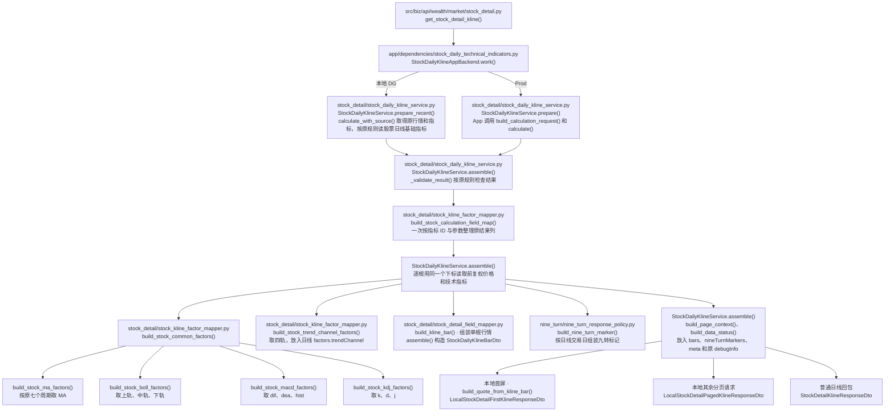
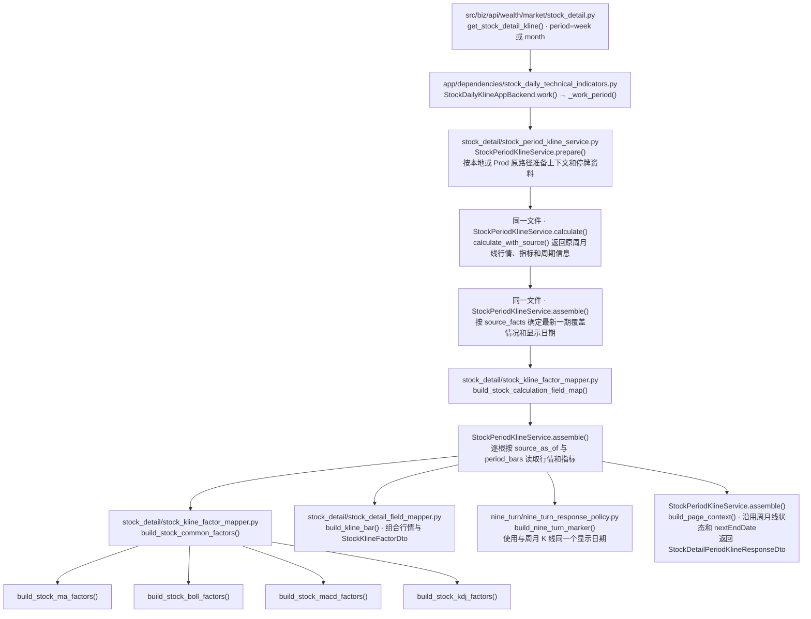
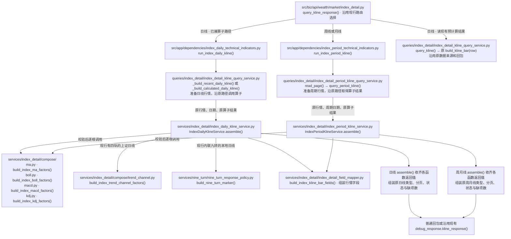

# 股票与指数 K 线指标组装架构改进方案 v1

**状态**　2026-11-27，三个阶段均已通过验收。本次架构改造完成。

逐行审计、文件和函数迁移对照及验收见[架构改进 LLD](technical-indicator-kline-composition-refactor-low-level-design-v1.md)。

## 1. 目标与范围

股票和指数详情的日线、周线、月线在拿到算子结果后，由各自的业务服务组装接口回包。业务服务负责选择本请求的指标、对齐行情和日期、组装分页与状态。指标组装函数只负责把已算好的结果变成业务字段，由业务服务直接调用。

- **股票**保留现有日线和周月线各自 `assemble()` 的结构。已确认将 `index_stock_calculation_results()` 改名为 `build_stock_calculation_field_map()`，函数留在原股票文件，迁移日线、周月线和对应测试的引用。股票与指数分别维护各自的结果处理。
- **指数**将已经走算子库的日线和周月线的回包组装移入各自的业务服务。指数的 `compose/` 按指标拆文件，日线和周月线调用所需函数。去掉算子指标先写进旧行情列、再从旧行情列读取的步骤。
- **行为基线**为当前工作区实现。接口地址、请求分支、算子清单与参数、算法与预热、数据来源及读取次数、单位与日期、分页游标、字段、空值、错误和诊断都按原行为验收。现有读预计算指标的指数日线入口仍沿现行逻辑运行。
- **并行事项**　暂停 Prod 股票日线九转阶段二的旧独立接口与专用能力清理。`9d7e10c04` 已在源码中完成阶段一的 Prod 股票日 K 接入，本次以此为基线。主要指数趋势通道扩展已确认方向，实施内容见 §5，属于后续功能改造。分钟线、数据集及线上部署均在本次架构改进范围之外。 [九转原方案](technical-indicator-nine-turn-plan-v1.md)

## 2. 代码依据

| 现行位置 | 行为和改造理由 |
| --- | --- |
| [股票指标映射](../../src/biz/services/wealth/market/stock_detail/stock_kline_factor_mapper.py) | `index_stock_calculation_results()` 按指标 ID 和参数建立字段字典，值引用原结果列。这里的 `index` 是建立索引。股票 `assemble()` 直接用这个字典，按当前 K 线下标取原算子字段组装。 |
| [指数日线查询](../../src/biz/queries/wealth/market/index_detail/index_detail_kline_query_service.py) | `apply_calculated_kline_factors()` 校验公共指标实例数、列及根数，再把 `hist` 等值逐根写回 `macd_bfq` 等旧字段。`_calculated_daily_response()` 用旧行情行组装公共指标。上证四轨已经按原算子字段直接组装。 |
| [指数周月线查询](../../src/biz/queries/wealth/market/index_detail/index_detail_period_kline_query_service.py)与 [App 周月线装配](../../src/app/dependencies/index_period_technical_indicators.py) | 周月线继承日线查询类，调用日线文件中的指标转换和缺失检查。App 的周月线入口也从日线查询文件导入 `SSE_DAILY_CALCULATIONS`。查本页周期和日期属于周月线，公共指标清单、校验和组装属于指数日线与周月线共用的代码。 |
| [指数行情字段映射](../../src/biz/services/wealth/market/index_detail/index_detail_field_mapper.py) | `build_kline_bar()` 和 `build_index_sse_daily_kline_bar()` 共用行情字段和四组公共指标。直接读预计算结果的日线仍会用 `build_kline_bar(row)`。算子链路可复用行情字段转换，从已校验的算子字段直接构造同一套接口类型。 |
| [股票及指数的 App 装配](../../src/app/dependencies/stock_daily_technical_indicators.py) | 指数日线和周月线从股票日线入口导入只读数据库会话。把会话移到 `src/app/runtime/technical_indicators/read_session.py`，三个入口分别引用，沿用原只读、超时和清理规则。该迁移只涉及 App 的资源管理。 |

用 CodeGraph `codegraph_explore` 查了股票日线、周月线到指标函数的调用，以及指数日线、周月线到字段映射的依赖。随后核对了 App 入口、现有查询、普通与 debug 回包、前端 K 线及历史加载消费者和相关测试。本文依据的是当前源码，图中的目标文件和函数以本次评审为准。

## 3. 股票目标流程

以下两图中，`stock_detail/` 和 `nine_turn/` 均相对于 `src/biz/services/wealth/market/`，`app/dependencies/` 相对于 `src/`。从逐根组装节点引出的各个指标函数，均由该 `assemble()` 调用并取回结果。股票业务组装只调整已确认的函数名及引用。两个 `assemble()` 各自组织原业务逻辑。需要 PostgreSQL 会话的请求由 App 入口调用 `src/app/runtime/technical_indicators/read_session.py:open_technical_indicator_read_session()`。

### 3.1 日线

本地首屏的报价仍从最后一根 K 线构造，原分页请求继续使用 `nextEndDate`。空结果、合同行为及响应类型分支见 [股票日线服务](../../src/biz/services/wealth/market/stock_detail/stock_daily_kline_service.py) 和 [App 日线装配](../../src/app/dependencies/stock_daily_technical_indicators.py)。

### 3.2 周线、月线

周线和月线各自的取数范围、最新一期显示日期和 `meta.limit` 继续由原服务处理。两者都返回已经接入的九转，公共指标为 MA、BOLL、MACD、KDJ。 [股票周月线服务](../../src/biz/services/wealth/market/stock_detail/stock_period_kline_service.py)

## 4. 指数目标流程

图中 `queries/index_detail/` 指 `src/biz/queries/wealth/market/index_detail/`。`services/index_detail/` 和 `services/nine_turn/` 均位于 `src/biz/services/wealth/market/`。现有 API 与 App 入口保留，`IndexDailyKlineService`、`IndexPeriodKlineService` 和 `compose/` 是拟新增位置。

### 4.1 取数、校验与回包由谁负责

| 位置 | 目标职责 |
| --- | --- |
| 日线、周月线查询文件 | 保留各自的行情和辅助字段读取、日期窗口及游标准备、算子调用时机。日线和周月线各自把已取得的数据交给自己的 `assemble()`。原本地周月线从 `read_page()` 接收算子结果，Prod 在 `query_period_kline()` 中取得结果，调用时机保持一致。 |
| `services/index_detail/index_daily_kline_service.py` | `IndexDailyKlineService.assemble()` 按原日线规则核对日期、实例参数、版本、字段、根数，组装指数普通日线和上证日线现有类型。本地九转、上证四轨、空页、状态和游标按现行规则得到。 |
| `services/index_detail/index_period_kline_service.py` | `IndexPeriodKlineService.assemble()` 按周月线原规则对齐 `times`、`source_as_of` 与本页周期日期，沿用原行情单位换算、状态和游标。使用公共指标组装函数，保留现行校验范围。 |
| 指数日线、周月线共同依赖的模块 | 移出 `SSE_DAILY_CALCULATIONS` 代表的原公共指标清单、两条算子路径通用的字段和缺项判定，以及周月线从日线父类借用的身份与查询依赖。公共清单保留原参数与顺序，由业务入口附加自己需要的算子。周月线去掉对日线查询类的继承和对日线文件的导入。身份和日历等沿用已有查询能力。 |
| `services/index_detail/compose/` | 各文件接收已校验的本指标结果列和当前下标，返回该指标的原接口类型。MA 按原周期取值，BOLL/KDJ 用原结果列，MACD 将 `hist` 直接写到接口对象的 `macd`，趋势通道将四轨映射到现有字段。计算、取数、接口分支、分页和整份回包都在调用方完成。 |

指数的 `apply_calculated_kline_factors()` 在算子链路同时承担校验和写入旧列。迁移时先保留它对指标实例、字段及长度的原检查，再移除向行情行写入 `macd_bfq` 等技术指标旧列的操作。缺项统计直接看已对齐的行情和算子列，原先按有效历史判断 MA、BOLL 空值的规则照用。旧列仍是直读预计算结果入口的输入，由该入口现有的 `build_kline_bar(row)` 处理。`compose/macd.py` 的目标调用关系为 `hist → build_index_macd_factors() → factors.macd.macd`。无需为此引入按周期分发的注册表或新的继承体系。

## 5. 后续功能改造：主要指数日线趋势通道

已确认范围是指数详情页现有 `majorIndices` 名单内的主要指数，**仅日线**。由指数日线入口在同一次请求中加入 `trend_channel`，继续用算子现有的 500 根预热规则，四轨随本批 K 线的 `factors.trendChannel` 返回。后续上线前需要下列工作，实施和验收独立于本次架构改进。

| 位置 | 后续改动与验证 |
| --- | --- |
| 名单与路由 | 从 `IndexDetailUniverseService.load_universe()` 取得现有名单。Prod 普通与 debug 日线入口当前进入算子链路的条件含 `000001.SH` 和原页大小限制。按名单扩展可进算子的请求，分别明确详情首屏、历史页与超出算子页大小请求的行为。 [名单](/Users/congming/github/goldenshare/src/biz/services/wealth/market/index_detail/index_detail_universe.py) · [日线路由](/Users/congming/github/goldenshare/src/biz/api/wealth/market/index_detail.py) |
| 本地及 Prod 数据源 | `daily_adjustment_paths()` 目前将 Prod 的普通指数日线限制在上证。扩大前，以名单为范围核对各指数的正式日线行情覆盖、可用历史起点、交易日、最高价和最低价。验证现有日线窗口、读取器及辅助字段读取能匹配其他指数，再开放对应来源。特别核对历史较短的指数和可读历史不足预热根数的页面。 [读取器合同](/Users/congming/github/goldenshare/src/foundation/clients/technical_indicator_stock_daily.py) · [Prod 日线装配](/Users/congming/github/goldenshare/src/app/dependencies/index_daily_technical_indicators.py) · [算子预热合同](/Users/congming/github/goldenshare/packages/technical_indicators/src/goldenshare_technical_indicators/calculation/indicators/trend_channel.py) |
| 返回合同 | 将现有上证专用的四轨回包合同推广到支持趋势通道的主要指数日线。同步普通、debug、OpenAPI 及前端类型。每次首批和续页只调用一次算子库，行情与四轨使用同一批日期。保持已有其他日线指标及本地九转回包口径。 [现有指数返回类型](/Users/congming/github/goldenshare/src/biz/schemas/wealth/market/index_detail.py) · [debug 回包](/Users/congming/github/goldenshare/src/biz/queries/wealth/market/index_detail/debug_response.py) |
| 前端 | 后端 `supportsTrendChannel` 与图层选项按同一名单和日线能力返回。前端图表、四轨适配和历史加载根据日线能力及 `nextEndDate` 工作，清理这条链上针对 `000001.SH` 的判断及上证专用类型约束。用上证和非上证指数验证首屏、翻页、换周期及日期和四轨逐根对应。 [后端能力](/Users/congming/github/goldenshare/src/biz/queries/wealth/market/index_detail/index_detail_page_query_service.py) · [前端四轨适配](/Users/congming/github/goldenshare/wealth/src/features/index-detail/api/indexDetailViewModelAdapter.ts) · [前端历史入口](/Users/congming/github/goldenshare/wealth/src/features/index-detail/controller/useIndexDetailController.ts) |

## 6. 推进与验收

阶段 1 记录基线、迁移只读会话并完成股票改名。阶段 2 完成指数日线、周月线组装拆分及消费者迁移。阶段 3 完成全阶段回归和独立对照审计，使用同一份隔离 PostgreSQL 样本核对股票 Prod 日、周、月 K 线的接口回包、读取范围和算子调用。验收明细见[架构改进 LLD §9](technical-indicator-kline-composition-refactor-low-level-design-v1.md#9-阶段-3-完整回归与独立对照审计2026-11-27)。九转旧能力删除维持暂停，主要指数日线趋势通道扩展依后续功能方案推进。

| 检查 | 通过条件 |
| --- | --- |
| 股票日线、周线、月线 | 使用相同输入对照改名前后的回包。本地首屏、续页、Prod 日线以及周月线的 OHLC、单位、指标、九转、四轨、空值、报价字段、时间、游标和错误都一致。原函数名在现行调用和测试中清零。已有 [字段映射测试](../../tests/test_stock_kline_factor_mapping.py)、[日线服务测试](../../tests/test_stock_daily_kline_service.py)、[周月线服务测试](../../tests/test_stock_period_kline_service.py)及 [股票详情接口测试](../../tests/web/test_wealth_stock_detail_api.py)。 |
| 指数日线与周月线 | 分别对照本地与 Prod 的相同请求及数据。覆盖上证算子日线、非上证本地日线、仍直读预计算结果的日线入口，以及周线与月线，检查普通与 debug 的字段、空值、缺项、错误、日期和游标。核对正常短历史、空页与日期／字段不完整等反例。复用 [DG 日线接口测试](../../tests/web/test_wealth_index_detail_dg_kline.py)、[Prod 上证通道测试](../../tests/app/technical_indicators/test_index_daily_prod_trend_channel.py)、[周月线接口测试](../../tests/web/test_wealth_index_detail_weekly_monthly_api.py)及 [原指数接口测试](../../tests/web/test_wealth_index_detail_api.py)。 |
| 职责与依赖 | 逐个追踪 `compose/` 中的指标函数到真实调用方。指数周月线无需导入或继承日线查询，算子链路不写入旧指标列，原直读入口仍可按原格式返回。股票和指数没有新增相互导入。 |
| 请求与性能 | 按现行请求预算，使用相同样本、参数与环境核对源码调用、取数次数、计算次数及总请求耗时。组装层对同一请求中的已有行情与结果列做内存处理，没有额外表、文件读取、写入或指标重算。前后对比包含空页、失败及取消，回归验证费用按实际用例记录。没有数据迁移或持久化续跑步骤，验证中断时按原入口重新发起对应测试请求。 |

验收以当前输入下的原行为为基准。文档检查只证明文件和引用可用。正式开发与验收前，再确认 LLD 中的证据、样本和待核实项。
