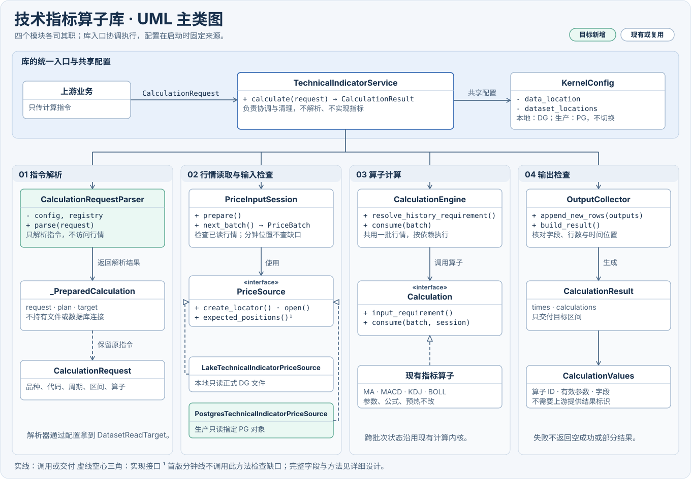
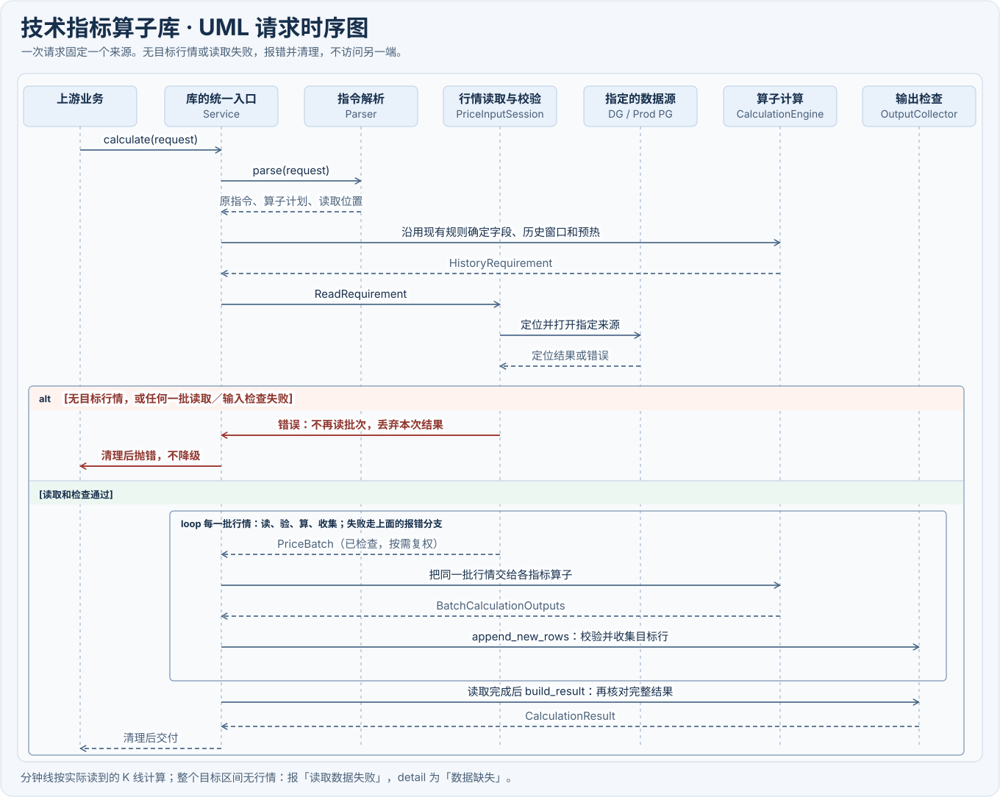

# 技术指标算子库整体详细设计 v1

**阶段 D 第 1–3 项已在独立工作树完成，生产切换待验收。** 独立算子库已通过 DG、Prod 不复权股票日线和指数 5 分钟线的完整计算验收。股票详情日线和上证综指日线已在隔离应用接入。[实施 LLD 的阶段 D 开发顺序](technical-indicator-operator-library-implementation-lld-v1.md#阶段-d-的开发顺序和切换条件)说明切换条件，[核验证据](technical-indicator-operator-library-implementation-lld-v1.md#8-本轮核验证据)记录实际样本。原 [内核组件设计](technical-indicator-kernel-component-design-v1.html) 与 [代码级 LLD](technical-indicator-kernel-low-level-design-v1.html) 描述原内核和已验收的算法规则。

## 1. 目标和模块分工

开发改动、迁移顺序及验收见独立的 [实施 LLD](technical-indicator-operator-library-implementation-lld-v1.md)；本设计保留目标与类的职责。

指数周线、月线见[专项方案](technical-indicator-index-period-plan-v1.md)与[专项 LLD](technical-indicator-index-period-low-level-design-v1.md)。专项沿用本设计的请求和输出结构，已分别接通并只读验收 DG、Prod 的指数周月线读取。

上游只告诉库“哪只证券、哪段行情、算哪些指标”。库按部署配置读取规定来源，核对行情后调用现有指标算子，并按标准结构返回结果。财势乾坤、研究程序等调用方使用同一份计算合同；如何分页、展示或使用结果不属于算子库。

**已确认的取数与预热规则：** 本地内核只读 DG，生产内核只读 Prod PostgreSQL。未配置、无目标行情或读取失败时直接报错，不访问另一端；已有预热规则、算法与跨批状态保持不变。

### UML 快速评审

**主类图：看类归哪个模块、谁调用谁。** 只画核心类、关键接口及传递对象，不把附录的所有类挤到图里。

**请求时序图：看数据怎么传，无行情时在哪里结束。** 成功路径以已有预热需求驱动行情读取；失败路径不返回空成功或部分结果。

**本轮已确认：**

1. **分钟线按实际读到的 K 线计算。** 首版不判断缺少哪些分钟位置，不补造 K 线。分钟位置完整性检查记为 TODO，已有预热规则不变。
2. **向上游报错的内容。** 整个目标区间没读到行情时，报错「读取数据失败」，`detail` 为「数据缺失」。不返回空结果、不降级。实际读取故障不冒充数据缺失。
3. **后续范围。** 股票周/月复权、股票 `90m/120m` 合成和 ETF 放到后续切片，不作为现有能力或首版验收条件。
4. **返回的量额单位。** 算子库统一返回成交量「股」、成交额「元」。业务方拿到结果后，可按展示或业务需要自行换算。
5. **指数 5 分钟开盘。** DG 和 Prod 使用同一套业务 K 线规则。09:30 集合竞价并入 09:35，首根计一根。归并所需记录缺一条时跳过首根，其余按实际形成的 K 线计算。

**启用前的核验工作：** 逐数据集核对读取字段、类型、单位及时间语义，尤其是股票和指数各自的周/月线实际截止字段。股票日线、常规分钟线的复权仍需验证两端复权因子来源和基准。这些是实现与验收工作，不要求重新讨论分钟缺口规则或内核的对上报错文案。

| 原图模块 | 负责 | 不负责 |
|---|---|---|
| 指令解析 | 根据计算指令校验算子和参数、确定行情数据集及已配置的读取位置 | 不接受上游给的行情、表名、文件路径、读取函数、翻页游标或自定义结果标识 |
| 数据读取与输入合法性检查 | 定位规定文件或视图；分批读取并核对实际行情；按已启用规则判断缺口，分钟位置完整性暂不检查 | 不用别的表兜底，不把缺失行情补成零，不直接读取预计算复权价格或预计算技术指标 |
| 算子模块 | 复用 MA、MACD、KDJ、BOLL 等现有对象、公式和版本；多个算子共享一次行情读取 | 算子不读湖、不访问 PG、不决定价格复权口径 |
| 输出合法性检查 | 检查字段、类型、值和时间位置；按指令顺序返回结果 | 不返回额外历史，不输出下一页、游标、页面文案；无目标行情或失败时不返回结果 |

**当前实现边界。** 独立工作树上的股票日线和上证综指日线已接入 `TechnicalIndicatorService` 的内部取数流程。业务确定分页区间并组装现有 HTTP 响应。生产仍按原部署运行。

**类清单阅读方式。** 代码块中的 `...` 表示省略实现，并不是可直接运行的代码。正文逐项给出新增类的全部字段与方法、变更类的目标字段和方法或完整变更项。附录逐类列出现有实现中的成员字段与显式方法（含私有方法）；标记复用的类以附录为完整清单。嵌套配置记录是数据，不另外建类；第三方类、Python 自动生成的通用方法和不在本次指标注册表里的独立 XXM 能力不纳入目标设计。

### 1.1 `TechnicalIndicatorService`：库的统一入口

保留现有类名。这个类属于算子库整体，不属于下列任何一个业务模块。它调用指令解析、行情读取、算子计算和输出检查，并管理整次请求的资源，不再亲自解析指令。

~~~python
class TechnicalIndicatorService:
    # 库的统一入口。持有各模块的依赖，不负责解析指令。
    config: KernelConfig
    parser: CalculationRequestParser  # 替换服务原来直接持有的 registry。
    source: PriceSource               # 部署端装配；上游不能传入读取对象。
    control: ExecutionControl | None  # 可选的请求执行控制。

    def __init__(self, *, config: KernelConfig, registry: CalculationRegistry,
                 source: PriceSource, control: ExecutionControl | None = None) -> None:
        # 由部署端装配。用共享配置和注册表构造独立解析器。
        ...

    def calculate(self, request: CalculationRequest) -> CalculationResult:
        # 唯一计算入口：先 parser.parse(request)，再执行整条计算链。
        ...

    @staticmethod
    def _describe_output_instances(plan: CalculationPlan) -> tuple[OutputInstanceDescription, ...]:
        # 从计划复制标准输出说明，交给输出检查；不是解析器的职责。
        ...

    def _prepare_calculation(self, request: CalculationRequest) -> _PreparedCalculation:
        # 交给解析器准备指令。App 也复用这个入口在排队前校验通用请求。
        ...

    def _calculate_library(
        self, prepared: _PreparedCalculation, *,
        control: ExecutionControl, collect_target_ohlc: bool = False,
    ) -> tuple[CalculationResult, int, tuple[tuple[float, float, float, float], ...] | None]:
        # 保留既有错误处理。内部交接结果、已校验的前置根数，以及按需收集的目标开高低收。
        # 公开 calculate() 只交付 CalculationResult。
        ...

    def _calculate_result(
        self, prepared: _PreparedCalculation, *,
        control: ExecutionControl, collect_target_ohlc: bool = False,
    ) -> tuple[CalculationResult, int, tuple[tuple[float, float, float, float], ...] | None]:
        # 合并历史需求，组装 ReadRequirement。上证 App 接线按需取得同批目标四价。
        ...

    def _open_execution(self, control: ExecutionControl):
        # 打开本次的计算连接与执行器，启动停止监控。
        ...

    def _close_execution(self, control: ExecutionControl, connection, *,
                         engine=None, inputs=None, output=None) -> tuple[BaseException, ...]:
        # 归还本次资源，返回清理错误供原错误处理逻辑使用。
        ...
~~~

`_prepare_calculation(request)` 直接调用独立解析类。App 负责装配，物理适配留在 Foundation，共享包依赖内部读取接口。

### 1.2 `KernelConfig`：库的共享配置

应用在启动时装配为只读对象，一次内核实例固定使用 DG 或 Prod PostgreSQL。表格配置与库一起版本管理，由部署装配读取，不能从 HTML 解析或由普通调用者传入替换。现行 17 个运行字段仍从应用 `Settings` 装配，沿用已有环境变量和默认值；不新增数据库、在线编辑入口或每次请求重新读配置。

~~~python
class KernelConfig:
    # 启动时必填，没有默认值；运行期间不切换环境。
    data_location: Literal["dg", "prod_pg"]
    # DG 必填，正式根为 /Volumes/datasource/data_lake；Prod 不使用。
    goldenshare_lake_root: str
    # 数据集标识 → {dg, prod_pg}。行情、复权因子、交易日历共用。
    dataset_locations: Mapping[str, Mapping[str, object]]
    # (证券品种, 周期) → 数据集标识。这里不重复存路径，也不拼字符串猜。
    market_datasets: Mapping[tuple[str, str], str]

    # 注释里的数字是应用 Settings 的现有默认值，不是本类的默认值。
    max_concurrent_requests: int        # 2 个，同时执行的请求上限。
    max_waiting_requests: int           # 2 个，排队上限；0 表示不排队。
    max_wait_ms: int                    # 2,000 毫秒；同时受总时间目标约束。
    sql_threads: int                    # 1 个，DuckDB 计算线程。
    batch_rows: int                     # 8,192 行，每批新行情上限。
    query_memory_bytes: int             # 134,217,728 字节，DuckDB 内存设置。
    request_memory_bytes: int           # 268,435,456 字节，单请求规划值，不是强制上限。
    deployment_reserve_bytes: int       # 1,073,741,824 字节，部署规划值，不预分配。
    total_target_ms: int                # 8,000 毫秒，从到达到清理的时间目标。
    cleanup_reserve_ms: int             # 2,000 毫秒，为清理保留。
    max_input_rows: int                 # 1,500,000 行，含额外历史。
    max_source_files: int               # 10,000 个，单次请求来源文件上限。
    max_output_rows: int                # 500 根，多个指标共用一根 K 线位置。
    max_indicator_instances: int        # 16 项，限制算子调用项数，与结果标识无关。
    max_projected_row_group_bytes: int  # 33,554,432 字节，单行组投影列上限。
    control_poll_ms: int                # 20 毫秒，停止监控间隔。
    monitor_join_target_ms: int         # 200 毫秒，等待监控线程结束的目标。

    def __init__(self, *, data_location, goldenshare_lake_root, dataset_locations, market_datasets,
                 max_concurrent_requests, max_waiting_requests, max_wait_ms, sql_threads,
                 batch_rows, query_memory_bytes, request_memory_bytes, deployment_reserve_bytes,
                 total_target_ms, cleanup_reserve_ms, max_input_rows, max_source_files,
                 max_output_rows, max_indicator_instances, max_projected_row_group_bytes,
                 control_poll_ms, monitor_join_target_ms) -> None:
        # 所有字段由应用传入；本类不加载环境变量、文件或凭据。
        ...

    def __post_init__(self) -> None:
        # 保留原数值检查：仅排队数可为 0，输出硬上限 500。
        # control_poll_ms < cleanup_reserve_ms < total_target_ms。
        # 检查位置格式、行情映射引用并冻结配置；允许一侧或两侧为 null。
        ...

    def market_dataset_id(self, security_type: str, period: str) -> str:
        # 查行情对应关系；不存在就报不支持。
        ...

    def enabled_adjustments(self, dataset_id: str) -> frozenset[str]:
        # 查当前环境已启用的复权口径。未登记、无位置或未启用时返回空集合。
        ...

    def resolve_dataset_location(self, dataset_id: str) -> DatasetReadTarget:
        # DG 代入固定分区，保留动态日期占位符；PG 返回表和固定条件。
        # 未登记或当前环境为 null 就报不支持；不访问源，也不切换环境。
        ...

    def _location(self, dataset_id: str) -> Mapping[str, object] | None:
        # 取当前环境的已冻结位置记录，供位置和启用口径查询复用。
        ...
~~~

位置记录必须明确两侧。`dg` 为 `null` 或 `{relative_path, partitions?, enabled_adjustments?}`，`prod_pg` 为 `null` 或 `{schema, relation, filters?, enabled_adjustments?}`。花括号标记分区占位符，固定条件保留真实数据类型。相对路径由库附加正式根，分钟频率在 DG 是整数分区，Prod 指数分钟筛选值是字符串。路径和筛选条件由可信部署装配，禁止嵌入 SQL、越界路径或凭据。

**登记与启用。** 行情位置记录的 `enabled_adjustments` 默认是空集合。每个环境只填已完成核验的口径，取值为 `none`、`qfq`、`hfq`，按证券品种和周期允许的组合校验，随位置一起冻结。位置为 `null` 时可用口径也是空集合。日历、股票生命周期、股票停牌和复权因子作为内部数据集登记具体位置。解析器和算子能力查询均使用 `KernelConfig.enabled_adjustments()`，只报告当前环境已启用的行情组合。

## 2. 指令解析模块

### 2.1 `CalculationRequest`：上游计算指令

复用现有类，替换目标合同。字段全部必填；复权口径与区间两端显式传入。对象创建后只读，指标列表顺序保留。

~~~python
class CalculationRequest:
    # 七个字段均必填；创建后只读。
    security_type: Literal["stock", "index"]  # ETF、其他品种待正式接入。
    ts_code: str     # 六位数字加 .SH、.SZ 或 .BJ，例如 600519.SH。
    period: str      # day、week、month 或 1m、5m、15m、30m、60m、90m、120m。
    adjustment: Literal["none", "qfq", "hfq"]  # 不用于选择不复权行情来源。
    # 所有周期均传带时区的时间，保存时归一到上海时间。
    start: datetime
    # 同 start，无“最新”默认值，须 start <= end。
    # 日线按交易日期含两端，分钟按时间含两端，周/月按周期相交并检查实际截止。
    end: datetime
    # 非空、按请求顺序。每项只有 calculation_id 和 parameters；空对象用默认值。
    # 例如 {"calculation_id": "ma", "parameters": {"period": 20}}。
    calculations: Sequence[Mapping[str, object]]

    def __init__(self, *, security_type, ts_code, period, adjustment,
                 start, end, calculations) -> None:
        # HTTP 日期先由业务按原分页规则确定交易日期，再以该日上海时间 00:00 构造指令。
        ...

    def __post_init__(self) -> None:
        # 校验格式、时间类型、起止和列表。拒绝纯日期、无时区时间及额外字段。
        # 统一转到 Asia/Shanghai 后比较起止，分钟复用现有转换逻辑。
        # 只查证券代码格式，不查证券归属、算子或行情；保存只读副本。
        ...
~~~

指令及结果中的 `requested.start/end` 保留归一后的上海时区。服务生成取数指令时，日、周、月从归一后的时间取上海当地日期，再匹配数据表的日期字段，日内时分秒不参与日期筛选。例如 `2026-11-17T16:00:00Z` 对应上海交易日期 `2026-11-18`。分钟线沿用现有具体时刻的筛选规则。数据表字段类型、行情日期及产品 HTTP 日期格式沿用现有口径。

### 2.2 `CalculationRequestParser`：指令解析类

在共享包内新增独立的 `CalculationRequestParser`。它接收已经构造好的计算指令，只把“要算什么、按配置到哪儿读”解析清楚，不连接数据库、不打开行情文件、不运行算子，也不组装输出。

~~~python
class CalculationRequestParser:
    # 新增：独立解析类。只解析配置和指令，不访问行情或执行算子。
    _config: KernelConfig
    _registry: CalculationRegistry

    def __init__(self, config: KernelConfig, registry: CalculationRegistry) -> None:
        # 保存解析时使用的共享配置和算子定义。
        ...

    def parse(self, request: CalculationRequest) -> _PreparedCalculation:
        # 核对算子及参数、展开依赖，按配置解析目标读取位置。
        ...

class _PreparedCalculation:
    # 现有准备对象移入解析模块，创建后只读；没有其他方法。
    request: CalculationRequest
    plan: CalculationPlan
    target: DatasetReadTarget
    # 删除 instances；统一入口从 plan 生成输出说明。
    # 不持有行情、临时表或连接。
~~~

`parse(request)` 按以下顺序处理：

1. 检查算子调用项数是否超出 `max_indicator_instances`。按算子定义检查指标 ID、支持周期和参数，填入有效默认值、展开依赖，生成按请求顺序记录的 `CalculationPlan`。允许创建本次计算将用到的算子对象，但不执行它们。
2. 用 `security_type` 和 `period` 取得数据集标识，通过 `KernelConfig.enabled_adjustments()` 核对当前环境是否已启用请求的复权口径，再解析具体位置。未登记、无位置或口径尚未启用时，在读取行情前报不支持；`adjustment` 不改变不复权行情的位置。
3. 把原指令、算子计划和已选位置返回库入口。要从首根目标前补读多少根历史，由后续计算流程依据算子的实际参数确定；行情是否实际存在、是否缺失及目标根数是否超限，由读取模块核实。

## 3. 数据读取和输入合法性检查

### 3.1 数据集位置与固定条件

本表定义 `dataset_locations` 的物理位置。源路径和表名的存在性已有核对，各环境的读取能力按实际验收逐项启用。每个分钟周期有独立数据集标识，表中合并展示同结构的记录。日、周、月线启用前还须核对判断应有行情位置所依赖的事实来源。

| 数据集标识 | DG 相对根路径 | Prod PostgreSQL 与固定条件 |
|---|---|---|
| `stock_daily` | `silver/quote/stock_daily/trade_date={trade_date}/part-000.parquet` | `core_serving.equity_daily_bar` |
| `stock_mins_1m`、`stock_mins_5m`、`stock_mins_15m`、`stock_mins_30m`、`stock_mins_60m` | `silver/quote/stk_mins/freq={freq}/trade_date={trade_date}/part-000.parquet`；对应固定整数 1、5、15、30、60 | `core_serving.equity_minute_bar`；`freq` 为对应整数 |
| `stock_mins_90m`、`stock_mins_120m` | `null`；没有可直读的不复权成品 | `null` |
| `stock_weekly` | `silver/quote/stock_weekly/week_end={week_end}/part-000.parquet` | `core_serving.stk_period_bar_adj`，固定 `freq = 'week'` |
| `stock_monthly` | `silver/quote/stock_monthly/month={month}/part-000.parquet` | `core_serving.stk_period_bar_adj`，固定 `freq = 'month'` |
| `index_daily` | `silver/index_daily/trade_date={trade_date}/part-000.parquet` | `core_serving.index_daily_serving` |
| `index_mins_1m`、`index_mins_5m`、`index_mins_15m`、`index_mins_30m`、`index_mins_60m` | `gold/quote/index_mins/freq={freq}/trade_date={trade_date}/part-000.parquet`；对应固定整数 1、5、15、30、60 | `core_serving.index_minute_bar`；`freq` 为对应字符串，如 `'5min'` |
| `index_mins_90m`、`index_mins_120m` | 同上；对应固定整数 90、120 | `null` |
| `index_weekly` | `silver/index_weekly/full/part-000.parquet` | `core_serving.index_weekly_serving` |
| `index_monthly` | `silver/index_monthly/full/part-000.parquet` | `core_serving.index_monthly_serving` |

DG 的交易日与周末分区用 `YYYY-MM-DD`，月份用 `YYYY-MM`；周期范围与物理分区不总相同，按实际交易日期形成。股票周、月线只投影原始 `open/high/low/close` 等字段，不取 `_qfq`、`_hfq` 列。主要指数专用的 `gold/quote/major_index_mins` 不作为通用指数缺失时的回退。日历、股票生命周期、停牌和复权因子另登记实际来源，不从这张行情表推断。

**读取层统一量额。** 读取模块在交给算子之前，将采用源单位的成交量和成交额各换算一次，统一为股和元。源单位按环境、数据集及周期核实。同一数据集内若随证券而异，按证券代码核实。原单位为手时乘 100，为千元时乘 1000。原单位已为股或元时原样传递。具体换算和已核实范围见 [实施 LLD §4.1](technical-indicator-operator-library-implementation-lld-v1.md#41-一份位置目录不同来源各自投影)。

**指数 5 分钟首根归并。** DG 直接使用已归并的业务 K 线。Prod 从同一指数、同一交易日的 09:30 和 09:35 记录形成 09:35，开盘价取竞价收盘价，最高和最低比较该竞价价与 09:35 的最高、最低，收盘价取 09:35 收盘价，量额相加。目标区间筛选、500 根上限及预热计数全部以业务 K 线时间为准。 [DG 归并实现](../../lake_console/orchestrator/src/orchestrator/defs/io/cn_a_gold_minute_bars.py#L365)

### 3.2 取数对象与接口类

~~~python
class DatasetReadTarget:
    # 从 KernelConfig 得到的一个具体环境的读取位置；只构造，无其他方法。
    dataset_id: str
    backend: Literal["dg", "prod_pg"]
    # DG：{path_template}，已经拼好正式根和固定分区。
    # PG：{schema, relation, filters}，无固定条件时 filters 是空对象。
    location: Mapping[str, object]

class ReadRequirement:
    # 本次取数指令，只构造。不会把上游参数、游标或整个上游请求交给读模块。
    target: DatasetReadTarget
    ts_code: str
    period: str
    start: date | datetime  # 分钟传上海时间；日/周/月由服务取归一后的上海日期。
    end: date | datetime
    history: HistoryRequirement
    batch_rows: int
    target_adjustment: Literal["none", "qfq", "hfq"]

class SourceLocator(Protocol):
    # 定位目标区间以及需要补读的历史；无接口级字段。
    def describe(self) -> SourceDescription: ...
    def close(self) -> None: ...

class SourceStream(Protocol):
    # 分批交付来源行情；不会因为当前文件结束就人为结束一批。
    def next_batch(self, max_rows: int) -> SourceBatch | None: ...
    def release_current_batch(self) -> None: ...
    def close(self) -> None: ...
~~~

**复用的数据类。** `PriceReadSelection` 保存实际读区间、目标区间、目标/历史行数、是否到真实起点和 DG 行组；`SourceDescription` 保存来源、单位、时间口径、复权依据和投影。PG 不填写文件/行组字段，输入始终是不复权。 `SourceBatch` 保存来源批次及计数；`PriceBatch` 保存本批新数据序号、必要的前置窗口、字段和目标复权口径。全部成员和方法见附录。

~~~python
class PriceSource(Protocol):
    # 内部行情读取接口，无接口级成员字段。
    # 通用数据集的位置由 DatasetReadTarget 表示，不能和行情读取混用。

    def create_locator(self, executor, requirement: ReadRequirement, *,
                       read_context: SourceReadContext) -> SourceLocator:
        # 定位目标区间和预热历史。
        ...

    def open(self, executor, description: SourceDescription, requirement: ReadRequirement, *,
             read_context: SourceReadContext) -> SourceStream:
        # 只读定位结果对应的不复权行情。
        ...

    def expected_positions(self, requirement: ReadRequirement, selection: PriceReadSelection, *,
                           read_context: SourceReadContext) -> Iterator[date | datetime]:
        # 新增：仅用于已启用位置校验的周期；首版分钟线不调用。
        # 分段提供目标区间及必要历史内应有的时间位置。
        ...

    def prepare_basis(self, executor, description: SourceDescription, requirement: ReadRequirement, *,
                      table_name: str, read_context: SourceReadContext) -> SourceDescription:
        # 仅用于支持的复权，准备基准临时表并返回更新后的说明。
        ...

    def prepare_factors(self, executor, description: SourceDescription, requirement: ReadRequirement,
                        trade_dates: tuple[date, ...], *, table_name: str,
                        read_context: SourceReadContext) -> None:
        # 按本批交易日写入所需因子，不改变行情位置。
        ...
~~~

~~~python
class HistoryRequirement:
    # 沿用现有含义；多个算子由引擎合并为一份历史需求。
    fields: frozenset[str]
    preceding_rows: int           # 窗口需要的前置 K 线根数。
    warmup_rows: int | None       # 有限预热根数；从来源起点开始时为 None。
    requires_source_origin: bool
    state_fields: tuple[str, ...]
    initial_null_rule: str
    output_alignment: str

    def __post_init__(self) -> None: ...  # 校验窗口与预热规则一致。
~~~

预热是回看实际 K 线，而不是把日期减去固定天数。多个算子的行情字段取并集，历史按现有引擎规则取能覆盖所有算子的需要；需要从真实起点开始的情况不能拿短历史冒充。

### 3.3 DG、Prod 适配类

**DG：改现有对象，不另建同职责适配。** `LakeTechnicalIndicatorPriceSource`、`LakePriceLocator`、`_LakePriceStream` 现有字段和方法全列于附录。三者保留既有文件、定位及批次管理职责；唯一新增接口方法是 `LakeTechnicalIndicatorPriceSource.expected_positions(...)`。定位和读取方法消费 `requirement.target` 的路径模板与分区，停止由 `price_contract()` 另选路径或因目标复权改变价格列。字段及类型的核对规则仍由对应数据集合同定义，不能根据通用文件命名推导。旧 `LakePriceContract` 中的第二套路由与新目录同时存在会造成冲突；迁移时审计后收敛，只保留实际用到的结构校验/字段投影定义。

**Prod：补与 DG 同协议的 PostgreSQL 适配。** 使用现有应用的已装配 PG 连接，开启本次请求有界的可重复读、只读事务，读取期间行情、日历及因子使用同一事务；关闭不提交业务写入。SQL 关系和列来自可信配置/合同，值使用绑定参数。日线按证券和日期、分钟按证券、频率及 `trade_time`；周、月按已核对的周期语义查询，股票带固定 `freq` 条件。使用有序范围读取；不允许逐根查询、跨环境回退、把 SQL 交给上游或无范围扫描。

~~~python
class PostgresTechnicalIndicatorPriceSource:
    _config: KernelConfig
    _session_factory: Callable  # 可信部署装配；这个对象不持有请求内会话。

    def __init__(self, config: KernelConfig, session_factory: Callable) -> None: ...

    def create_locator(self, executor, requirement: ReadRequirement, *,
                       read_context: SourceReadContext) -> SourceLocator:
        # 创建本请求的定位对象。
        ...

    def open(self, executor, description: SourceDescription, requirement: ReadRequirement, *,
             read_context: SourceReadContext) -> SourceStream:
        # 使用请求内同一个只读事务返回读取流。
        ...

    def expected_positions(self, requirement: ReadRequirement, selection: PriceReadSelection, *,
                           read_context: SourceReadContext) -> Iterator[date | datetime]:
        # 需要核对应有位置时读取指定范围的交易日历与对象事实。
        # 首版分钟线不调用这个方法来检查缺口。
        ...

    def prepare_basis(self, executor, description: SourceDescription, requirement: ReadRequirement, *,
                      table_name: str, read_context: SourceReadContext) -> SourceDescription:
        # 同一事务内为已开放的复权路径准备基准。
        ...

    def prepare_factors(self, executor, description: SourceDescription, requirement: ReadRequirement,
                        trade_dates: tuple[date, ...], *, table_name: str,
                        read_context: SourceReadContext) -> None:
        # 同一事务内取得本批要用的因子。
        ...

class _PostgresPriceLocator:
    _requirement: ReadRequirement
    _read_context: SourceReadContext
    _description: SourceDescription | None
    _closed: bool

    def __init__(self, requirement: ReadRequirement, read_context: SourceReadContext) -> None: ...

    def describe(self) -> SourceDescription:
        # 按规定关系定位目标区间，并从首根目标前补读必要历史。
        ...

    def close(self) -> None:
        # 只释放定位资源，不提前关闭读取流要使用的事务。
        ...

class _PostgresPriceStream:
    _cursor: Any  # 当前有界读取游标。
    _description: SourceDescription
    _delivered_rows: int
    _current_batch: SourceBatch | None
    _closed: bool

    def __init__(self, cursor, description: SourceDescription) -> None: ...
    def next_batch(self, max_rows: int) -> SourceBatch | None: ...  # 读取并标准化至多一批。
    def release_current_batch(self) -> None: ...                  # 释放本批。
    def close(self) -> None: ...                                  # 只关游标，不负责关事务。

class SourceReadContext:
    # 其余现有成员与方法见附录；这里仅列 PG 扩展。
    _pg_session: Any  # 本次请求的会话。

    def open_postgres(self, session_factory: Callable, control: ExecutionControl):
        # 打开有界的只读事务，同一请求只开一次。
        ...

    def close_postgres(self) -> None:
        # 正常、失败或取消均归还会话，清理有界。
        ...
~~~

`core_serving.equity_minute_bar` 的 `freq` 用整数，`core_serving.index_minute_bar` 用字符串。股票周/月线用 `trade_date` 确定周期标签，实际截止来自 `end_date`，DG 是文本日期，PG 是日期类型。指数周/月线由 `period_start_date` 确定周期标签，实际截止来自 `trade_date`。不能核实实际截止含义的来源暂不开启周/月读取。

**周、月线截止。** 两端按现有周期相交语义定位。请求截至日已存在可用的部分周期记录时可用。相交且未结束的周期只有晚于请求截止日的版本时，沿用现有 `SourceUnsupportedError`，在统计目标根数之前报错。例如截至周二而只有周五版本时，本次请求失败。已结束的周期沿用原规则。周/月结果逐根返回实际截止日 `source_as_of`。 [现有截止检查](../../packages/technical_indicators/src/goldenshare_technical_indicators/time_range.py#L27)

### 3.4 输入合法性：修改 `PriceInputSession`

~~~python
class PriceInputSession:
    # 只列目标新增字段与相关方法；其余完整成员和方法见附录。
    _expected_positions: Iterator[date | datetime] | None  # 分钟线首版不用。
    _next_expected_position: date | datetime | None
    _last_position: date | datetime | None          # 上一个实际位置。

    def prepare(self) -> None: ...  # 仅对启用位置检查的周期建立期望范围。
    def next_batch(self) -> PriceBatch | None: ...     # 交给算子前校验，结束时检查遗漏。
    def _check_position_sequence(self, batch) -> None: ...  # 都检查顺序、重复；按周期比较期望。
    def _check_expected_exhausted(self) -> None: ...         # 只对启用位置检查的周期执行。
~~~

1. **结构和身份**：核对实际字段、类型、证券代码、按周期定义的时间、从首根起的顺序和唯一性；必需价格缺失、非有限或不在合同允许范围内时拒绝。只读取所需价格列与校验/定位字段，不为 MA 额外读取无关行情列。
2. **分钟线首版不查缺失时间位置**：读到多少算多少。只检查实际读到的 K 线，不生成应有分钟时间表，不因跳过某个时间位置而拒绝，也不补造 K 线。多个指标按实际存在的 K 线顺序计算；原有预热规则、从真实来源起点初始化的规则，以及同批交付数量核对均保持不变。**TODO：** 后续单独增加应有分钟位置的完整性检查，再确定交易时段、停牌、短市等例外。
3. **新增日、周、月线缺口校验**：用正式交易日、证券存续和全日停牌等适用事实独立判断应有位置。周、月按周期及实际截止判断。覆盖整个目标区间及所选预热范围，包含首尾；休市、证券存续前后和经确认的全日停牌按各来源规则排除。现有交付数量校验继续检查定位选中的记录是否全部交齐。
4. **无目标行情直接报错**：无论周期，只要整个目标区间读不到任何目标 K 线，即报「读取数据失败」，`detail` 为「数据缺失」，不返回空的 `CalculationResult`，也不切到其他来源。找不到数据与文件打不开或数据库查询失败不是同一种原因；后者保留实际错误原因。
5. **每批核验、整次返回**：某个后续批次出错时丢弃本次已计算的结果，不提前向上游输出部分成功。不向正式 Lake 或 PostgreSQL 修补数据。

逐数据集、逐环境确定日历、证券存续、停牌等适用事实的具体位置、字段及可用日期范围后才启用。已知候选包括 DG 的交易日历 `silver/calendar/trade_calendar/full/part-000.parquet`、股票生命周期 `silver/basic/stock_lifecycle/full/part-000.parquet`、股票停牌 `silver/quote/stock_suspend_daily` 和 Prod 交易日历 `core_serving.trade_calendar`。已有日历用于判断适用交易日，当前行情本身不能作为“应有位置”的依据。原内核方案把行情完整性留在库外，本节新增的是读取模块按请求范围执行的检查。 [原内核方案](technical-indicator-kernel-component-design-v1.html#components)

### 3.5 复权与股票长周期分钟线

**复权。** `none` 不读取复权因子。支持的股票日线/分钟线在读到原价后，由现有 `PriceAdjustmentCalculation` 只计算 OHLC：原价 × 当日复权因子 ÷ 基准因子，量额不变。沿用当前日线公式的基准语义：前复权为同一来源状态下的最新可用因子，后复权为最早可用因子；基准不按本次查询起止缩放。股票分钟按交易日使用股票日复权因子，按环境验证源和日期匹配后才启用。复权因子 DG 对象是 `silver/quote/adj_factor`；Prod 已有存储定义 `core.equity_adj_factor`，作为候选，启用前核对访问及适用范围。缺少当日因子、基准缺失或非法均报错，不用 1 兜底，不直接使用前/后复权成品。字段和方法沿用附录：`algorithm_version`、`describe(input_adjustment, target, basis)`、`build_sql(...)`，无新增字段。指数仅开放不复权。股票周、月按 **不复权先可读** 设计：区间内可能有多个因子，不能用一个因子复权整根 OHLC；若要支持，另审从日级复权原价重合成与正式周/月行情的语义差异，不在本版静默切换粒度。

**股票 90m/120m 合成。** 作为后续切片，不虚构可读取数据集。现有 DG 关系是 90m 从 30m、120m 从 60m 派生，但已发布的股票成品不是目标的不复权输入。拟在库内用不复权基础周期按交易时段合成：取首开、最高、最低、末收、量额求和，不跨交易日或拿缺条拼满窗口。若目标要复权，在合成和校验后按该交易日因子转换，再交指标算子。交易时段、窗口标签、开盘位置和短市/停牌例外须用现有 DG 样本确认；完成前返回不支持。不把合成规则塞进 `dataset_locations`。

~~~python
class MinuteBarAggregation:
    # 后续内部合成算子，不公开给上游，也不自行读表。
    input_period: Literal["30m", "60m"]
    output_period: Literal["90m", "120m"]
    windows: Sequence  # 经批准的交易窗口及各窗口输出位置。

    def __init__(self, input_period, output_period, windows) -> None: ...

    def input_range(self, start, end, history: HistoryRequirement):
        # 将目标位置和所需历史映射到基础周期的窗口。
        ...

    def aggregate(self, batch):
        # 同一证券、同一交易日内，按完整窗口合成不复权 K 线。
        ...
~~~

## 4. 算子模块

继续使用现有 `Calculation` 接口。各算子定义负责声明参数类型、默认值、依赖、输入列、预热和结果字段。调用方不提供 SQL、初始化种子、代码或输出字段名。

~~~python
class Calculation(Protocol):
    # 接口没有成员字段。
    def input_requirement(self, session: CalculationSession, max_input_rows: int) -> HistoryRequirement:
        # 声明需要的字段和历史。
        ...
    def dependencies(self) -> tuple[Dependency, ...]: ...  # 声明内部算子依赖。
    def prepare(self, session: CalculationSession) -> None: ...  # 准备本请求状态。
    def consume(self, batch: PriceBatch, session: CalculationSession) -> CalculationOutput:
        # 使用共享行情批次计算。
        ...
    def release_batch(self, session: CalculationSession) -> None: ...  # 释放当前批次。
    def release(self, session: CalculationSession) -> None: ...        # 释放本请求状态。
~~~

~~~python
# 现有公开算子：ID → 实现类。完整成员和方法见附录。
built_in_calculations = {
    # 无参数。输入及输出为开、高、低、收、成交量（股）和成交额（元）。
    "price": PriceCalculation,
    # period=20（正整数），只用收盘价；输出 value，不足完整窗口可为空。
    "ma": MovingAverageCalculation,
    # period=20（正整数），multiplier=2（有限非负）；只用收盘价。
    # 输出 middle、upper、lower，不足完整窗口可为空。
    "boll": BollingerBandsCalculation,
    # fast=12、slow=26、signal=9（正整数且 fast < slow）；只用收盘价。
    # 输出 dif、dea、hist，沿用现有两个 EMA 和柱值口径。
    "macd": MACDCalculation,
    # window=9、k_period=3、d_period=3（正整数）；用最高、最低、收盘价。
    # 输出 k、d、j；沿用既有平区间与初始值。
    "kdj": KDJCalculation,
}

# 仅内部依赖，不对上游开放。参数与输入按对应算子定义传入。
internal_calculations = {
    "window_mean": WindowMeanCalculation,    # 中间均值。
    "window_range": WindowRangeCalculation,  # 中间 RSV。
}
~~~

**完整类清单与改动。**

- `CalculationDefinition`、`ParameterSpec`、`OutputField`、`Dependency`、`CalculationNode`、七个算子实现类：全部复用，字段及显式方法见附录；不改变现有算法、版本或默认参数。
- `CalculationRegistry`：字段和方法见附录。只调整 `expand_dependencies(request)` 的取参方式：从 ID 与参数记录建立按请求顺序的索引，不依赖上游的 `instance_id`。同算法版本和相同有效参数的计算节点可共享，输出仍按请求项顺序。依赖展开、循环检查、版本与工厂约束保留。
- `CalculationPlan`：字段仍为 `nodes` 与 `instances`，后者的目标值是 `(calculation_index, node_index)` 的有序记录；方法为构造和 `__post_init__()`。内部索引是本次执行的定位，不是上游字段。
- `CalculationEngine`、`CalculationSession`、`CalculationOutput`、`BatchCalculationOutputs`、`SqlStep`、`ControlReadStep`、`ExecutionStats`、`DuckDBExecutor`：复用，字段及方法见附录。引擎为每个请求单独准备状态，同一行情批次依赖在先、指标在后；跨批次保留必要窗口及递推状态，处理完释放本批临时资源。不得对每个指标重新查源。
- 参数和输出格式可用现有 `describe_calculation` / `list_calculations` 查询。装配时用 `market_datasets` 和 `KernelConfig.enabled_adjustments()` 生成当前环境的 `SourceCapability`，两项查询继续按算子支持的周期筛选。生成说明只读取配置。

### 4.1 九转算子计数口径

**2026-11-22 阶段 1 算子已验收。** 九转沿用 DG 现有的价格比较规则。每根 K 线的收盘价和前第 4 根的收盘价比较，同向就连续累加，换向就从 1 开始，相等或前面不足 4 根时归零。算子返回的计数最高为 **13**。同向继续时保持 13，直到换向或归零。13 表示连续同向至少 13 次，仍使用前第 4 根收盘价的比较规则。[DG 现有比较与计数](../../lake_console/orchestrator/src/orchestrator/defs/nineturn_formula.py#L70)

算子直接使用输入会话准备好的收盘价。股票前复权日线和其他算子共用同一次取数、同一复权基准和同一批已复权行情。前端沿用现有标记规则，计数 1–9 时画标记，恰好为 9 时标记完成，10–13 留空。[共享行情批次](../../packages/technical_indicators/src/goldenshare_technical_indicators/calculation/engine.py#L122) · [标记规则](../../src/biz/services/wealth/market/nine_turn/nine_turn_response_policy.py#L82)

首根目标行情最多需要 **16 根前置 K 线**。判定是否连续同向 13 次时，最早一次比较发生在当前根往前第 12 根，它要和再往前第 4 根比较，合计回看 16 根。预热和分批传递方式见[实施 LLD §9](technical-indicator-operator-library-implementation-lld-v1.md#9-九转算子接入约定)。

本地股票详情已切换，首批和续页由同一次日 K 计算提供九转标记。接口、前端接入和验收见[九转专项方案](technical-indicator-nine-turn-plan-v1.md)与[九转专项 LLD](technical-indicator-nine-turn-low-level-design-v1.md)。

### 4.2 趋势通道及分阶段接入（2026-11-25 阶段一、二实现及技术验收完成，未部署）

新增专项见[趋势通道方案](technical-indicator-trend-channel-plan-v1.md)与[专项 LLD](technical-indicator-trend-channel-low-level-design-v1.md)。阶段一已在共享包实现、注册趋势通道并完成隔离验收和独立对照审计，证据见专项 LLD §9；阶段二股票接入已实现并完成技术验收，阶段三上证尚未接入，不能把旧计算器或预计算结果读取器列为已迁移。

趋势通道完整计算最高价、最低价各自的 25/90 周期 EMA，只输出四条轨道；不迁入历史方向与组合状态，也不新增通道升降方向。固定前置预热 500 根，返回根数另计，每轨绝对误差不超过 0.01：参考从完整历史起点计算，被测从目标前 500 根开始计算，用同一行情及复权基准比较相同目标日期。500 是管理员的设计决定，不用 MACD 的 100 万范围假设求根。

本期已取消 JSON 说明字段，不新增 `info`、说明空串、`output_info()` 或相关协议、校验与编码。数值字段继续使用 DOUBLE，日期时间继续走公共 `times`。先开发并验收新算子，再分别沿股票和上证现有 MACD/KDJ 的计算指令、结果组装与日 K 回包接入；页面每批最多 500 根，沿 `nextEndDate` 续页，不要求直接用共享库响应替换旧独立通道接口。

四轨随现有日 K 接口返回，页面不再调用旧独立通道接口；上证四轨改用算子库结果，旧专用计算器和缓存退出该页面调用链。股票页面入口同步移除旧通道目录及专用开关依赖，不新增 Dagster 就绪查询。新算子不读股票旧通道结果和续算文件，基础行情及股票复权因子数据继续使用；无消费者的旧接口和专用代码在清理阶段删除，整个旧数据集是否停产、清退另按全部消费者确定，不作为新算子或页面接入前置条件。

管理员后续确认：各指标分别用明确的 build 函数组装，公共指标只映射一份，由日线、周月线自己的 `assemble()` 显式组合专属内容；不使用笼统 special 函数、不在公共映射中堆周期判断。这项组装架构修改在第三阶段实施，先整理当前股票公共映射与全部调用方、再接入上证；阶段二仅完成股票接入所需的计算清单隔离、独立通道 build 和日线类型。本地沿现有每批 500 根及游标，Prod 原加载/回包只增加四轨，不新增生产分页。具体函数、类型、交接和验收见专项 LLD §4.2–4.3；阶段二代码与技术验收已完成，证据见[专项 LLD §10](technical-indicator-trend-channel-low-level-design-v1.md#stock-trend-channel-stage2-execution)；阶段三、四未实施，未部署。

现有业务的方向与组合状态清理是专项独立步骤，覆盖代码、API、前端类型、预计算合同和相关检查；真正用于 EMA 递推的四个数值必须保留。正式股票趋势通道文件迁移尚须补齐原 DG 方案和 LLD，不因本节记录而获得执行授权。MACD 的 100 万常量、最低预热和动态计算本次均保持现状。

## 5. 输出合法性检查

**格式。** 每项输出由固定算子 ID、实际有效参数和算子版本标明，结果字段由算子定义。共享的 `times` 递增、唯一，字段数组长度与其相等。所有周期的 `requested.start/end` 都带上海时区。行情位置 `times`、实际读取区间及输出区间仍按周期表达，分钟带上海时区，日、周、月为日期。周、月的 `source_as_of` 逐根对应 `times`，返回实际截止日期，日线及分钟该字段为 `None`。用同一请求算 MA20 和 MA60，两个结果都用 `value` 字段，由实际有效参数区分。

**目标行来自读取结果。** 输出收集器根据 `PriceReadSelection` 的前置根数和目标根数，按 `seq` 取每批落入目标区间的行，并与算子字段对齐。输出检查首末时间、目标根数和数组长度。日线请求的起止先按上海当地日期定位，同一个交易日可以由当天中午的时间指定。预热行情只用于计算。

**对上游的量额合同。** `price` 的开、高、低、收为必有的有限值。成交量 `volume` 与成交额 `amount` 有值时分别用股和元，来源合法为空时保留空值。结果的 `SeriesDescription.volume_unit` 为 `share`、`amount_unit` 为 `CNY`。业务方可在收到标准结果后自行换算。现有产品接口继续按各自已定义的单位交付。

~~~python
class BatchCalculationOutputs:
    # 一个行情批次及每项请求对应的算子输出。
    price_batch: PriceBatch
    instances: tuple[tuple[int, CalculationOutput], ...]

    def __post_init__(self) -> None: ...  # 校验从 0 开始的整数请求下标，固化批次交接。

class OutputFieldDescription:
    # 算子定义的固定输出字段说明；仅构造。
    name: str
    sql_type: str
    nullable: bool
    initialization_rule: str

class OutputInstanceDescription:
    # 内部定义说明；索引不对上游发送。
    calculation_index: int
    calculation_id: str
    algorithm_version: str
    parameters: Parameters
    fields: tuple[OutputFieldDescription, ...]

    def __post_init__(self) -> None: ...  # 固化输出字段说明。

class CalculationValues:
    # 对外单项结果，通过算子 ID 与有效参数区分，不含 instance_id。
    calculation_id: str
    algorithm_version: str
    parameters: Parameters
    fields: tuple[tuple[str, tuple[float | None, ...]], ...]

    def __post_init__(self) -> None: ...  # 固定结果数组。

class RequestedRange:
    # 记录归一到上海时区的请求起止，仅构造。
    start: datetime
    end: datetime

class CalculationResult:
    # 返回后不依赖任何连接。时间数组和各输出数组逐位置对齐。
    kernel_version: str
    series: SeriesDescription
    requested: RequestedRange
    source: SourceResult
    price_adjustment: PriceAdjustmentResult
    times: tuple[date | datetime, ...]
    source_as_of: tuple[date, ...] | None  # 周/月必有，按位置记录实际截止日。
    calculations: tuple[CalculationValues, ...]
    range: OutputRange
    statistics: CalculationStatistics
    msg: str  # 成功时沿用空字符串，不承载页面文案。

    def __post_init__(self) -> None: ...  # 固定时间和结果。

class OutputCollector:
    # 附录记录现有成员和方法。阶段 C 用 selection 替换原请求时间过滤。
    instances: tuple[OutputInstanceDescription, ...]
    selection: PriceReadSelection  # 由读取模块交付，包含目标根数及首末位置。
    target_first_seq: int  # 从 selection.preceding_rows + 1 得到。
    target_rows: int      # 与 selection.target_rows 相同。

    def __init__(self, *, executor: DuckDBExecutor, request: CalculationRequest,
                 instances: tuple[OutputInstanceDescription, ...],
                 selection: PriceReadSelection) -> None: ...
    def _check_descriptions(self) -> None: ...         # 核对输出定义。
    def _check_batch(self, outputs): ...               # 核对批次与输出项。
    def _inspect_output(self, output, batch, identity) -> None:
        # 核对字段、类型、空值口径和批次序号。
        ...

    def append_new_rows(self, batch_outputs) -> None: ...  # 只收集目标行。
    def build_result(self, description, statistics, *, read_start, read_end) -> CalculationResult:
        # 构造并核对完整结果。
        ...

    def discard(self) -> None: ...  # 异常时释放本次输出资源。
~~~

`SeriesDescription`、`SourceResult`、`PriceAdjustmentResult`、`OutputRange` 和 `CalculationStatistics` 均仅构造，完整字段见附录。`SeriesDescription.timezone` 说明行情所属市场时钟。来源使用这次选定的对象标识，凭据留在部署侧。错误类沿用附录，`OutputContractError` 的目标诊断字段由 `instance_id` 改为 `calculation_index`。

**数据缺失怎样报给上游。** 复用现有 `SourceReadError`，给它增加可选的 `detail`，不新建无行情异常类。目标区间没有行情时，错误主信息固定为「读取数据失败」，`detail` 固定为「数据缺失」。文件损坏、数据库断开等故障不发这个 `detail`，沿用实际错误原因。这里明确的是算子库与上游业务的接口，不是新的 HTTP 状态码或页面处理规则。

~~~python
class SourceReadError(TechnicalIndicatorError):
    detail: str | None

    def __init__(self, message: str, *, detail: str | None = None) -> None:
        # 主信息由父异常保留，str(error) 可读到；现有单参数调用仍然有效。
        ...

# 整个目标区间没有目标行情时，向上游抛出：
raise SourceReadError("读取数据失败", detail="数据缺失")
~~~

目标区间有行情时，保留 MA／BOLL 按定义产生的合法预热空值，以及 `price` 的合法量额空值。结果少行、多行、重复、越界、字段不符或出现非有限值时，整次返回输出合同错误。目标区间全无行情时由读取模块返回数据缺失错误。

## 6. 一条指令如何走完

以 `000001.SH` 指数 5 分钟、`2026-11-18T09:35:00+08:00` 至 `2026-11-18T10:00:00+08:00`、不复权、算 MA3 为例。下列是传参示例，不是实测行情。

~~~python
from datetime import datetime
from zoneinfo import ZoneInfo

market_tz = ZoneInfo("Asia/Shanghai")
request = CalculationRequest(
    security_type="index",
    ts_code="000001.SH",
    period="5m",
    adjustment="none",
    start=datetime(2026, 11, 18, 9, 35, tzinfo=market_tz),
    end=datetime(2026, 11, 18, 10, 0, tzinfo=market_tz),
    calculations=[{"calculation_id": "ma", "parameters": {"period": 3}}],
)
result = service.calculate(request)
~~~

| 环节 | 收到什么 | 交给下一步什么 |
|---|---|---|
| 上游 → 库入口 → 指令解析 | `service.calculate(request)` 调用 `parser.parse(request)` | 解析器用注册表得到有效参数 `period=3`；从 `market_datasets[("index", "5m")]` 取得 `index_mins_5m` |
| 指令解析 → 库入口 | 解析器调用 `config.resolve_dataset_location("index_mins_5m")` | 返回 `_PreparedCalculation(request, plan, target)`。DG 的 `target` 是模板 `…/gold/quote/index_mins/freq=5/trade_date={trade_date}/part-000.parquet`；Prod 是 `core_serving.index_minute_bar` 和 `freq = '5min'`。同一实例只得到一侧 |
| 算子说明 → 读取 | MA3 声明 `close`、首个目标位置前 2 根历史 | `ReadRequirement` 携带已选位置、代码、目标起止、所需字段与历史、批大小、目标复权口径。DG 展开所需日期分区；PG 加代码与时间过滤，额外历史从首个目标位置前有界查找 |
| 读取 → 指标 | 核对实际分钟 K 线，不检查没读到的分钟位置；`none` 不读取因子 | 分批交付 `PriceBatch`，包含实际时间位置、收盘价和本批序号。多指标请求共享该批 |
| 输出检查 → 上游 | `BatchCalculationOutputs` 中的字段与价格批次序号 | `CalculationResult`：目标时间、`ma`、`{"period":3}`、版本、对应 `fields.value`；两根历史只计算不返回 |

人工验收：若首根目标前实际读到的两根收盘价分别为 10、20，首根目标收盘价为 30，则首个 MA3 值为 20。若目标区间只读到 09:35 和 09:45，就只返回这两个时间位置，不构造 09:40，也不因它缺失而报错。若一个目标位置也未读到，向上游报「读取数据失败」，`detail` 为「数据缺失」，不访问另一端。

## 7. 实施顺序、预算和验收

**A–C 是首轮验收。** 用股票日线和指数 5 分钟在 DG、Prod PostgreSQL 各走通不复权取数和计算。其余已登记来源逐项核对后再启用。A–C 在隔离环境验收，现有业务继续走现行入口。首轮通过后进入 D，迁移股票日线和上证综指日线，保留现有 HTTP 和翻页行为。真实核验限指定代码、日期和周期的小样本。

| 阶段 | 实现范围 | 通过标准 |
|---|---|---|
| A. 指令和配置 | 定义计算指令、独立解析器、`KernelConfig` 及取数指令。核对首批读源字段和现有调用方 | 所有周期的起止均带时区。解析器和能力查询共享启用配置，识别当前环境，未启用的组合在读取前拒绝 |
| B. 不复权取数 | 改造 DG 读取器，新增 PG 有界只读读取，按数据集落实输入校验 | 股票日线和指数 5 分钟在两端各有真实小样本。500 根目标上限、分钟跳点照算、整段无行情报错、读取失败只留在当前来源均通过验证 |
| C. 独立算子库验收 | 复用现有算子和输出检查，验证预热、同批共享、跨批状态、取消及错误后的清理 | 新旧用相同行情对照，数值符合原验收标准。结果仅包含目标区间。通过后完成首轮 |
| D. 业务迁移 | 验证股票日线前复权因子和基准、验证普通指数日线后，迁移股票日线和上证综指日线，同步迁移其余旧合同调用方。落实右侧报价的换手率和量比取数、缺值展示，以及股票日线九转单表取结果、按正式日 K 日期检查缺失 | 两条链路逐日核对页面与指标四价以及辅助字段，首屏、续页、短页、合法空页和读取失败通过回归。核对右侧报价字段和日线九转后再评估发布 |

阶段 B 先验证通用读取和股票不复权日线，再接入两端统一开盘规则的指数 5 分钟。首批验收之外的数据集、证券和周期按来源证据逐项开放。 [实施 LLD·阶段 B](technical-indicator-operator-library-implementation-lld-v1.md#阶段-b-的实施步骤)

阶段 C 复用已验证的读取和算子，改造批次交接、目标行收集和结果编码。先迁移独立数值预期及控制测试，再通过公开 `calculate()` 在 DG、Prod 按相同范围验证股票日线、两只指数的 5 分钟线，以及失败后的清理。沿用现有预算，记录首次执行、同指令复跑和故障验收的实际开销。通过阶段 C 的数值和错误回归后，将内核合同版本从 `3.0.0` 更新为 `4.0.0`，以反映请求和结果的字段变化。 [实施 LLD·阶段 C](technical-indicator-operator-library-implementation-lld-v1.md#阶段-c-的实施步骤)

阶段 A–C 在独立工作树实施。A 验收计算指令、算子计划、读取位置及使用显式历史需求构造取数指令。B 接入实际取数与现有预热需求，C 验收完整计算。阶段 A 的配置来源、验收和业务隔离见 [实施 LLD](technical-indicator-operator-library-implementation-lld-v1.md#阶段-a-的实施边界)。

股票详情日线的图上开高低收取同批前复权计算结果。业务层从股票不复权日线取昨收、涨跌额和涨跌幅，从股票每日指标取换手率和量比，按股票代码和交易日匹配。股票日线技术因子文件和表退出该分支的行情及辅助字段读取。 [实施 LLD §5.1 的 DG、Prod 取数位置](technical-indicator-operator-library-implementation-lld-v1.md#51-股票详情日线)

右侧报价的换手率和量比由业务按股票代码和报价实际的交易日读取股票每日指标。缺值在接口中保留为 `null`，页面显示 `--`，有值时按现有格式显示，零值也按数字显示。 [实施 LLD 的右侧报价规则](technical-indicator-operator-library-implementation-lld-v1.md#右侧报价的换手率和量比)

股票日线九转的结果只从 `core_serving.equity_qfq_nineturn_daily` 读取。业务复用股票日 K 的日期定位规则，按本页实际存在的日 K 日期分页和检查缺失。某日确有日 K 而九转表没有该日记录时，才计为缺失。读取范围限本页日 K 日期和对应的九转结果。 [实施 LLD 的股票日线九转规则](technical-indicator-operator-library-implementation-lld-v1.md#股票日线九转)

上证接线从内核同批已校验的目标行情取得图上开高低收，从当前环境的同一普通指数日线数据集按日期取得量额、昨收和涨跌字段。页面翻页下限继续为 DG `2000-01-04`、Prod `2010-01-04`，Prod 更早的普通日线可按需参与预热。前置根数继续用于区分指标合法空值和异常缺失。读取错误保留约定的主信息和原因，按现有产品格式返回。 [实施 LLD §5.2 的页面边界与内部交接](technical-indicator-operator-library-implementation-lld-v1.md#52-上证综指日线和已有通用调用)

股票日线后复权和常规股票分钟复权各自核验后启用。股票周/月复权、股票 `90m/120m` 合成和 ETF 另行评审。

**性能、失败和恢复。** 沿用表列现有上限作为设计约束，不宣称是 Prod 新链的实测性能。按有界批次处理，字段投影、DG 行组和 PG 范围过滤在源端实施；输出或输入超过限制报错，不裁剪。PG 一次请求一条只读事务，实际 SQL 需有停止和截止控制；DG 路径需保持正式根内。取消或失败停止新读取，关闭游标/会话、释放临时表，不发部分结果、不写正式数据；再试从原指令开始，不承诺可续跑中间结果。这意味着重试的成本仍是一次完整的同范围读取、预热与计算；验收另外计入有界样本查询、重复请求一致性和取消后的资源归还。没有现成可靠数据支持新的 PG 读取额外内存/延迟数值：首次真实小样本应按区分环境记录读取行数、源文件数、各阶段耗时和清理耗时，再评估是否满足现有上限。隔离测试不得用正式库做可写测试。

**一致性的适用范围。** 同一有效指令、同一来源及行情/因子状态、同一算法版本，应得到相同时间位置和指标值。行情补录、因子变化或算法升级不是同一输入；不承诺两种环境数值一样或跨数据更新可复现旧值。不引入行情历史版本服务。

**共享合同切换。** 新指令要求带时区的 `start/end` 并移除 `before/limit/instance_id`。受影响的正式调用方在 D 阶段随新合同一起迁移。单次请求仍以 500 根目标 K 线为硬上限，部署配置可更低。目标根数超限时报错，预热另受现有输入上限约束。产品分页由业务维持现有合同。

**本地编译与启动。** 本地一键脚本应让 Web 和由它触发的预检加载当前工作树中的算子库源码。代码更新后，重跑同一启动命令即可。该规则仅作用于本地脚本派生的这两个进程。生产继续按正式发布流程从候选代码安装并检查实际加载的包。 [本地启动实施细节](technical-indicator-operator-library-implementation-lld-v1.md#本地启动加载当前工作树源码)

## 8. 代码证据和影响面

- 用 CodeGraph 的 `codegraph_explore` 核对了 `TechnicalIndicatorService`、`KernelConfig`、`ReadRequirement`、`PriceInputSession`、适配器、注册表、计算引擎、输出收集器、股票/指数应用入口及相关测试。调用链和私有字段再按具体文件核对。CodeGraph 证明结构和调用关系，不证明生产数据完整。
- 现有运行配置入口：[KernelConfig](../../packages/technical_indicators/src/goldenshare_technical_indicators/configuration/settings.py#L11)、[应用 Settings 装配](../../src/foundation/config/settings.py#L150)、[服务计算入口](../../packages/technical_indicators/src/goldenshare_technical_indicators/service.py#L85)。现行装配与配置校验按“除 Lake 根外全是数值字段”处理，新增映射必须改成分类校验和明确装配。
- 来源事实：[DG 路径定义](../../lake_console/orchestrator/src/orchestrator/defs/paths.py)、[DG 行情读取合同](../../src/foundation/clients/local_lake/technical_indicator_contracts.py#L51)、[现有股票日线入口](../../src/app/dependencies/stock_daily_technical_indicators.py#L147)、[现有上证综指日线入口](../../src/app/dependencies/index_daily_technical_indicators.py#L28)。先前只读核对确认了表列正式 Lake 路径及 Prod PostgreSQL 表/视图存在；不等于覆盖或可用性验收。
- 回归依据：[配置](../../tests/foundation/technical_indicators/test_configuration.py)、[复权及周期截止](../../tests/foundation/technical_indicators/test_price_adjustment.py)、[读取复用](../../tests/foundation/technical_indicators/test_request_reuse_correction.py)、[输出失败](../../tests/foundation/technical_indicators/test_d3_output_failures.py)、[股票接线](../../tests/app/technical_indicators/test_stock_daily_integration.py)、[上证综指接线](../../tests/app/technical_indicators/test_index_daily_kline_integration.py)。本轮不跑业务回归，不修改代码或正式环境。

## 附录：现有类、成员字段和方法逐项清单

按源码文件分组，标题可跳转到原文件。代码块列出类声明的字段、类常量、直接写入的实例成员和显式方法（含私有方法与属性读取方法）；没有源码类型注解且无法直接从字面值确认的字段用 `Any` 表示。自动生成的构造方法不重复列。标注“修改见正文”的类，以正文为目标设计；附录仅用于对照现状。新增类及其注释在正文。

### [`calculation/calculation.py`](../../packages/technical_indicators/src/goldenshare_technical_indicators/calculation/calculation.py)

~~~python
# 复用。声明并校验一个算子参数。 源码起点：第 21 行。
@dataclass(frozen=True, slots=True)
class ParameterSpec:
    # 成员字段及类常量。
    name: str
    kind: Literal['positive_integer', 'finite_nonnegative']
    default: int | float

    def validate(self, value: ParameterValue) -> int | float: ...

# 复用。描述一个标准输出字段以及它使用的内部列。 源码起点：第 45 行。
@dataclass(frozen=True, slots=True)
class OutputField:
    # 成员字段及类常量。
    name: str
    column_name: str
    sql_type: Literal['DOUBLE']
    nullable: bool
    initialization_rule: str

# 复用。算子注册、输入需求与结果字段的固定定义。 源码起点：第 54 行。
@dataclass(frozen=True, slots=True)
class CalculationDefinition:
    # 成员字段及类常量。
    calculation_id: str
    algorithm_version: str
    description: str
    parameter_specs: tuple[ParameterSpec, ...]
    input_fields: frozenset[str]
    output_fields: tuple[OutputField, ...]
    initialization: str
    history_rule: str
    units: tuple[tuple[str, str], ...]
    supported_periods: tuple[Period, ...]
    public: bool
    parameter_relations: tuple[tuple[str, str], ...]

    # 校验或固化构造参数。
    def __post_init__(self) -> None: ...

    # 校验参数并补齐默认值。
    def validate_parameters(self, mapping: Mapping[str, ParameterValue]) -> Parameters: ...

# 复用。 源码起点：第 97 行。
@dataclass(frozen=True, slots=True)
class Dependency:
    # 成员字段及类常量。
    role: str
    calculation_id: str
    algorithm_version: str
    parameters: Parameters

    # 校验或固化构造参数。
    def __post_init__(self) -> None: ...

# 复用。 源码起点：第 108 行。
@dataclass(frozen=True, slots=True)
class SqlStep:
    # 成员字段及类常量。
    name: str
    sql: str
    bindings: tuple[int | float | bool | str | date | datetime | None, ...]
    input_tables: tuple[str, ...]
    output_tables: tuple[str, ...]
    processed_rows: int

    # 校验或固化构造参数。
    def __post_init__(self) -> None: ...

# 复用。 源码起点：第 131 行。
@dataclass(frozen=True, slots=True)
class ExecutionStats:
    # 成员字段及类常量。
    step_name: str
    elapsed_ms: float
    logical_input_rows: int
    output_rows: int
    failed: bool

# 复用。 源码起点：第 140 行。
@dataclass(frozen=True, slots=True)
class CalculationOutput:
    # 成员字段及类常量。
    table_name: str
    fields: tuple[OutputField, ...]
    new_first_seq: int
    new_last_seq: int
    sequence_field: str

    # 校验或固化构造参数。
    def __post_init__(self) -> None: ...

# 复用。 源码起点：第 155 行。
@dataclass(frozen=True, slots=True)
class ControlReadStep:
    # 成员字段及类常量。
    sql: str
    input_roles: tuple[str, ...]
    binding_types: tuple[type, ...]
    expected_columns: tuple[tuple[str, str], ...]
    processed_rows: int

    # 校验或固化构造参数。
    def __post_init__(self) -> None: ...

# 复用。持有单个算子在本次请求中的临时表和执行状态。 源码起点：第 171 行。
@dataclass(slots=True)
class CalculationSession:
    # 成员字段及类常量。
    executor: object
    node_index: int
    parameters: Parameters
    dependencies: Mapping[str, CalculationOutput]
    state_tables: list[str]
    batch_tables: list[str]
    initialized: bool
    readable_tables: frozenset[str]
    allowed_step_names: frozenset[str]
    owned_table_names: frozenset[str]
    current_batch: PriceBatch | None
    table_roles: Mapping[str, tuple[str, str]]
    control_read_steps: Mapping[str, ControlReadStep]
    sql_templates: Mapping[str, str]
    _cleanup_mode: bool

    # 校验或固化构造参数。
    def __post_init__(self) -> None: ...

    def _registered_owned(self, name: str) -> bool: ...

    # Register this node's fixed name before creating its SQL table.
    def declare_owned_table(self, role: str) -> str: ...

    def _check_tables(self, step: SqlStep) -> None: ...

    def execute(self, step: SqlStep) -> ExecutionStats: ...

    def drop_owned_table(self, name: str, *, cleanup: bool=False) -> None: ...

    def read_control_row(self, step_name: str, bindings: tuple=()) -> tuple[int | bool | None, ...]: ...

    @staticmethod
    def _control_error(step_name: str, reason: str) -> None: ...

# 修改见正文。阶段 C 将字符串标识换为整数请求下标。 源码起点：第 299 行。
@dataclass(frozen=True, slots=True)
class BatchCalculationOutputs:
    # 成员字段及类常量。
    price_batch: PriceBatch
    instances: tuple[tuple[str, CalculationOutput], ...]

    # 校验或固化构造参数。
    def __post_init__(self) -> None: ...

# 复用。 源码起点：第 315 行。
class Calculation(Protocol):
    # 声明输入字段和历史需求。
    def input_requirement(self, session: CalculationSession, max_input_rows: int) -> HistoryRequirement: ...

    # 声明算子依赖。
    def dependencies(self) -> tuple[Dependency, ...]: ...

    # 准备本次执行需要的依赖或资源。
    def prepare(self, session: CalculationSession) -> None: ...

    # 消费一个新批次并推进状态。
    def consume(self, batch: PriceBatch, session: CalculationSession) -> CalculationOutput: ...

    # 释放当前批次资源。
    def release_batch(self, session: CalculationSession) -> None: ...

    # 释放本次执行的资源。
    def release(self, session: CalculationSession) -> None: ...
~~~

### [`calculation/dependencies.py`](../../packages/technical_indicators/src/goldenshare_technical_indicators/calculation/dependencies.py)

~~~python
# 复用。一个具体算法版本和有效参数对应的计算节点。 源码起点：第 19 行。
@dataclass(frozen=True, slots=True)
class CalculationNode:
    # 成员字段及类常量。
    node_index: int
    definition: CalculationDefinition
    parameters: Parameters
    calculation: Calculation
    dependencies: Mapping[str, int]

    # 校验或固化构造参数。
    def __post_init__(self) -> None: ...

# 修改见正文。顺序执行的算子节点，以及请求项对应的节点索引。 源码起点：第 32 行。
@dataclass(frozen=True, slots=True)
class CalculationPlan:
    # 成员字段及类常量。
    nodes: tuple[CalculationNode, ...]
    instances: tuple[tuple[str, int], ...]

    # 校验或固化构造参数。
    def __post_init__(self) -> None: ...
~~~

### [`calculation/engine.py`](../../packages/technical_indicators/src/goldenshare_technical_indicators/calculation/engine.py)

~~~python
# 复用。按依赖顺序执行各算子，并管理批次状态。 源码起点：第 15 行。
class CalculationEngine:
    # 成员字段及类常量。
    executor: Any
    plan: Any
    sessions: dict[int, CalculationSession]
    _outputs: dict[int, CalculationOutput]
    _batch: PriceBatch | None
    _prepared: Any
    _failed: Any
    _closed: Any
    _last_seq: Any
    _history_requirement: Any
    _template_texts: dict[tuple[str, str], str]

    # 初始化对象及其持有的依赖。
    def __init__(self, executor, plan: CalculationPlan): ...

    def _check_ready(self) -> None: ...

    def _session_for(self, node) -> CalculationSession: ...

    # 准备本次执行需要的依赖或资源。
    def prepare(self) -> None: ...

    # Resolve prepared parameters once, before the source reads prices.
    def resolve_history_requirement(self, max_input_rows: int): ...

    # 消费一个新批次并推进状态。
    def consume(self, batch: PriceBatch) -> None: ...

    def output_for(self, batch: PriceBatch) -> BatchCalculationOutputs: ...

    def release_batch_tables(self) -> None: ...

    def finish(self) -> None: ...

    # 关闭该对象持有的资源。
    def close(self) -> None: ...
~~~

### [`calculation/history.py`](../../packages/technical_indicators/src/goldenshare_technical_indicators/calculation/history.py)

~~~python
# 复用。描述所需行情字段、前置窗口和预热规则。 源码起点：第 13 行。
@dataclass(frozen=True, slots=True)
class HistoryRequirement:
    # 成员字段及类常量。
    fields: frozenset[str]
    preceding_rows: int
    warmup_rows: int | None
    requires_source_origin: bool
    state_fields: tuple[str, ...]
    initial_null_rule: str
    output_alignment: str

    # 校验或固化构造参数。
    def __post_init__(self) -> None: ...
~~~

### [`calculation/indicators/bollinger_bands.py`](../../packages/technical_indicators/src/goldenshare_technical_indicators/calculation/indicators/bollinger_bands.py)

~~~python
# 复用。 源码起点：第 23 行。
@dataclass(frozen=True, slots=True)
class BollingerBandsCalculation:
    # 成员字段及类常量。
    parameters: Parameters
    TABLE_ROLES: ClassVar
    SQL_FILES: ClassVar
    FIXED_SQL_STEPS: ClassVar
    SQL_PACKAGE: ClassVar

    # 校验或固化构造参数。
    def __post_init__(self): ...

    # 声明输入字段和历史需求。
    def input_requirement(self, session, max_input_rows): ...

    # 声明算子依赖。
    def dependencies(self): ...

    # 准备本次执行需要的依赖或资源。
    def prepare(self, session): ...

    # 消费一个新批次并推进状态。
    def consume(self, batch, session): ...

    # 释放当前批次资源。
    def release_batch(self, session): ...

    # 释放本次执行的资源。
    def release(self, session): ...
~~~

### [`calculation/indicators/kdj.py`](../../packages/technical_indicators/src/goldenshare_technical_indicators/calculation/indicators/kdj.py)

~~~python
# 复用。 源码起点：第 36 行。
@dataclass(frozen=True, slots=True)
class WindowRangeCalculation:
    # 成员字段及类常量。
    parameters: Parameters
    SQL_PACKAGE: ClassVar
    TABLE_ROLES: ClassVar
    SQL_FILES: ClassVar
    FIXED_SQL_STEPS: ClassVar

    # 校验或固化构造参数。
    def __post_init__(self): ...

    # 声明输入字段和历史需求。
    def input_requirement(self, session, max_input_rows): ...

    # 声明算子依赖。
    def dependencies(self): ...

    # 准备本次执行需要的依赖或资源。
    def prepare(self, session): ...

    # 消费一个新批次并推进状态。
    def consume(self, batch, session): ...

    # 释放当前批次资源。
    def release_batch(self, session): ...

    # 释放本次执行的资源。
    def release(self, session): ...

# 复用。 源码起点：第 79 行。
@dataclass(frozen=True, slots=True)
class KDJCalculation:
    # 成员字段及类常量。
    parameters: Parameters
    SQL_PACKAGE: ClassVar
    TABLE_ROLES: ClassVar
    SQL_FILES: ClassVar
    FIXED_SQL_STEPS: ClassVar

    # 校验或固化构造参数。
    def __post_init__(self): ...

    # 声明输入字段和历史需求。
    def input_requirement(self, session, max_input_rows): ...

    # 声明算子依赖。
    def dependencies(self): ...

    @staticmethod
    def _check_count(stats, expected): ...

    # 准备本次执行需要的依赖或资源。
    def prepare(self, session): ...

    # 消费一个新批次并推进状态。
    def consume(self, batch, session): ...

    # 释放当前批次资源。
    def release_batch(self, session): ...

    # 释放本次执行的资源。
    def release(self, session): ...
~~~

### [`calculation/indicators/macd.py`](../../packages/technical_indicators/src/goldenshare_technical_indicators/calculation/indicators/macd.py)

~~~python
# 复用。 源码起点：第 28 行。
@dataclass(frozen=True, slots=True)
class MACDCalculation:
    # 成员字段及类常量。
    parameters: Parameters
    SQL_PACKAGE: ClassVar
    TABLE_ROLES: ClassVar
    SQL_FILES: ClassVar
    FIXED_SQL_STEPS: ClassVar

    # 校验或固化构造参数。
    def __post_init__(self): ...

    # 声明输入字段和历史需求。
    def input_requirement(self, session, max_input_rows): ...

    # 声明算子依赖。
    def dependencies(self): ...

    @staticmethod
    def _check_count(stats, expected): ...

    # 准备本次执行需要的依赖或资源。
    def prepare(self, session): ...

    # 消费一个新批次并推进状态。
    def consume(self, batch, session): ...

    # 释放当前批次资源。
    def release_batch(self, session): ...

    # 释放本次执行的资源。
    def release(self, session): ...
~~~

### [`calculation/indicators/moving_average.py`](../../packages/technical_indicators/src/goldenshare_technical_indicators/calculation/indicators/moving_average.py)

~~~python
# 复用。 源码起点：第 31 行。
@dataclass(frozen=True, slots=True)
class WindowMeanCalculation:
    # 成员字段及类常量。
    parameters: Parameters
    TABLE_ROLES: ClassVar
    SQL_FILES: ClassVar
    FIXED_SQL_STEPS: ClassVar
    SQL_PACKAGE: ClassVar

    # 校验或固化构造参数。
    def __post_init__(self): ...

    # 声明输入字段和历史需求。
    def input_requirement(self, session, max_input_rows): ...

    # 声明算子依赖。
    def dependencies(self): ...

    # 准备本次执行需要的依赖或资源。
    def prepare(self, session): ...

    # 消费一个新批次并推进状态。
    def consume(self, batch, session): ...

    # 释放当前批次资源。
    def release_batch(self, session): ...

    # 释放本次执行的资源。
    def release(self, session): ...

# 复用。 源码起点：第 75 行。
@dataclass(frozen=True, slots=True)
class MovingAverageCalculation:
    # 成员字段及类常量。
    parameters: Parameters
    TABLE_ROLES: ClassVar
    SQL_FILES: ClassVar
    FIXED_SQL_STEPS: ClassVar
    SQL_PACKAGE: ClassVar

    # 校验或固化构造参数。
    def __post_init__(self): ...

    # 声明输入字段和历史需求。
    def input_requirement(self, session, max_input_rows): ...

    # 声明算子依赖。
    def dependencies(self): ...

    # 准备本次执行需要的依赖或资源。
    def prepare(self, session): ...

    # 消费一个新批次并推进状态。
    def consume(self, batch, session): ...

    # 释放当前批次资源。
    def release_batch(self, session): ...

    # 释放本次执行的资源。
    def release(self, session): ...
~~~

### [`calculation/indicators/price.py`](../../packages/technical_indicators/src/goldenshare_technical_indicators/calculation/indicators/price.py)

~~~python
# 复用。 源码起点：第 23 行。
@dataclass(frozen=True, slots=True)
class PriceCalculation:
    # 成员字段及类常量。
    parameters: Parameters
    TABLE_ROLES: ClassVar
    SQL_FILES: ClassVar
    FIXED_SQL_STEPS: ClassVar
    SQL_PACKAGE: ClassVar

    # 校验或固化构造参数。
    def __post_init__(self): ...

    # 声明输入字段和历史需求。
    def input_requirement(self, session, max_input_rows): ...

    # 声明算子依赖。
    def dependencies(self): ...

    # 准备本次执行需要的依赖或资源。
    def prepare(self, session): ...

    # 消费一个新批次并推进状态。
    def consume(self, batch, session): ...

    # 释放当前批次资源。
    def release_batch(self, session): ...

    # 释放本次执行的资源。
    def release(self, session): ...
~~~

### [`calculation/registry.py`](../../packages/technical_indicators/src/goldenshare_technical_indicators/calculation/registry.py)

~~~python
# 修改见正文。管理算子及其工厂，并展开计算依赖。 源码起点：第 18 行。
class CalculationRegistry:
    # 成员字段及类常量。
    _definitions: dict[str, CalculationDefinition]
    _factories: dict[str, Callable[[Parameters], Calculation]]
    _frozen: Any

    # 初始化对象及其持有的依赖。
    def __init__(self) -> None: ...

    def register(self, definition: CalculationDefinition, factory: Callable[[Parameters], Calculation]) -> None: ...

    # Stop registration; repeated freezing is harmless.
    def freeze(self) -> None: ...

    # 按标识查找定义。
    def resolve(self, calculation_id: str) -> CalculationDefinition: ...

    def resolve_dependency(self, calculation_id: str, algorithm_version: str) -> CalculationDefinition: ...

    def public_definitions(self) -> tuple[CalculationDefinition, ...]: ...

    def expand_dependencies(self, normalized: CalculationRequest) -> CalculationPlan: ...

    def _definition(self, calculation_id: str) -> CalculationDefinition: ...

    def _create(self, definition: CalculationDefinition, parameters: Parameters) -> Calculation: ...
~~~

### [`configuration/settings.py`](../../packages/technical_indicators/src/goldenshare_technical_indicators/configuration/settings.py)

~~~python
# 修改见正文。现有运行配置；新增字段和查询方法以正文为准。 源码起点：第 11 行。
@dataclass(frozen=True, slots=True)
class KernelConfig:
    # 成员字段及类常量。
    goldenshare_lake_root: str
    max_concurrent_requests: int
    max_waiting_requests: int
    max_wait_ms: int
    sql_threads: int
    batch_rows: int
    query_memory_bytes: int
    request_memory_bytes: int
    deployment_reserve_bytes: int
    total_target_ms: int
    cleanup_reserve_ms: int
    max_input_rows: int
    max_source_files: int
    max_output_rows: int
    max_indicator_instances: int
    max_projected_row_group_bytes: int
    control_poll_ms: int
    monitor_join_target_ms: int

    # 校验或固化构造参数。
    def __post_init__(self) -> None: ...
~~~

### [`contracts.py`](../../packages/technical_indicators/src/goldenshare_technical_indicators/contracts.py)

~~~python
# 旧合同/旧路径，审计后收敛。现有单项请求结构；目标不再要求调用方提供结果标识。 源码起点：第 49 行。
@dataclass(frozen=True, slots=True)
class CalculationInstance:
    # 成员字段及类常量。
    instance_id: str
    calculation_id: str
    parameters: Mapping[str, ParameterValue]

    # 校验或固化构造参数。
    def __post_init__(self) -> None: ...

# 修改见正文。现有对外请求；目标请求字段以正文为准。 源码起点：第 70 行。
@dataclass(frozen=True, slots=True)
class CalculationRequest:
    # 成员字段及类常量。
    security_type: SecurityType
    ts_code: str
    period: Period
    calculations: tuple[CalculationInstance, ...]
    adjustment: Adjustment
    start: TimePosition | None
    end: TimePosition | None
    limit: int
    before: TimePosition | None

    # 校验或固化构造参数。
    def __post_init__(self) -> None: ...

# 复用。 源码起点：第 129 行。
@dataclass(frozen=True, slots=True)
class SeriesDescription:
    # 成员字段及类常量。
    security_type: SecurityType
    ts_code: str
    period: Period
    adjustment: Adjustment
    timezone: str
    price_unit: str
    volume_unit: str
    amount_unit: str

# 修改见正文。 源码起点：第 141 行。
@dataclass(frozen=True, slots=True)
class RequestedRange:
    # 成员字段及类常量。
    start: TimePosition | None
    end: TimePosition | None
    before: TimePosition | None
    limit: int

# 复用。 源码起点：第 149 行。
@dataclass(frozen=True, slots=True)
class SourceResult:
    # 成员字段及类常量。
    id: str
    contract_version: str
    input_adjustment: Adjustment
    history_start: TimePosition | None
    read_start: TimePosition | None
    read_end: TimePosition | None
    available_through: TimePosition | None

# 复用。 源码起点：第 160 行。
@dataclass(frozen=True, slots=True)
class PriceAdjustmentResult:
    # 成员字段及类常量。
    input_basis_rule: str | None
    output_basis_rule: str | None
    basis_date: date | None
    basis_value: float | None
    converted: bool
    formula_version: str

# 修改见正文。 源码起点：第 170 行。
@dataclass(frozen=True, slots=True)
class CalculationValues:
    # 成员字段及类常量。
    instance_id: str
    calculation_id: str
    algorithm_version: str
    parameters: Parameters
    fields: tuple[tuple[str, tuple[float | None, ...]], ...]

    # 校验或固化构造参数。
    def __post_init__(self) -> None: ...

# 复用。 源码起点：第 183 行。
@dataclass(frozen=True, slots=True)
class OutputRange:
    # 成员字段及类常量。
    actual_start: TimePosition | None
    actual_end: TimePosition | None
    count: int

# 复用。 源码起点：第 190 行。
@dataclass(frozen=True, slots=True)
class CalculationStatistics:
    # 成员字段及类常量。
    source_rows: int
    sql_processed_rows: int
    source_files: int
    source_file_bytes: int
    locator_rows: int
    price_conversion_batches: int
    elapsed_ms: float

# 复用。上游收到的完整结果。 源码起点：第 201 行。
@dataclass(frozen=True, slots=True)
class CalculationResult:
    # 成员字段及类常量。
    kernel_version: str
    series: SeriesDescription
    requested: RequestedRange
    source: SourceResult
    price_adjustment: PriceAdjustmentResult
    times: tuple[TimePosition, ...]
    source_as_of: tuple[date, ...] | None
    calculations: tuple[CalculationValues, ...]
    range: OutputRange
    statistics: CalculationStatistics
    msg: str

    # 校验或固化构造参数。
    def __post_init__(self) -> None: ...
~~~

### [`discovery/catalog.py`](../../packages/technical_indicators/src/goldenshare_technical_indicators/discovery/catalog.py)

~~~python
# 复用。 源码起点：第 11 行。
@dataclass(frozen=True, slots=True)
class SourceCapability:
    # 成员字段及类常量。
    security_type: SecurityType
    period: Period
    adjustment: Adjustment
    source_id: str

# 复用。 源码起点：第 19 行。
@dataclass(frozen=True, slots=True)
class CalculationDescription:
    # 成员字段及类常量。
    definition: CalculationDefinition
    source_capabilities: tuple[SourceCapability, ...]
    source_supported: bool

    # 校验或固化构造参数。
    def __post_init__(self) -> None: ...
~~~

### [`errors.py`](../../packages/technical_indicators/src/goldenshare_technical_indicators/errors.py)

~~~python
# 复用。 源码起点：第 24 行。
class TechnicalIndicatorError(Exception):
    ...  # 未新增成员或方法，沿用父类。

# 复用。 源码起点：第 28 行。
class RequestInvalidError(TechnicalIndicatorError, ValueError):
    ...  # 未新增成员或方法，沿用父类。

# 复用。 源码起点：第 32 行。
class CalculationUnsupportedError(TechnicalIndicatorError):
    ...  # 未新增成员或方法，沿用父类。

# 复用。 源码起点：第 36 行。
class SourceUnsupportedError(TechnicalIndicatorError):
    ...  # 未新增成员或方法，沿用父类。

# 复用。 源码起点：第 40 行。
class SourceContractError(TechnicalIndicatorError):
    ...  # 未新增成员或方法，沿用父类。

# 修改见正文；现有实现未提供 detail。源码起点：第 44 行。
class SourceReadError(TechnicalIndicatorError):
    ...  # 未新增成员或方法，沿用父类。

# 复用。 源码起点：第 48 行。
class CalculationExecutionError(TechnicalIndicatorError):
    ...  # 未新增成员或方法，沿用父类。

# 复用。 源码起点：第 52 行。
class ResourceLimitError(TechnicalIndicatorError):
    ...  # 未新增成员或方法，沿用父类。

# 复用。 源码起点：第 56 行。
class CapacityBusyError(TechnicalIndicatorError):
    ...  # 未新增成员或方法，沿用父类。

# 复用。 源码起点：第 60 行。
class WaitExpiredError(TechnicalIndicatorError):
    ...  # 未新增成员或方法，沿用父类。

# 复用。 源码起点：第 64 行。
class CalculationCancelledError(TechnicalIndicatorError):
    ...  # 未新增成员或方法，沿用父类。

# 复用。 源码起点：第 68 行。
class CalculationDeadlineError(TechnicalIndicatorError):
    ...  # 未新增成员或方法，沿用父类。

# 复用。 源码起点：第 72 行。
class OutputEncodingError(TechnicalIndicatorError):
    ...  # 未新增成员或方法，沿用父类。

# 复用。 源码起点：第 76 行。
class OutputReadError(TechnicalIndicatorError):
    # 成员字段及类常量。
    reason: Any
    stage: Any
    step_name: Any

    # 初始化对象及其持有的依赖。
    def __init__(self, message, *, reason, stage, step_name): ...

# 修改见正文。输出违反合同的错误；目标内部诊断索引见正文。 源码起点：第 84 行。
class OutputContractError(TechnicalIndicatorError):
    # 成员字段及类常量。
    reason: Any
    stage: Any
    instance_id: Any
    diagnostics: Any

    # 初始化对象及其持有的依赖。
    def __init__(self, message, *, reason, stage, instance_id=None, **diagnostics): ...

# 复用。 源码起点：第 93 行。
class ResourceCleanupError(TechnicalIndicatorError):
    ...  # 未新增成员或方法，沿用父类。
~~~

### [`execution_control.py`](../../packages/technical_indicators/src/goldenshare_technical_indicators/execution_control.py)

~~~python
# 复用。控制本次请求的期限、停止和清理。 源码起点：第 21 行。
class ExecutionControl:
    # 成员字段及类常量。
    config: Any
    clock: Any
    arrived_at: Any
    work_until: Any
    target_finish: Any
    condition: Any
    stop_reason: str | None
    stop_requested_at: float | None
    interrupt_callback: Callable[[], None] | None
    monitor: threading.Thread | None
    monitor_started: Any
    monitor_stop: Any
    monitor_exited: Any
    interrupt_count: Any
    interrupt_error: tuple[str, str] | None
    sql_returned_at: float | None
    resources_released_at: float | None
    stop_monitor_elapsed_ms: float | None
    monitor_lock_wait_ms: float | None
    monitor_join_elapsed_ms: float | None
    _start_attempted: Any
    _owner_thread: int | None

    # 初始化对象及其持有的依赖。
    def __init__(self, *, arrived_at: float, config: KernelConfig, clock=monotonic): ...

    def _assert_working_thread(self) -> None: ...

    def _stop_locked(self, reason: str, now: float) -> None: ...

    def _set_deadline_if_due_locked(self) -> None: ...

    def request_stop(self, reason: str) -> None: ...

    def check_active(self) -> None: ...

    def start_monitor(self, callback: Callable[[], None]) -> None: ...

    def _monitor_loop(self) -> None: ...

    def _note_sql_returned(self) -> None: ...

    @property
    def cleanup_ready(self) -> bool: ...

    # Detach and really join; timing targets do not permit an early return.
    def stop_monitor(self) -> tuple[BaseException, ...]: ...
~~~

### [`executor.py`](../../packages/technical_indicators/src/goldenshare_technical_indicators/executor.py)

~~~python
# 复用。执行本次请求的计算 SQL，管理临时资源。 源码起点：第 19 行。
class DuckDBExecutor:
    # 成员字段及类常量。
    connection: Any
    control: Any
    _owner_thread: Any
    _executing: Any
    _known_tables: set[str]
    _live_tables: set[str]
    _known_arrow: set[str]
    _live_arrow: set[str]
    _statistics: list[ExecutionStats]

    # 初始化对象及其持有的依赖。
    def __init__(self, connection, control: ExecutionControl): ...

    @property
    def statistics(self) -> tuple[ExecutionStats, ...]: ...

    @property
    def sql_processed_rows(self) -> int: ...

    def _assert_owner(self) -> None: ...

    @staticmethod
    def _validate_name(name: str) -> None: ...

    def _raise_execution_error(self, exc: Exception) -> None: ...

    # Remember ownership before source preparation or cancellation checks.
    def declare_table(self, name: str) -> None: ...

    def execute(self, step: SqlStep) -> ExecutionStats: ...

    # Rename an owned table and retire its old name before checking stop.
    def rename_table(self, old_name: str, new_name: str, *, processed_rows: int) -> ExecutionStats: ...

    def _execute_step(self, step: SqlStep, *, renamed_from: str | None=None) -> ExecutionStats: ...

    def scalar(self, sql: str, bindings=()): ...

    # Read one fixed smoothing-control row, never indicator values.
    def read_control_row(self, step: SqlStep, *, expected_columns): ...

    # Fully fetch a fixed collector query without exposing a live cursor.
    def read_result(self, step: SqlStep, *, expected_columns, max_rows: int): ...

    def register_arrow(self, name: str, batch) -> None: ...

    def _release(self, name: str, *, arrow: bool, cleanup: bool) -> None: ...

    def drop_table(self, name: str) -> None: ...

    def unregister_arrow(self, name: str) -> None: ...

    def cleanup_drop(self, name: str) -> None: ...

    def cleanup_unregister(self, name: str) -> None: ...
~~~

### [`output/collector.py`](../../packages/technical_indicators/src/goldenshare_technical_indicators/output/collector.py)

~~~python
# 修改见正文。校验算子结果，仅收集目标区间。 源码起点：第 47 行。
class OutputCollector:
    # 成员字段及类常量。
    SQL_PACKAGE: Any
    SQL_FILES: tuple
    FIXED_SQL_STEPS: Any
    TABLE_ROLES: tuple
    executor: Any
    request: Any
    instances: Any
    target_first_seq: Any
    target_rows: Any
    _range_condition: Any
    _range_bindings: Any
    _tables: list[str]
    _template_texts: dict[tuple[str, str], str]
    _templates: Any
    _tail_rows: Any
    _last_seq: int | None
    _failed: Any
    _discarded: Any
    _built: Any
    _time_fields: Any
    _value_columns: Any
    _columns: Any
    _expected_columns: Any
    _result_columns: Any
    _result_expected_columns: Any

    # 初始化对象及其持有的依赖。
    def __init__(
        self,
        *,
        executor: DuckDBExecutor,
        request: CalculationRequest,
        instances: tuple[OutputInstanceDescription, ...],
        target_first_seq: int,
        target_rows: int,
    ): ...

    def _check_descriptions(self) -> None: ...

    @staticmethod
    def _contract(reason: str, stage: str, message: str, **diagnostics): ...

    def _assert_open(self) -> None: ...

    def _own_table(self, name: str) -> None: ...

    def _drop(self, name: str) -> None: ...

    def _template(self, name: str, *, tables: dict[str, str], fragments=None) -> str: ...

    def _read(self, name, sql, bindings, inputs, processed_rows, *, expected, maximum): ...

    def _check_batch(self, outputs: BatchCalculationOutputs): ...

    # 核对输出字段、类型和行序号。
    def _inspect_output(self, output: CalculationOutput, batch: PriceBatch, identity: str) -> None: ...

    def _merge(self, batch: PriceBatch, received, first: int, last: int) -> None: ...

    # 检查并收集批次的目标行。
    def append_new_rows(self, batch_outputs: BatchCalculationOutputs) -> None: ...

    # 核对结果并构造最后的返回对象。
    def build_result(
        self,
        description: SourceDescription,
        statistics: CalculationStatistics,
        *,
        read_start: TimePosition | None,
        read_end: TimePosition | None,
    ) -> CalculationResult: ...

    # Clean only owned tables after the service stops interrupt monitoring.
    def discard(self) -> None: ...
~~~

### [`output/contracts.py`](../../packages/technical_indicators/src/goldenshare_technical_indicators/output/contracts.py)

~~~python
# 复用。 源码起点：第 10 行。
@dataclass(frozen=True, slots=True)
class OutputFieldDescription:
    # 成员字段及类常量。
    name: str
    sql_type: Literal['DOUBLE']
    nullable: bool
    initialization_rule: str

# 修改见正文。 源码起点：第 18 行。
@dataclass(frozen=True, slots=True)
class OutputInstanceDescription:
    # 成员字段及类常量。
    instance_id: str
    calculation_id: str
    algorithm_version: str
    parameters: Parameters
    fields: tuple[OutputFieldDescription, ...]

    # 校验或固化构造参数。
    def __post_init__(self) -> None: ...
~~~

### [`output/encoding.py`](../../packages/technical_indicators/src/goldenshare_technical_indicators/output/encoding.py)

~~~python
# 复用。 源码起点：第 26 行。
class _ContractJSONEncoder(json.JSONEncoder):
    def default(self, value): ...
~~~

### [`service.py`](../../packages/technical_indicators/src/goldenshare_technical_indicators/service.py)

~~~python
# 修改见正文。现有准备结果；目标字段调整见指令解析模块。 源码起点：第 23 行。
@dataclass(frozen=True, slots=True)
class _PreparedCalculation:
    # 成员字段及类常量。
    normalized: CalculationRequest
    plan: CalculationPlan
    instances: tuple[OutputInstanceDescription, ...]

# 修改见正文。现有计算入口；目标把解析职责交给独立解析类。 源码起点：第 57 行。
class TechnicalIndicatorService:
    # 成员字段及类常量。
    source: Any
    registry: Any
    config: Any
    control: Any

    # 初始化对象及其持有的依赖。
    def __init__(
        self,
        *,
        source: PriceSource,
        registry: CalculationRegistry,
        config: KernelConfig,
        control: ExecutionControl | None=None,
    ): ...

    # Copy public result metadata without exposing the execution plan.
    @staticmethod
    def _describe_output_instances(plan): ...

    # Compute the requested region and return a detached immutable result.
    def calculate(self, request): ...

    # 准备现有计算请求。
    def _prepare_calculation(self, request): ...

    def _calculate_library(self, prepared, *, control): ...

    # 执行行情读取、计算与输出主流程。
    def _calculate_result(self, prepared, *, control): ...

    # 打开本次计算资源。
    def _open_execution(self, control: ExecutionControl): ...

    # 关闭本次计算资源。
    def _close_execution(
        self,
        control: ExecutionControl,
        connection,
        *,
        engine=None,
        inputs=None,
        output=None,
    ) -> tuple[BaseException, ...]: ...
~~~

### [`sources/contracts.py`](../../packages/technical_indicators/src/goldenshare_technical_indicators/sources/contracts.py)

~~~python
# 修改见正文。定位得出的目标区间、实际读取区间和行组。 源码起点：第 20 行。
@dataclass(frozen=True, slots=True)
class PriceReadSelection:
    # 成员字段及类常量。
    target_start: TimePosition | None
    target_end: TimePosition | None
    read_start: TimePosition | None
    read_end: TimePosition | None
    target_rows: int
    preceding_rows: int
    reached_source_origin: bool
    row_groups: tuple[tuple[int, ...], ...]

    # 校验或固化构造参数。
    def __post_init__(self) -> None: ...

# 修改见正文。来源、严格字段、时间口径和复权依据的说明。 源码起点：第 50 行。
@dataclass(frozen=True, slots=True)
class SourceDescription:
    # 成员字段及类常量。
    source_id: str
    contract_version: str
    input_adjustment: Adjustment
    basis_rule: str | None
    basis_date: date | None
    basis_value: float | None
    price_unit: str
    volume_unit: str
    amount_unit: str
    timezone: str
    period_label_rule: str
    history_origin_rule: str
    available_through: TimePosition | None
    supports_partial_period: bool
    supported_adjustment_paths: tuple[tuple[Adjustment, Adjustment], ...]
    converted: bool
    selection: PriceReadSelection
    price_paths: tuple[Path, ...]
    factor_paths: tuple[tuple[date, Path], ...]
    source_projection: tuple[str, ...]
    standard_projection: tuple[tuple[str, str], ...]

    # 校验或固化构造参数。
    def __post_init__(self) -> None: ...

# 修改见正文。现有取数需求；目标增加已选位置并去掉整条上游请求。 源码起点：第 84 行。
@dataclass(frozen=True, slots=True)
class ReadRequirement:
    # 成员字段及类常量。
    request: CalculationRequest
    history: HistoryRequirement
    batch_rows: int
    history_start: TimePosition | None
    processing_end: TimePosition | None

# 复用。 源码起点：第 93 行。
@dataclass(frozen=True, slots=True)
class SourceBatch:
    # 成员字段及类常量。
    columns: object
    source_first_position: int
    source_last_position: int
    physical_rows: int | None
    selected_rows: int
    source_files: int
    source_file_bytes: int

# 复用。 源码起点：第 106 行。
@dataclass(frozen=True, slots=True)
class PriceBatch:
    # 成员字段及类常量。
    table_name: str
    new_first_seq: int
    new_last_seq: int
    new_row_count: int
    history_rows: int
    time_fields: tuple[str, ...]
    fields: tuple[str, ...]
    adjustment: Adjustment

    # 校验或固化构造参数。
    def __post_init__(self) -> None: ...

# 复用。来源批次的读取和释放接口。 源码起点：第 121 行。
class SourceStream(Protocol):
    # 读取或生成下一批数据。
    def next_batch(self, max_rows: int) -> SourceBatch | None: ...

    # 释放已交付批次。
    def release_current_batch(self) -> None: ...

    # 关闭该对象持有的资源。
    def close(self) -> None: ...

# 复用。定位行情目标和预热范围的接口。 源码起点：第 133 行。
class SourceLocator(Protocol):
    # 返回经核对的描述信息。
    def describe(self) -> SourceDescription: ...

    # 关闭该对象持有的资源。
    def close(self) -> None: ...

# 修改见正文。内部行情读取接口。 源码起点：第 138 行。
class PriceSource(Protocol):
    def create_locator(
        self,
        executor: DuckDBExecutor,
        requirement: ReadRequirement,
        *,
        read_context: SourceReadContext,
    ) -> SourceLocator: ...

    def open(
        self,
        executor: DuckDBExecutor,
        description: SourceDescription,
        requirement: ReadRequirement,
        *,
        read_context: SourceReadContext,
    ) -> SourceStream: ...

    def prepare_basis(
        self,
        executor: DuckDBExecutor,
        description: SourceDescription,
        requirement: ReadRequirement,
        *,
        table_name: str,
        read_context: SourceReadContext,
    ) -> SourceDescription: ...

    def prepare_factors(
        self,
        executor: DuckDBExecutor,
        description: SourceDescription,
        requirement: ReadRequirement,
        trade_dates: tuple[date, ...],
        *,
        table_name: str,
        read_context: SourceReadContext,
    ) -> None: ...
~~~

### [`sources/index_daily.py`](../../packages/technical_indicators/src/goldenshare_technical_indicators/sources/index_daily.py)

~~~python
# 旧合同/旧路径，审计后收敛。 源码起点：第 20 行。
@dataclass(frozen=True)
class _IndexDailyLocator:
    # 成员字段及类常量。
    description: SourceDescription

    # 返回经核对的描述信息。
    def describe(self) -> SourceDescription: ...

    # 关闭该对象持有的资源。
    def close(self) -> None: ...

# 旧合同/旧路径，审计后收敛。 源码起点：第 30 行。
class _IndexDailyStream:
    # 成员字段及类常量。
    _rows: Any
    _delivered: Any

    # 初始化对象及其持有的依赖。
    def __init__(self, rows: Iterator[PriceRow]) -> None: ...

    # 读取或生成下一批数据。
    def next_batch(self, max_rows: int) -> SourceBatch | None: ...

    # 释放已交付批次。
    def release_current_batch(self) -> None: ...

    # 关闭该对象持有的资源。
    def close(self) -> None: ...

# 旧合同/旧路径，审计后收敛。 源码起点：第 55 行。
class IndexDailyPriceSource:
    # 成员字段及类常量。
    _rows: Any
    _read_previous: Any
    _source_origin: Any
    _source_id: Any
    _preceding: Sequence[PriceRow]

    # 初始化对象及其持有的依赖。
    def __init__(
        self,
        rows: Sequence[PriceRow],
        read_previous: Callable[[date, int], Sequence[PriceRow]],
        *,
        source_origin: date,
        source_id: str,
    ) -> None: ...

    @property
    def preceding_rows(self) -> int: ...

    def create_locator(self, executor, requirement: ReadRequirement, *, read_context: SourceReadContext): ...

    def open(self, executor, description, requirement, *, read_context): ...

    def prepare_basis(self, executor, description, requirement, *, table_name, read_context): ...

    def prepare_factors(self, executor, description, requirement, trade_dates, *, table_name, read_context): ...
~~~

### [`sources/price_adjustment.py`](../../packages/technical_indicators/src/goldenshare_technical_indicators/sources/price_adjustment.py)

~~~python
# 复用。用复权因子和基准计算 OHLC；不改量额。 源码起点：第 11 行。
class PriceAdjustmentCalculation:
    # 成员字段及类常量。
    algorithm_version: Any

    # 返回经核对的描述信息。
    def describe(self, input_adjustment, target, basis): ...

    def build_sql(
        self,
        input_table,
        factors,
        basis,
        *,
        output_table,
        fields,
        time_fields,
        processed_rows,
        template: str,
    ): ...
~~~

### [`sources/read_context.py`](../../packages/technical_indicators/src/goldenshare_technical_indicators/sources/read_context.py)

~~~python
# 修改见正文。记录本次读取的资源和可复用信息。 源码起点：第 9 行。
class SourceReadContext:
    # 成员字段及类常量。
    SQL_PACKAGE: str
    SQL_FILES: tuple
    config: Any
    _files: dict[Path, int]
    _source_rows: Any
    _locator_rows: Any
    _source_file_bytes: Any
    _sql_texts: dict[tuple[str, str], str]
    _basis_row: Any

    # 初始化对象及其持有的依赖。
    def __init__(self, config: KernelConfig): ...

    def sql_template(self, name: str, *, control) -> str: ...

    def remember_basis(self, description, request, path: Path) -> None: ...

    def reusable_basis(self, description, request, selected_dates, selected_paths): ...

    def clear_request_metadata(self) -> None: ...

    def record_file(self, path: Path, size_bytes: int) -> None: ...

    # Charge a first physical read once, before copying or delivery.
    def record_price_rows(self, rows: int) -> None: ...

    @property
    def locator_rows(self) -> int: ...

    def record_locator_rows(self, rows: int) -> None: ...

    @property
    def source_files(self) -> int: ...

    @property
    def source_file_bytes(self) -> int: ...

    @property
    def source_rows(self) -> int: ...
~~~

### [`sources/session.py`](../../packages/technical_indicators/src/goldenshare_technical_indicators/sources/session.py)

~~~python
# 修改见正文。准备、校验并交付算子共享的行情批次。 源码起点：第 11 行。
class PriceInputSession:
    # 成员字段及类常量。
    executor: Any
    source: Any
    description: Any
    requirement: Any
    read_context: Any
    _resolved: Any
    _stream: Any
    _locator: Any
    _tables: list[str]
    _registrations: list[str]
    _prepared: Any
    _closed: Any
    _failed: Any
    _exhausted: Any
    _batch: Any
    _retained: Any
    _rows: Any
    _history_rows: Any
    read_start: Any
    read_end: Any
    conversion_batches: Any
    fields: Any
    time_fields: Any
    time_key: Any

    # 初始化对象及其持有的依赖。
    def __init__(self, executor, source, requirement, *, read_context): ...

    # 准备本次执行需要的依赖或资源。
    def prepare(self): ...

    def _validate_selection(self): ...

    def _check_delivered_count(self): ...

    def resolved_description(self): ...

    def _own_table(self, name): ...

    def _execute(self, name, sql, inputs, output, rows, bindings=()): ...

    def _drop(self, name): ...

    def _rename_owned_table(self, old_name, new_name, rows): ...

    # 读取或生成下一批数据。
    def next_batch(self): ...

    def retain_required_history(self): ...

    def finish_batch(self): ...

    # 关闭该对象持有的资源。
    def close(self): ...
~~~

### [`sources/stock_daily.py`](../../packages/technical_indicators/src/goldenshare_technical_indicators/sources/stock_daily.py)

~~~python
# 旧合同/旧路径，审计后收敛。 源码起点：第 15 行。
@dataclass(frozen=True)
class _StockDailyLocator:
    # 成员字段及类常量。
    description: SourceDescription

    # 返回经核对的描述信息。
    def describe(self): ...

    # 关闭该对象持有的资源。
    def close(self): ...

# 旧合同/旧路径，审计后收敛。 源码起点：第 25 行。
class _StockDailyStream:
    # 成员字段及类常量。
    _rows: Any
    _source: Any
    _delivered: Any

    # 初始化对象及其持有的依赖。
    def __init__(self, rows, source): ...

    # 读取或生成下一批数据。
    def next_batch(self, max_rows): ...

    # 释放已交付批次。
    def release_current_batch(self): ...

    # 关闭该对象持有的资源。
    def close(self): ...

# 旧合同/旧路径，审计后收敛。 源码起点：第 54 行。
class StockDailyPriceSource:
    # 成员字段及类常量。
    _rows: Any
    _read_previous: Any
    _source_id: Any
    _preceding: Any

    # 初始化对象及其持有的依赖。
    def __init__(self, rows, read_previous, *, source_id): ...

    def create_locator(self, executor, requirement, *, read_context): ...

    def open(self, executor, description, requirement, *, read_context): ...

    def prepare_basis(self, executor, description, requirement, *, table_name, read_context): ...

    def prepare_factors(self, executor, description, requirement, trade_dates, *, table_name, read_context): ...

    # 关闭该对象持有的资源。
    def close(self): ...
~~~

### [`src/app/dependencies/stock_daily_technical_indicators.py`](../../src/app/dependencies/stock_daily_technical_indicators.py)

~~~python
# 装配或消费者；迁移前核对。现有股票日线业务接线，迁移时核对。 源码起点：第 147 行。
class StockDailyKlineAppBackend:
    # 成员字段及类常量。
    runtime: Any
    session_factory_provider: Any
    service: Any
    _price_query: Any
    _use_dg: Any
    _price_source_id: Any
    _source_tables: Any

    # 初始化对象及其持有的依赖。
    def __init__(self, runtime, session_factory_provider=get_session_factory, *, settings: Settings): ...

    def response(self, request, *, arrived_at): ...

    def validate_before_wait(self, request): ...

    def work(self, request, control): ...

# 装配或消费者；迁移前核对。 源码起点：第 248 行。
class StockDailyKlineResponse(Response):
    # 成员字段及类常量。
    backend: Any
    request: Any
    arrived_at: Any

    # 初始化对象及其持有的依赖。
    def __init__(self, backend, request, arrived_at): ...

    async def __call__(self, scope, receive, send): ...
~~~

### [`src/app/runtime/technical_indicators/admission.py`](../../src/app/runtime/technical_indicators/admission.py)

~~~python
# 装配或消费者；迁移前核对。 源码起点：第 19 行。
@dataclass(slots=True, eq=False)
class AdmissionLease:
    # 成员字段及类常量。
    lease_id: int
    control: ExecutionControl
    released: bool

# 装配或消费者；迁移前核对。 源码起点：第 26 行。
@dataclass(slots=True, eq=False)
class _Waiter:
    # 成员字段及类常量。
    future: asyncio.Future[AdmissionLease]
    control: ExecutionControl
    wait_until: float
    assigned_lease: AdmissionLease | None
    handed_over: bool

# 装配或消费者；迁移前核对。控制并发和排队，不属于行情读取或算子实现。 源码起点：第 34 行。
class AdmissionController:
    # 成员字段及类常量。
    config: Any
    _loop: Any
    closing: Any
    active_leases: dict[int, AdmissionLease]
    waiters: list[_Waiter]
    idle_event: Any

    # 初始化对象及其持有的依赖。
    def __init__(self, config: KernelConfig): ...

    def _assert_loop(self) -> None: ...

    def _grant(self, control: ExecutionControl) -> AdmissionLease: ...

    @staticmethod
    def _raise_expired(waiter: _Waiter) -> None: ...

    async def acquire(self, control: ExecutionControl) -> AdmissionLease: ...

    # 释放本次执行的资源。
    def release(self, lease: AdmissionLease) -> None: ...

    async def shutdown(self) -> None: ...
~~~

### [`src/app/runtime/technical_indicators/composition.py`](../../src/app/runtime/technical_indicators/composition.py)

~~~python
# 装配或消费者；迁移前核对。 源码起点：第 20 行。
@dataclass(frozen=True, slots=True)
class TechnicalIndicatorRuntime:
    # 成员字段及类常量。
    config: KernelConfig
    registry: CalculationRegistry
    source: PriceSource
    admission: AdmissionController

    async def aclose(self) -> None: ...
~~~

### [`src/foundation/clients/local_lake/technical_indicator_contracts.py`](../../src/foundation/clients/local_lake/technical_indicator_contracts.py)

~~~python
# 旧合同/旧路径，审计后收敛。 源码起点：第 40 行。
@dataclass(frozen=True, slots=True)
class LakePriceContract:
    # 成员字段及类常量。
    source_id: str
    relative_root: str
    schema: tuple[tuple[str, str], ...]
    input_adjustment: str
    adjustment_paths: tuple[tuple[str, str], ...]
    volume_unit: str
    amount_unit: str
    period_kind: str
~~~

### [`src/foundation/clients/local_lake/technical_indicator_price_locator.py`](../../src/foundation/clients/local_lake/technical_indicator_price_locator.py)

~~~python
# 复用。 源码起点：第 25 行。
@dataclass(frozen=True, slots=True)
class _Group:
    # 成员字段及类常量。
    path: Path
    index: int
    rows: int
    targets: int
    first: object
    last: object
    price_schema_error: str | None
    price_projected_bytes: int

# 修改见正文。现有 DG 行情定位实现。 源码起点：第 36 行。
class LakePriceLocator:
    # 成员字段及类常量。
    FIXED_SQL_STEPS: Any
    source: Any
    executor: Any
    requirement: Any
    context: Any
    control: Any
    _metadata_reader: Any
    _reader: Any
    _scanner: Any
    _fragment: Any
    _tables: Any
    _registrations: Any
    _stage_text: Any
    _closed: Any
    _started: Any
    _defer_sql_cleanup: Any

    # 初始化对象及其持有的依赖。
    def __init__(self, source, executor, requirement, *, read_context): ...

    def _position(self, value): ...

    def _close_metadata(self): ...

    def _open_metadata(self, path, contract, projection, *, price_projection): ...

    def _validate_selected_price_groups(self, groups: tuple[_Group, ...]) -> None: ...

    # Use only reliable typed metadata; missing statistics require keys.
    def _may_match(self, group, projection): ...

    def _check_group_bytes(self, group, projection): ...

    def _close_key_reader(self): ...

    def _key_batches(self, path, index, projection, standard): ...

    def _read_key_batches(self, path, index, projection, standard): ...

    def _count_group(self, path, index, projection, standard, *, price_schema_error, price_projected_bytes): ...

    def _close_iteration(self, iterator, primary): ...

    # Second key pass for at most two ordinal positions in this group.
    def _bounds(self, group, ranks, projection, standard): ...

    def _select(self, paths, contract, projection, standard, *, price_projection): ...

    # 返回经核对的描述信息。
    def describe(self): ...

    # 关闭该对象持有的资源。
    def close(self): ...
~~~

### [`src/foundation/clients/local_lake/technical_indicator_price_source.py`](../../src/foundation/clients/local_lake/technical_indicator_price_source.py)

~~~python
# 修改见正文。现有 DG 行情读取实现。 源码起点：第 62 行。
class LakeTechnicalIndicatorPriceSource:
    # 成员字段及类常量。
    _config: Any

    # 初始化对象及其持有的依赖。
    def __init__(self, config: KernelConfig): ...

    @property
    def capabilities(self): ...

    def _root(self): ...

    @staticmethod
    def _safe_path(root, path): ...

    def _partition_paths(self, root, base, request, control, *, factors=False): ...

    # Footer-only protection; never reads or audits individual values.
    def _inspect(self, path, projection, schema, control, read_context, *, row_groups=None): ...

    def create_locator(self, executor, requirement, *, read_context): ...

    def open(self, executor, description, requirement, *, read_context): ...

    def prepare_basis(self, executor, description, requirement, *, table_name, read_context): ...

    def prepare_factors(self, executor, description, requirement, trade_dates, *, table_name, read_context): ...

# 修改见正文。现有 DG 行情批次交付实现。 源码起点：第 253 行。
class _LakePriceStream:
    # 成员字段及类常量。
    _description: Any
    _requirement: Any
    _control: Any
    _context: Any
    _files: Any
    _row_groups: Any
    _label_bounds: Any
    _fragment: Any
    _scanner: Any
    _reader: Any
    _current_batch: Any
    _pending_batch: Any
    _current_path: Any
    _exhausted: Any
    _closed: Any
    _failed: Any
    _delivered: Any

    # 初始化对象及其持有的依赖。
    def __init__(self, description, requirement, control, read_context, *, label_bounds=None): ...

    def _open_file(self, path): ...

    def _close_reader(self): ...

    # Copy selected columns so a small slice does not retain a file buffer.
    def _copy_rows(self, batch, offset, length): ...

    # 读取或生成下一批数据。
    def next_batch(self, max_rows): ...

    # 释放已交付批次。
    def release_current_batch(self): ...

    # 关闭该对象持有的资源。
    def close(self): ...
~~~
