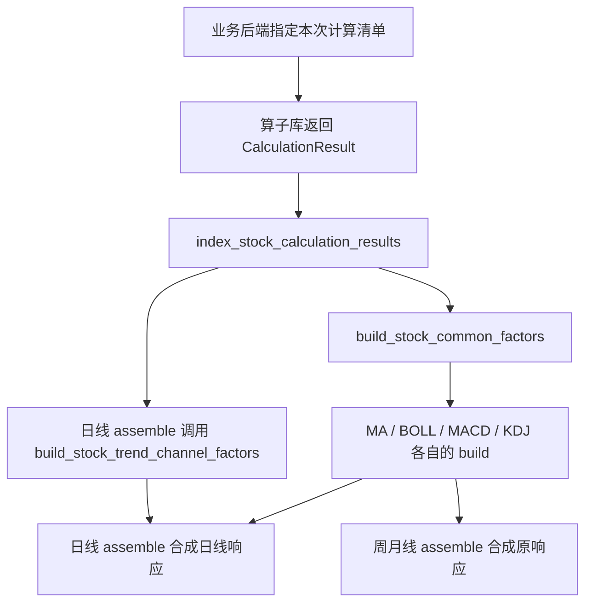
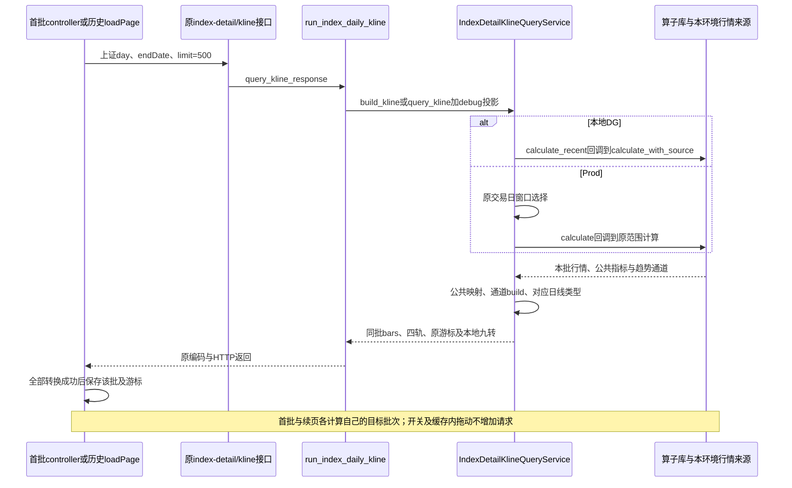

# 趋势通道算子及股票、上证接入 LLD v1

2026-11-25｜[专项方案](technical-indicator-trend-channel-plan-v1.md)记录最终需求。阶段一算子已实现，隔离验收和独立对照审计已完成，证据见 §9；提交管理员阶段 review。阶段二股票日线接入代码、隔离技术验收及对照审计已完成，提交管理员 review，证据见 §10；阶段三、四尚未实施，未发包或部署。JSON 已取消、预热与接口处理等已确认口径保持不变。

固定前置 500 根、每轨绝对误差不超过 0.01、四轨输出、旧方向清理和 MACD 保持现状均已确认，不需要重新拍板。阶段二、三设计已补齐，每步按其现行代码、合同和验收范围复核并单独 review。

**2026-11-25 后续设计确认。** 管理员确认每个指标独立 build、公共组装复用、业务 `assemble()` 显式组合，并指定在第三阶段实施该组装架构修改。本轮仅补设计：阶段二先完成股票日线接入及计算范围隔离；阶段三先整理公共组装，再接入上证；阶段四清理不变。本地和 Prod 各沿原有接法与环境，Prod 不新增本地式分页。以下 §4.2、§4.3 已按此补齐；本段记录开发前决定，阶段二实施现状与证据见 §10。

## 1. 当前代码与本期改动边界

| 对象 | 当前代码依据 | 本期处理 |
| --- | --- | --- |
| 算子请求与结果 | `packages/technical_indicators/src/goldenshare_technical_indicators/contracts.py` | 沿用 `CalculationRequest/CalculationValues`、数值 `fields` 和公共 `times`；不新增说明字段或说明空串。 |
| 算子接口与引擎 | 同包 `calculation/calculation.py`、`registry.py`、`engine.py`、`history.py` | 沿现有接口新增计算实现与注册，不增加 `output_info()`，不批量改造既有算子。 |
| 输出检查与编码 | 同包 `output/collector.py`、`result.py`、`encoding.py` | 四轨沿既有 DOUBLE 校验、日期对齐和编码，不为本期增加 VARCHAR 指标列或 JSON 处理。 |
| 股票调用 | `src/biz/services/wealth/market/stock_detail/stock_daily_kline_calculations.py`、`stock_daily_kline_service.py`，`src/app/dependencies/stock_daily_technical_indicators.py` | 按现有 MACD/KDJ 接法：计算指令加项 → 共享计算 → 按同批日期组装日 K 指标。 |
| 上证调用 | `src/app/dependencies/index_daily_technical_indicators.py`、`src/biz/queries/wealth/market/index_detail/index_detail_kline_query_service.py` | 按现有日线装配、算子请求、数值映射和 `nextEndDate` 接入。 |
| 页面首批与续页 | 股票 `useStockDailyHistory.ts`、指数 `useIndexDailyHistory.ts`、对应页面 controller | 沿 `DAILY_CHART_PAGE_SIZE` 与 `nextEndDate` 加载，趋势四轨随同一批行情进入图层。 |
| 股票页面入口与旧路由挂载 | `src/foundation/config/stock_daily_trend_channel_capability.py`、股票查询的 `_page_options()`、`src/app/api/v1/router.py`；`tests/test_stock_daily_trend_channel_capability.py` | 开发前该检查同时用于页面入口、旧路由挂载和旧接口请求；阶段二已移除页面调用，旧路由和旧接口仍沿原限制，阶段四再按引用清理。 |
| 旧独立通道 | 上证 `quote_trend_channel_calculator.py`、`quote_trend_channel_query_service.py`；股票通道 query service 与 Lake reader | 属于后续清理、消费者迁移对象；不把完整旧 HTTP 响应直接换成共享库响应。 |

CodeGraph 已用于定位算子结果、请求解析与旧业务调用影响；已用 `codegraph_explore(run_index_daily_kline)` 核对上证装配，本次再用 `codegraph_explore(resolve_stock_daily_trend_channel_capability)` 定位股票页面、旧路由和旧接口的调用关系，并直接核对股票、指数的计算指令、读取器、前端批次加载和相关测试。同名 `run/calculate/resolve` 的无关命中不作为真实依赖。完整清理仍须在对应阶段按引用逐项核对，当前未证明旧数据集已无其他消费者。

## 2. 本期输出合同与范围

本期只增加 `trend_channel` 数值算子。JSON 说明字段已取消：不增加 `CalculationValues.info`，不返回 `info: ""`，不增加 `Calculation.output_info()` 或相关注册、校验、编码和测试。该能力未来需要时另议，不作为本期前置步骤。

算子 ID 为 `trend_channel`、算法版本 `1.0.0`，参数为空。短期固定 25、长期固定 90，不开放管理员未要求的周期参数。返回四个必有有限 DOUBLE 字段：

| 字段 | 计算 | 单位 |
| --- | --- | --- |
| `short_upper` | 最高价的 25 周期 EMA | 输入价格单位 |
| `short_lower` | 最低价的 25 周期 EMA | 输入价格单位 |
| `long_upper` | 最高价的 90 周期 EMA | 输入价格单位 |
| `long_lower` | 最低价的 90 周期 EMA | 输入价格单位 |

日期时间仍由 `times` 与各字段数组一一对应，日线为日期，分钟为既有带时区业务时间。说明、位置、方向、组合状态均不进入新算子结果。数值输入只需要 `high/low`，来源原有 OHLC 检查继续执行；无需读取收盘价来判断历史方向。

通用算法沿现有标准行情及已启用来源合同注册，不自动开放新的证券、周期、复权或环境组合。页面接入范围是股票日线及上证日线；股票周月线、分钟线、其他指数页面不因本次接入自动增加通道图层。

## 3. 阶段一：完整实现趋势通道算子

### 3.1 文件与接口

实现位于 `packages/technical_indicators/src/goldenshare_technical_indicators/calculation/indicators/trend_channel.py`，实现 `TrendChannelCalculation` 的现有六个方法：`input_requirement/dependencies/prepare/consume/release_batch/release`。在 `calculation/indicators/__init__.py` 的 `create_builtin_registry()` 冻结前注册，沿现有 `CalculationDefinition/CalculationOutput` 和能力查询，不改变通用协议。

在该算子定义中以 `TREND_CHANNEL_WARMUP_ROWS = 500` 保存唯一数值来源，历史需求和能力说明读取它；测试以管理员指定的 500 为独立预期。此值随算法版本生效，不存入 Settings、环境变量或数据库，不开放运营输入，不复用 MACD 的最低预热常量或 `PRICE_ABSOLUTE_BOUND`。

`input_requirement(session, max_input_rows)` 声明 `fields={high, low}`、`preceding_rows=0`、`warmup_rows=500`、`requires_source_origin=False`，并声明 `last_seq` 与四条 EMA 数值状态。没有额外算子依赖，不读现有通道成品。

### 3.2 初始化、递推与批次

短期 `α=2/26`，长期 `α=2/91`。首个已读取的最高价初始化两组上轨，最低价初始化两组下轨；以后按 `EMA_t=α×价格_t+(1−α)×EMA_(t−1)` 递推。

1. `prepare` 准备固定系数和本请求数值状态。复用现有 `smoothing_parameters.sql` 的分段范围计算，不另造段长上限。
2. `consume` 仅首次初始化，其后只处理新序号；四轨使用共享行情执行固定 SQL，每段末尾更新四个原始 EMA 和 `last_seq`。批次重叠行不重复推进。
3. 使用新增的 `trend_channel_first.sql`、`trend_channel_segment.sql`，登记到该类资源声明和现有 SQL 白名单。输入只限本请求共享行情、自有参数和数值状态，输出 `seq` 与四轨。
4. `release_batch` 释放本批输出，跨批保留四个 EMA 与序号；`release` 沿引擎的结束、失败、超时和取消路径释放剩余资源。

计算中不按两位或四位小数逐根量化；0.01 是结果绝对误差标准。四个 EMA 数值是必要的续算状态，与要删除的方向标签不同。不得增加 `short_state/long_state/combined_state`，不得为新算子增加价格位置判断或旧方向保留规则。

### 3.3 读取、重试和预算

单算时沿当前已启用的读取方式定位目标：支持按根数时使用截止时间和本批数量，已有范围调用继续由当前装配确定目标日期；本阶段不改请求解析器的来源选择或扩大来源支持。读取模块在目标之前补最多 500 根实际 K 线。到已确认的来源起点而不足 500 时使用已有历史，不补造行情，不把缺失或 I/O 错误当成合法短历史。只返回目标区间，前置行情不进入结果。

| 场景 | 计算输入与恢复成本 |
| --- | --- |
| 历史充足，单算返回 R 根 | `500 + R` 根，R 不超过本次业务每批 500 根。 |
| 单算返回 500 根 | `500 + 500 = 1,000` 根计算输入，返回后 500 根。 |
| 与其他指标同算 | `R + max(各算子实际历史需求)`，不相加、不重复取数或复权；其他指标确需更多历史时整次输入可能更大。 |
| 中断后完整重试一次 | 两轮计算输入按 `2×(500+R)` 核算，实际中断点可能少于一轮；沿现有取消与资源清理，不新增持久化状态。 |
| 最后验收 | 完整参考与被测窗口的输入分别计量；复用固定样本，真实核验仅限获准证券、周期和有界窗口。 |

这些是计算 K 线数量，不是物理文件读量、重复 SQL 处理量或耗时保证。现有输出/输入容量、批量、时限、内存、文件和编码预算沿当前装配，不扩容、不新增参数。共享 SQL 链路的耗时、物理读量、内存、中断重跑与清理费用在阶段一有界验收时实测；现无依据预填新的数值阈值或套用旧业务计算器耗时。

### 3.4 阶段一开工审计（2026-11-25）

开发前结论：阶段一具备开始开发的条件，没有需要重新拍板的业务口径。范围仅为算子实现、注册、固定 SQL 资源和必要测试，不修改业务日 K、页面、旧接口或正式数据集。以下保留开工时证据，实施后对账见 §9。

本次用 `codegraph_explore` 检索 `MACDCalculation/CalculationEngine`，返回结果包含无关同名项；下表结论已逐项复核当前算子、引擎、读取、输出代码和相关测试，不以索引结果代替源码。

| 已确认约束 | 当前代码依据及实施要求 |
| --- | --- |
| 完整四轨、无参数、固定 500 根预热 | `CalculationDefinition`、六方法 `Calculation` 协议及 `HistoryRequirement` 已支持；`history.py` 合并历史需求取最大值，趋势通道独立返回 500，不使用 `session.recursive_warmup` 或 MACD 价格上界。 |
| 固定 SQL 和数值续算 | 沿 MACD/KDJ 声明 `TABLE_ROLES/SQL_FILES/FIXED_SQL_STEPS`，分别保存参数、四个 EMA 与序号、批次工作表及输出。`sql_templates.py` 的白名单加入本算子两份 SQL；分段控制读取复用引擎已允许的 `read_smoothing_limits/read_segment_bounds`，不增加新的控制读取名称或修改通用引擎。 |
| 分批、共享输入及只返回目标 | `service.py` 先准备算子、合并历史再创建输入会话；`sources/session.py` 区分预热与目标、按 `preceding_rows` 保留输入；`OutputCollector` 按目标区间收集已声明的 DOUBLE 字段，支持四轨而无需新结果协议。 |
| 结束、取消及失败清理 | `CalculationEngine.release_batch_tables()` 释放本批表并保留请求状态；`close()` 逆序释放各算子资源。新算子按现有 MACD 的释放方式处理自有表，测试覆盖失败后完整重试，不增加持久续跑状态。 |
| 0.01 精度和独立预期 | §6、§7 已区分不同起点的预热误差与相同起点的分批一致性；固定上证输入夹具的 1,599 根记录和 SHA-256 与 §7 一致。新 SQL 的金样本、误差、短历史、共享、跨批和取消仍须实现后验收。 |

已执行 74 项既有基线测试并全部通过，覆盖合同、注册/依赖，以及选定的执行器配置、标量绑定、取消后清理和 SQL 失败后的资源释放。测试只用本地隔离资源，未运行受保护 D3，未读取正式数据。该结果证明上述现有基础可用，不代表未实现的趋势通道已验收。

本机 `.venv` 默认加载已安装的旧版算子包，首次测试因缺少 `configuration.datasets` 在收集阶段失败；显式指定工作区源码后通过，无需安装依赖或改本机配置。阶段一测试从仓库根运行，必须沿当前源码路径启动；新增算子测试文件落地后加入下列明确清单，不直接运行整个指标目录：

```bash
trend_audit_tmp="$(mktemp -d /private/tmp/trend-channel-stage1-XXXXXX)"
PYTHONPATH=packages/technical_indicators/src:. PYTHONDONTWRITEBYTECODE=1 \
  .venv/bin/python -B -m pytest -q -p no:cacheprovider --basetemp="$trend_audit_tmp" \
  tests/foundation/technical_indicators/test_contracts.py \
  tests/foundation/technical_indicators/test_registry_dependencies.py \
  tests/foundation/technical_indicators/test_executor.py::test_private_connection_uses_all_confirmed_settings \
  tests/foundation/technical_indicators/test_executor.py::test_execute_uses_returned_count_and_bindings_without_an_extra_scan \
  tests/foundation/technical_indicators/test_executor.py::test_stopped_cleanup_only_accepts_owned_resources_and_is_idempotent \
  tests/foundation/technical_indicators/test_executor.py::test_failed_creation_retains_cleanup_eligibility_and_original_database_cause
```

这份清单是本次开工基线；阶段一完成验收还须运行 §6 对应的新算子、同批共享、输出、失败与取消测试。新增和复跑均使用工程外临时目录，验收后删除无用临时文件，保留必要证据于本 LLD。

## 4. 阶段二、三：沿现有业务接法接入

### 4.1 已核对的现有方式

- **股票。** `stock_daily_kline_calculations.py` 集中构造算子清单；`StockDailyKlineService` 校验结果并由 `build_kline_factors()` 组装日 K 指标；App 按环境调用共享库。本地 DG 已使用 `build_recent_calculation_request()` 的 `end/latest_rows`，Prod 沿现有 `prepare()` 确定目标日期后，以 `build_calculation_request()` 调用共享库。股票日线请求本来就限制 1–500 根。
- **上证。** `run_index_daily_kline()` 构造现有 MACD、KDJ 等指令；DG 用 `calculate_with_source()`，Prod 先由查询服务确定本批目标日期，再沿现有范围计算与结果映射。`apply_calculated_kline_factors()`、`_calculated_daily_response()` 负责指标和 `nextEndDate`。
- **页面。** 股票与上证日 K 都用当前 `DAILY_CHART_PAGE_SIZE` 请求，当前为 500；下一次沿服务返回的 `nextEndDate` 取更早一批。旧独立趋势端点的 2,000 上限不是本次页面单次请求的要求。接入不要求共享库支持一次 2,000 根，也不以全量替换旧端点为前提。

因此此前审计把“旧端点允许 2,000 根”直接当成本次接入阻塞，遗漏了当前页面的 500 根批次调用，是判断错误。本次沿已有入口加算子、组装四轨和翻页，不强制新增 Prod 的原生按根数读取，也不自行改写现有 2,000 根旧端点的合同。

### 4.2 阶段二：股票日线

目标是沿现有 `/api/v1/wealth/market/stock-detail/kline` 返回本批四轨，停止页面的独立通道请求，并保持周月线和各环境原有行为。本阶段不执行 §4.3.1 的公共四组指标拆分，不修改算法、通用结果合同、正式文件或部署配置。

#### 4.2.1 计算清单和实际调用

阶段二开发前，周月线 `StockPeriodKlineService.calculate()` 也调用 `stock_daily_calculations(include_nine_turn=True)`；只按旧函数名认为它是日线独有，会错误扩大计算范围。本次经 `codegraph_callers(stock_daily_calculations)` 及源码核对，消费者包括请求构造、日线结果检查、周月线计算和 App 启动检查。阶段二作如下必要隔离：

1. 在 `stock_daily_kline_calculations.py` 将原共用清单命名为 `STOCK_COMMON_CALCULATIONS`，由 `stock_common_calculations(include_nine_turn=...)` 保持原指标、实际参数及九转选择。新增的 `STOCK_DAILY_CALCULATIONS` 是不含可选九转的公共基础清单加无参数 `trend_channel`；日线 `stock_daily_calculations()` 对公共函数返回的原序列在末尾加通道，保留已有指标与可选九转的顺序。公共指标只声明一份，不按周期复制参数或先加通道再过滤。
2. `StockPeriodKlineService.calculate()` 改调用公共清单，实际请求集合与改前一致；日线两个请求构造、`StockDailyKlineService._validate_result()`、App 启动检查使用日线清单。版本映射加入 `trend_channel=1.0.0`，字段映射加入四轨，沿现有检查核对实例、参数、版本、字段、长度和数值输出。
3. 本地继续 `StockDailyKlineAppBackend.work()` → `StockDailyKlineService.prepare_recent()` → `build_recent_calculation_request()` → 传入的 `TechnicalIndicatorService.calculate_with_source()`。首批和续页只是不同的截止日，不另造翻页接口。
4. Prod 继续 `work()` → `prepare()` 取得本批日期 → `build_calculation_request()` → `TechnicalIndicatorService.calculate()`。保留原 PostgreSQL 只读范围、会话、错误与取消规则，不要求新增按根数读取或生产翻页。

代码中的算法调用仍在组装之前。各 build 函数只映射已经算完的结果，不读取数据、不调用算子库、不决定计算清单。

#### 4.2.2 日线字段、类型与组装

固定字段路径为 `bars[].factors.trendChannel`：

| API 字段 | 算子结果字段 | 合同 |
| --- | --- | --- |
| `shortUpper` | `short_upper` | 25 周期最高价 EMA，必有有限数值，单位元 |
| `shortLower` | `short_lower` | 25 周期最低价 EMA，必有有限数值，单位元 |
| `longUpper` | `long_upper` | 90 周期最高价 EMA，必有有限数值，单位元 |
| `longLower` | `long_lower` | 90 周期最低价 EMA，必有有限数值，单位元 |

在 `src/biz/schemas/wealth/market/stock_detail.py` 增加 `StockTrendChannelFactorsDto`、`StockDailyKlineFactorDto`、`StockDailyKlineBarDto`。日线 factor 类型在原公共四组上增加必有 `trendChannel`，日线 bar 明确声明该 factor 类型；`StockDetailKlineResponseDto.bars` 使用日线 bar，本地首批、续页响应沿原继承使用它。`StockDetailPeriodKlineResponseDto.bars` 显式保留 `list[StockKlineBarDto]`，原公共 factor/bar 不增加通道、可选空对象或空轨道。无行情时沿原空 `bars`，不造空 K 线。

阶段二在 `stock_daily_kline_service.py` 增加 `build_stock_trend_channel_factors(results, index)`，输入为本请求按实际算子参数整理的数值数组，输出上述通道 DTO；不使用 `special_factors` 名称。日线 `assemble()` 继续调用现有 `build_kline_factors()` 得到公共四组，再显式组合通道形成 `StockDailyKlineFactorDto`。公共字段按现有对象成员合入，不重新列写一份 MA/BOLL/MACD/KDJ 的数值映射。价格及基础字段复用 `build_kline_bar()` 已生成的成员，替换 `factors` 后构造明确的日线 bar；不复制一套 OHLC、幅度或盘口映射。

四轨必须在实际 JSON 和 OpenAPI 中出现，不能只验证 Python 对象上有属性。Pydantic 默认按字段声明的模型类型序列化嵌套对象，基类声明不会自动输出子类新增字段；已按[官方序列化说明](https://docs.pydantic.dev/latest/concepts/serialization/#subclasses-of-model-like-types)和本机 2.13.4 有界实例核对。因此响应、bar、factor 三层均须明确对应类型，不开启全局多态序列化来代替合同定义。

`StockDailyKlineService.assemble()` 是完整响应组装；上述每指标 build 是其子步骤。首批与续页都调用同一个 `assemble()`，不是算一次后再重复组装另一份相同响应。

#### 4.2.3 前端首批、续页和图层交接

`stockDetailApiTypes.ts` 区分日线 bar（必有四轨）和周月线 bar（原字段）。`fetchStockDetailKline()` 仍是同一个入口，以 `period=day` 与 `week/month` 的请求类型分别声明对应返回类型；通过函数重载保持现有调用方式，不新增 HTTP 端点或按是否缺字段猜回包版本。

在 `stockDetailViewModelAdapter.ts` 增加 `buildStockDailyTrendChannelPoints()`，将每根日 K 的日期、收盘价和 `factors.trendChannel` 转为现有 `TrendChannelPoint`。沿既有日期、数值及上下轨合同适配，不计算 EMA、不使用旧 API 响应类型拼造新结果。

| 位置 | 实施动作 |
| --- | --- |
| `StockDetailPage.loadStockDetail()` | 日 K 返回后同时生成原 viewModel 和首批通道点；`StockDetailLoad` 增加 `dailyTrendPoints`，与首批 candles 一同保存，之后才进入 ready。首批图层无须再等待另一请求。 |
| `useStockDailyHistory.loadPage()` | `HistoryPage` 保存必有 `trendPoints`；先完成本批原日期/游标核对、candles 转换、通道点转换和九转读取，再一次提交 `nextEndDate`、candles、pages。失败时不推进游标、不追加部分数据，重试同一 `endDate`。现有代码先写游标再转换的顺序须随本次接入调整。 |
| `StockChartWorkspace` | 用 `initialTrendPoints` 替代旧 `trend` 对象，类型为 `readonly TrendChannelPoint[]`；日线传入首批数组，非目标周月线传空数组并维持禁用。合并历史页的 `trendPoints` 与首批点，沿已有 `buildTrendChannelLines()` 和 `TrendChannelPanePrimitive` 绘制。 |
| 开关和历史状态 | 移除页面的 `useStockTrendChannel()` 调用、`onTrendSelect` 请求回调，以及历史控制的 `loadTrend/ensureTrend/retryTrend`、独立 phase 和通道失败重试 UI。`changeOverlay()` 只控制绘制；未选择通道时加载的历史页仍保存四轨，之后打开无需补请求。 |

保持页面初始图层、画法、着色、盘口和页面日期。首批失败由 `loadStockDetail()` 处理，本地续页失败由 `loadPage()` 处理并保留已加载图表及当前视野；切证券、切页面日期或离开日线沿现有取消和迟到响应隔离，不创建跨页面通道缓存。

旧通道接口读取的是 DG 后台已生成的股票日线趋势通道结果文件，不是首屏计算缓存。接入后每个日 K 请求计算自己的目标与预热，浏览器保留该批结果供开关重复使用；不同 HTTP 翻页请求不复用首屏 EMA 状态。旧前端请求模块与后端接口按 §5 清理，阶段二只保证新页面不再调用，不提前改变旧路由限制。

#### 4.2.4 本地与 Prod 范围

| 环境 | 保持的现有行为 | 本次增加与验收 |
| --- | --- | --- |
| 本地 DG | 由 page-init 锚定日期；首屏含盘口、续页不含；每批最多 500 根、沿实际 `nextEndDate` 续取，保留日 K 内联九转 | 每批日 K 必有四轨，入口不依赖旧开关和旧通道目录；首批与至少一批续页验收。 |
| Prod | 原 page-init 盘口、原日 K 参数和范围计算、原 meta；前端原先不创建本地 historySeed 的行为保持 | 现有日 K 回包增加四轨，首屏可展示；不添加 `nextEndDate`、本地九转字段、首屏盘口迁移或新的分页流程。 |

页面入口修改沿 §4.5；旧通道开关关闭、两个旧目录不存在时，两个已接入环境的日线均应支持新通道。缺行情仍走各自原有日 K 错误/空态，不改成关闭功能或回退旧源。

#### 4.2.5 影响面、测试与预算

代码落点为：计算清单与版本/字段表、股票日线服务及请求/结果检查、周月线清单调用、股票 schema/路由响应声明、页面能力判断、App 装配、前端 API 类型与 adapter、`StockDetailPage`、`useStockDailyHistory`、`StockChartWorkspace`。原股票首屏与本地 DG 方案/LLD同步记录本次后续切换，保留已有实施与生产证据。

后端至少覆盖 `tests/test_stock_daily_kline_service.py`、`tests/app/technical_indicators/test_stock_daily_integration.py`、`tests/app/technical_indicators/test_stock_daily_source_repair.py`、`tests/web/test_wealth_stock_detail_api.py`、`tests/web/test_stock_daily_technical_indicator_api.py`，同步迁移 `tests/stock_daily_kline_helpers.py` 等日线夹具；新增 `tests/test_stock_period_kline_service.py` 隔离验证周月线清单、组装和原 JSON。基础周期计算继续引用现有 `tests/foundation/technical_indicators/test_stock_period_calculation.py` 的适用合同，不把无关正式 PG 测试整组运行。验证日线有四轨且参数/版本匹配，周月线计算指令、字段集合不变；验证真实 `model_dump`、HTTP JSON、OpenAPI，避免嵌套类型漏字段。本地与 Prod 分别装配隔离应用，不能用本地通过代替生产路径合同。

前端覆盖 `stockDetailViewModelAdapter.test.ts`、`useStockDailyHistory.test.tsx`、`StockChartWorkspace.test.tsx`、`StockDetailPage.test.tsx` 及受 API 类型影响的周月线测试。正向覆盖首批、续页、未选通道先翻页后打开、反复开关、切证券/日期、周月线切换；反向覆盖日线缺轨/非有限值/错日期、续页失败后原游标重试、迟到响应丢弃、旧接口请求次数为零。夹具按新日线/原周月线合同分别构造，预期四轨用独立手算或 Decimal 参考，不调用待测 builder 生成 expected。

沿 §3.4 的工作区算子源码路径运行；不为开发安装包或改变部署。前端执行 `npm --prefix wealth run typecheck`、相关 Vitest 和 build，并将缓存、编译产物等本次输出放到工程外临时目录；浏览器核对网络只走日 K、首批/续页数据和图形、开关、失败重试、盘口及页面日期。

预算沿当前 App 配置：默认公共清单是 7 组 MA 加 BOLL/MACD/KDJ/price 共 11 项；本地分页原有九转后为 12 项，加通道后为 13，Prod 沿原选择从 11 增为 12，均低于现有实例上限 16。共享行情取各算子的最大前置需求，不叠加读取或复权；目标 R、最大前置 500 时交付 `R+500`，R=500 时为 1,000 根，合法历史不足据实减少。计入新增 DTO 构造、前端点转换、正常请求、取消清理、完整重试和最后验收，不新增或抬高耗时/内存/文件阈值。

真实有界验收优先复用原股票页面 LLD 的 `600519.SH`、截止 2026-11-19、首批和至少下一批各最多 500 根的来源与接口证据；新四轨及新调用仍须实际验证。目标环境覆盖不足时保留失败原因、先选当前正式覆盖内的有界窗口并记录选择依据，不回填数据或跨环境兜底。记录各请求实际源行/文件、SQL处理量、组装编码、总耗时和取消至资源归还，不能把旧实测当成接入后结果。核对范围为单证券有界窗口，不全市场扫库；真实 Prod 访问和部署仍遵守原授权边界。

### 4.3 阶段三：逐指标组装整理与上证日线接入

本阶段包含两个依次验收的步骤，四个总阶段不重新编号。先完成管理员指定的组装架构修改，再接入上证；不将该重构提前到阶段二，也不推迟到旧业务清理阶段。

**2026-11-25 设计补齐。** 本节将管理员确认的职责划分落实到两个步骤的函数、类型、调用方、前端交接及验收，不再把这些工程细节留作“开工前定稿”。阶段二股票接入验收是本阶段的执行前置条件：阶段三使用其日线类型、通道 build 和接口基线，不能把阶段二尚未实施说成阶段三还缺业务决定。本段记录阶段二开发前的设计补齐；阶段二实施现状见 §10，阶段三仍未实施。

#### 4.3.1 公共组装与每指标独立函数

当前 `build_kline_factors()` 位于日线服务，但同时被股票日线与周月线 `assemble()` 调用。它是固定 MA/BOLL/MACD/KDJ 映射，不是指标算法，也不是所有算子的自动处理器。目标是公共映射只维护一份，各业务显式选择自己的指标，不在公共函数中累积 `day/week/month` 判断。

新增 `src/biz/services/wealth/market/stock_detail/stock_kline_factor_mapper.py`，承接当前两个股票调用方的公共职责：

| 函数 | 职责与输出 |
| --- | --- |
| `stock_calculation_key()` | 从现有 `_calculation_key()` 迁入公共模块，以算子 ID 和实际参数形成原有键；所有调用方同步迁移，无旧名兼容别名。 |
| `index_stock_calculation_results()` | 每请求一次整理 `CalculationResult.calculations` 的索引，保留各数值元组引用；不复制整列、不读源、不算算法。 |
| `build_stock_ma_factors()` | 按实际 MA 周期取当前根，返回 `StockMovingAverageDto`，保持现有周期和字段名。 |
| `build_stock_boll_factors()` | 返回现有 `StockBollDto`。 |
| `build_stock_macd_factors()` | 返回现有 `StockMacdDto`，保留 hist 到 macd 的既有字段映射。 |
| `build_stock_kdj_factors()` | 返回现有 `StockKdjDto`。 |
| `build_stock_trend_channel_factors()` | 将阶段二的独立通道函数移入该模块，仍只由获准的日线业务调用，返回 `StockTrendChannelFactorsDto`。 |
| `build_stock_common_factors()` | 明确调用 MA/BOLL/MACD/KDJ 四个独立函数，返回这四组已组装对象的命名映射，供日线和周月线复用；不包含趋势通道或周期分支。 |

日线 `assemble()` 使用公共组装结果，加上独立的通道 build 结果，构造阶段二已确定的日线 factor/bar/响应。周月线 `assemble()` 使用公共组装结果，维持原 factor/bar/响应及自己的周期日期、九转等组装；本次没有专属指标时不造空专属函数。后续共性指标放入独立指标 build 并由公共组合调用，专属指标由所属业务 `assemble()` 显式调用。

原 `_calculation_key/build_kline_factors` 的消费者须全量迁移，周月线不再从日线服务导入公共映射。各 build 不决定要算哪些算法，不修改通用结果，不获取行情；上游请求清单仍由业务装配负责。采用直接函数组合，不新增策略注册表、处理器链、继承体系或周期兼容分支。

本次公共映射范围是已核实的股票日/周/月调用方；不要求指数业务依赖股票私有 DTO，也不为追求统一重写未涉及的业务。该步骤不改变阶段二已经发布的字段合同、不增加算法或来源；上证的新增组装继续位于指数业务路径。

各函数的输入交接固定如下：`index_stock_calculation_results(result.calculations)` 每请求调用一次，返回以 `stock_calculation_key(id, parameters)` 为键、以字段名到原数值元组的映射为值的索引。MA build 接收该索引和当前根下标，按原七个周期分别取值；BOLL/MACD/KDJ/趋势通道 build 接收本指标已验证的字段映射和下标。`build_stock_common_factors()` 接收请求索引和下标，调用四个公共 build，返回键为 `ma/boll/macd/kdj` 的对象映射。各业务 `assemble()` 先复用公共组合，再处理自己的内容；日线显式调用通道 build，价格、九转、日期和游标仍由原步骤处理。输入已经过原合同检查，每个 build 不重复校验、不另算指标。



重构前保存独立字面金样本及当前日/周/月 JSON 基线，重构后逐项验证相同输入下的字段、数值、日期、空值、游标与错误行为一致。新增 `tests/test_stock_kline_factor_mapping.py` 验证每个指标 build 的独立字段映射，包含不同 MA 周期不可混用、公共指标只维护一处、日线有通道而周月线不计算/不输出通道；再跑阶段二后端/页面及新增周月线服务回归。不得从待测 builder 生成 expected，或为通过测试修改已有正确字段和行为。

改动只有请求内结果读取和对象组装，不新增源读取、复权、SQL计算、状态持久化或重试；沿原请求预算，计入重构后的组装、错误清理、取消、重试和最后回归开销。记录前后源行/文件及计算次数一致，实测总请求费用；没有未测依据的新性能阈值。实现、接口与原方案对账后，独立审计该步骤，再进入上证接入。

#### 4.3.2 上证日线接入：计算与组装

本步骤只给 `000001.SH + day` 已接入算子库的日 K 请求增加四轨。本地与 Prod 页面均沿现有每批 500 根和 `meta.nextEndDate` 翻页；**上证 Prod 原来已有日 K 游标，不能套用股票 Prod 不翻页的情况。** 其他指数、指数周月线、分钟线、顶底识别及波段接口不新增通道。基础指数日线行情继续使用，旧独立通道接口留至阶段四清理。

**计算指令与结果分组。** 当前 `SSE_DAILY_CALCULATIONS` 的七个 MA 加 BOLL/MACD/KDJ，不仅供指数日线使用，也被 `index_period_technical_indicators.py` 的周月线调用；`apply_calculated_kline_factors()` 同样被日线和周月线查询调用。本步骤保留这份公共清单与公共映射的现有输入，不向其中直接塞入通道。

在 `index_detail_kline_query_service.py` 增加 `index_daily_calculations(ts_code, *, include_price_and_nine_turn)`：先返回原清单，本地加原有 price、nineturn，最后仅对上证日线追加 `trend_channel`、空参数。App 日线装配及相应 query 的完整结果检查都使用这个函数，不复制另一份期望清单；原实例相对顺序保留。App 移除静态 `_DG_CALCULATIONS` 的使用，本地显式传 `include_price_and_nine_turn=True`，Prod 为 False。周月线继续原公共清单，不调用该日线函数。

`_build_recent_daily_kline()` 先验证实际返回的实例与本次请求一致，再分出 price、nineturn 和上证趋势通道；仅将原十个公共指标交给 `apply_calculated_kline_factors()`。`_build_calculated_daily_kline()` 同样先检查完整结果，再分出通道、交公共指标给原映射。沿原日期/根数对应检查，趋势通道按算子定义检查空参数、版本 `1.0.0`、四字段、根数和有限数值；不修改共享结果协议，也不把缺轨当正常 PARTIAL。空目标无计算结果时仍返回合法空页。公共映射继续核对自己实际接收的十个实例，不能让它接收十一项却仍核对十项，也不能用“忽略未知项”吞掉错误。

**环境与调用不变。** `index_detail.py:query_kline_response()` 沿原分支调用 `run_index_daily_kline()`。DG 使用现有 `end/latest_rows` 和 `calculate_with_source()`；Prod 先按原交易日窗口选择目标日期，再沿当前 `_prepare_calculation/_calculate_library` 范围计算并收集同批 OHLC，保留现有辅助行情查询。保留各自历史下界，不强制改 Prod 为按根数来源。通道在同一请求中与公共指标共享行情，历史需求取最大值，不能再请求旧通道接口、旧缓存或全历史计算器。

**字段与类型。** 上证目标响应的每根 K 线必有 `factors.trendChannel`，四字段是有限数值，单位为指数点，不强制舍入：

| 算子字段 | JSON 字段 | 含义 |
| --- | --- | --- |
| `short_upper` | `shortUpper` | 最高价的 25 周期 EMA |
| `short_lower` | `shortLower` | 最低价的 25 周期 EMA |
| `long_upper` | `longUpper` | 最高价的 90 周期 EMA |
| `long_lower` | `longLower` | 最低价的 90 周期 EMA |

在 `src/biz/schemas/wealth/market/index_detail.py` 增加以下类型；原公共 factor/bar/response 不加可空通道，其他指数及周月线 JSON 字段集合不变。

| 类型 | 具体约定 |
| --- | --- |
| `IndexTrendChannelFactorsDto` | 上表四个必有数值，无状态、说明或 JSON 文本。 |
| `IndexSseDailyKlineFactorsDto` | 复用 `IndexKlineFactorsDto` 的四组公共指标，增加必有 `trendChannel`。 |
| `IndexSseDailyKlineBarDto` | 复用原行情字段，将 `factors` 明确标注为上述上证类型。 |
| `IndexDetailSseDailyKlineResponseDto` | Prod 目标响应，明确 `period=day`、上述 `bars` 类型和原 `IndexDetailSseKlineMetaDto`；不添加九转字段。 |
| `LocalIndexDetailSseDailyKlineResponseDto` | 保留原本地日线类型的必有 `nineTurnMarkers`，明确覆盖 `bars` 为上述类型。 |
| `IndexDetailSseDailyKlineDebugResponseDto` / `LocalIndexDetailSseDailyKlineDebugResponseDto` | 在 debug schema 中分别保留相应普通响应的完整 bars、meta 和本地九转，`debugInfo` 为原诊断类型。 |

原 `index_detail_field_mapper.py` 内的公共映射拆为 `build_index_ma_factors/build_index_boll_factors/build_index_macd_factors/build_index_kdj_factors`，由 `build_index_common_factors(row)` 返回四组对象的命名映射；不改变源列、正常空值和 hist 到 macd 的原映射。新增 `build_index_trend_channel_factors(fields, index)` 只做四轨映射。现有 `build_kline_bar()` 与新增 `build_index_sse_daily_kline_bar(row, trend_factors)` 共用从原函数提取的 `build_index_kline_bar_fields(row)` 和公共指标组合，分别构造原 bar 和上证 bar。行情和公共指标映射各维护一份，公共 build 不判断周期/代码，不导入股票 DTO；本次只拆直接受影响的组装，不重写其他指数业务。

`_calculated_daily_response()` 的上证日线分支按目标下标调用通道 build、上证 bar build，选择本地/Prod 响应；其他指数仍用原 bar 和响应。首批、续页都经过这里，只有当前请求的一次组装。类型覆盖必须到 factor、bar、普通/本地 response 和 debug response 每一层，不能把子类对象塞进仍标注为公共基类的字段而丢失四轨。

`index_detail.py`、`index_detail_debug.py` 的响应声明，`debug_response.kline_response()` 的投影类型选择及 `add_openapi_responses()` 同步迁移。debug 使用当前 `project` 回调，不另算一次；普通与 debug 的行情、四轨、游标及本地九转一致，只保留原诊断差异。Prod 大于 500 根的旧请求仍沿原分支，不在本次新增算子支持，也不补空通道冒充目标响应；页面始终显式请求 500 根。旧独立通道端点的 2,000 根上限留至阶段四引用审计，本次不改其合同。

#### 4.3.3 上证前端首批、续页及图层交接

`indexDetailApiTypes.ts` 增加与上述上证日线 factor/bar 对应的类型，普通与 debug 消费者同步使用；保留其他指数及周月线原类型。`fetchIndexDetailKline()` 沿原 URL、参数和调度，目标日线类型明确包含四轨，不通过字段碰巧存在与否选择新旧来源。

在 `indexDetailViewModelAdapter.ts` 新增 `buildIndexDailyTrendChannelPoints(response)`：对目标上证日线逐根读取 `tradeDate/close/factors.trendChannel`，映射为已有 `TrendChannelPoint`。每根都有四轨，日期和该根行情对应；缺轨、非有限值等按本批合同错误失败，不沿旧 adapter 丢点后显示一部分，也不前端计算 EMA。其他指数返回空通道点数组，不增加请求。

| 位置 | 修改及交接 |
| --- | --- |
| `useIndexDetailController` | 首批日 K 及四轨全部转换成功后，同一次状态提交保存 `dailyTrendPoints`、viewModel、九转和 historySeed。删除独立通道 AbortController、`requestTrend/commitTrendSuccess/commitTrendFailure/retryTrend`，不再因该独立请求制造页面 PARTIAL。 |
| `IndexDailyHistorySeed` / `HistoryPage` | seed 保存首批通道点；每页必有 `trendPoints` 数组，上证来自本批四轨，其他指数为 `[]`。删除旧 `trend` 异步加载状态。 |
| `useIndexDailyHistory.loadPage()` | 先完成原游标核对、K 线、九转和通道点转换，成功后一起更新页数组与 `nextEndDate`。失败保留原图和游标，使用原截止日重试；不得先推进游标再发现缺轨。 |
| 历史缓存与展示 | 保留现有预取阈值、缓存页和显示页规则。用户拖回近期时，回包暂存；再次拖入历史范围时，该页 K 线与通道点一并展示。切证券/日期、离开日线沿原取消和所有者检查丢弃迟到回包，不重置缩放、位置或用户叠加选择。 |
| `IndexChartWorkspace` | 改接 `initialTrendPoints`，与历史可见页点合并后交原 `buildTrendChannelLines/TrendChannelPanePrimitive`。删除独立 `trendPhase` 依赖；开关只切绘制，保持原默认叠加及逐日收盘相对下轨的着色。 |
| `IndexDetailPageView`、`IndexInfoRail`、`IndexTechnicalTab` | 传递首批 `dailyTrendPoints`；技术面四轨摘要只取首批最后一根日 K，历史翻页不改变摘要。删除 `onTrendRetry` 及通道专用加载/失败展示，沿日 K 原页面状态；切周月或分钟仍保留原右栏日线语义。 |
| 既有九转 | DG 首批/续页继续内联九转，Prod 继续原独立九转。历史异步图层的加载、失败与重试只保留仍需它的九转，不因删除通道分支删掉九转逻辑。 |

页面链不再引用 `fetchTrendChannel()`、旧通道 adapter、`QuoteTrendChannelQueryService`、`TrendChannelCalculator` 或旧缓存。阶段三移除已迁移页面中的调用、状态和专用重试；阶段四才按全部引用删除无消费者的模块、路由、schema 和专用测试，不恢复兼容分支。page-init 的支持范围仍只有上证日线；其他业务来源和能力不扩大。



#### 4.3.4 预算、恢复和测试验收

纯股票组装整理沿 §4.3.1，不新增计算或源读取。上证 DG 原有 `7 MA + BOLL + MACD + KDJ + price + nineturn = 12` 项，加通道为 13；Prod 原有 `7 MA + BOLL + MACD + KDJ = 10` 项，加通道为 11。其他指数和周月线项数不变，不提高现有实例上限 16。数字依据是当前 App 清单和 `src/foundation/config/settings.py`。

通道申报 500 根，整次仍按 `R+W` 交付行情，`W=max(本次各算子实际历史需求)`；只有其他指标历史需求均不超过 500 时，R=500 才是 1,000 根计算输入。不是物理文件量，不按各指标叠加。请求中断后按同一截止日完整重试，不持久化跨请求 EMA。正常首批、续页，再以首批相同截止日取消并完整重试，这组验收按 `2×(R首批+W首批)+(R续页+W续页)+C取消已交付` 分别记账；独立参考与回归测试另外计量，不能说整个验收只有这些读量。

沿实际生效配置；当前 Settings 默认 SQL 内存 128 MiB、请求内存 256 MiB、总目标 8,000 ms，其中清理保留 2,000 ms。这是已有预算，不是新接入的实测保证，不调整环境值。开发后记录定位、源行/文件、SQL 处理、组装编码、总请求、取消到资源归还、完整重试和最后验收成本。连接、算子清理及 HTTP 失败继续沿原 `_execute` 和释放流程，清理失败不能报告成功，不新增自动重试或全历史回退。

| 硬口径 | 代码及合同落点 | 必要验收 |
| --- | --- | --- |
| 公共映射单处维护、每指标独立 build | 股票 mapper 及日/周/月 assemble；指数 mapper 的公共与通道 build | 新增 `tests/test_stock_kline_factor_mapping.py` 和 `tests/test_index_trend_channel_mapping.py`。字面金样本验证字段、MA 参数及 hist 映射，expected 不调用待测 build；同输入下改前/改后日周月 JSON、日期、空值和错误行为一致。 |
| 只给上证日线追加通道 | 日线清单、App、query 完整结果检查；原公共清单/周月线保持 | `tests/app/technical_indicators/test_index_daily_kline_integration.py`、`tests/integration/test_index_period_derived_from_daily.py`、`tests/web/test_wealth_index_detail_weekly_monthly_api.py`；其他指数和周月线不请求/不输出通道，原实例顺序保留；重复、缺项、错参数和错版本反例失败。 |
| 普通/debug 都完整返回四轨 | schema、mapper、debug 投影、路由及 OpenAPI | 上述 App 测试及 `tests/web/test_wealth_index_detail_api.py`、`tests/web/test_wealth_index_detail_dg_kline.py`、`tests/test_index_detail_field_mapper.py`；真实序列化、HTTP JSON、OpenAPI 均声明四个必有数字；普通/debug 日期、数值、游标及本地九转一致，其他响应不增加 null 字段；空页成功。 |
| 首批/续页和摘要只用当批结果 | adapter、controller、history、PageView、chart、sidebar | `indexDetailViewModelAdapter.test.ts`、`useIndexDetailController.test.tsx`、`indexDailyHistoryRequests.test.tsx`、`IndexChartWorkspace.test.tsx`、`IndexDetailPage.test.tsx`、`IndexTechnicalTab.test.tsx`；覆盖先翻页后开通道、反复开关、缓存回包暂存、切日期/指数/周期、迟到回包丢弃、摘要不被历史页改写。 |
| 失败不推进游标、不回退旧链 | 日 K 失败及取消，通道旧调用退出 | 缺轨或错误页后保持原图、原游标并重试原截止日；旧请求、计算器和缓存被调用即失败。九转合法空标记、MA/BOLL 正常历史不足的 null 不误拦；Prod 九转原重试保留。 |
| 500 根预热、每轨误差 ≤0.01 | 共享算子及 §3、§7、§9 的独立参考 | 固定上证样本复用来源和 SHA，参考从样本首根计算，被测从目标前 500 根初始化，逐轨最大误差比较；同起点分批一致性另验，不把固定样本起点冒充全部历史。 |

后端分别装配 DG 与 Prod 隔离应用，不能以 DG 成功代替 Prod 合同。真实只读验证限定 `000001.SH` 的首批和下一批，各最多 500 根，优先复用固定样本截止 2026-08-07；实际覆盖按当次来源核验，不覆盖时记录原因后选已覆盖窗口，不回填数据或跨环境取数。记录代码版本、参数、返回日期、数值与费用，不全市场或全历史读取。沿 §3.4 源码启动，受保护 D3 与无关正式 PG 测试不整组运行。

前端执行 typecheck、上述相关测试及 build，产物和日志放工程外临时目录。浏览器核对首批/续页网络、四轨与图形颜色、开关和失败重试；没有旧通道请求，仍需的其他业务请求保持。旧性能记录只作基线，接入后费用必须实际记录。

本轮设计核对使用 CodeGraph `codegraph_explore`，并核验 App、日线/周月线 query、schema、API、OpenAPI、controller/history/chart/sidebar、相关测试及配置。共享常量和跨语言消费者以实际 import、构造和调用补齐，不能把 CodeGraph 返回“无调用方”当作可删除依据。设计无新增待拍板业务项；阶段二验收及该步现状复核是执行前置，股票组装审计通过后才进入上证步骤。部署、正式写入另按原阶段授权。

### 4.4 新旧接口和数据集的具体处理

| 对象 | 当前实现依据 | 接入后 |
| --- | --- | --- |
| 股票、指数日 K 接口 | 现有日线 App 装配、计算清单、结果组装和前端 API 类型 | 保留入口及既有日 K 行为，在目标日线指标中增加四轨；图层与其他指标使用同批日期、复权和游标。 |
| 股票旧独立接口 `/api/v1/wealth/market/stock-detail/trend-channel` | `stock_detail_trend_channel.py` → `StockDetailTrendChannelQueryService` → `StockDailyTrendChannelLakeReader` | 股票页面切换后不再调用。接口尚保留期间继续按原合同读结果文件；阶段四审计全部调用方后删除无消费者的路由、专用查询、schema 和读取器，不转调新日 K 接口或另造算子入口。 |
| 上证旧独立接口 `/api/v1/quote/detail/trend-channel` | `src/biz/api/quote.py` → `QuoteTrendChannelQueryService._load_consistent_series()` → `load_all_rows()` 与专用计算器/缓存 | 页面切换后不再调用，页面所需结果改由算子库计算。阶段四按引用删除旧路由及其专用计算、查询、缓存、schema 和前端请求代码；不因移除通道接口而删除 `quote.py` 中其他接口。 |
| 股票日线趋势通道结果数据集 `gold/indicator/stock_daily_trend_channel` | 旧读取器按股票、截止日期和根数读取正式 Parquet 结果 | 新算子、新日 K 接入和新页面入口均不依赖它；是否整体停产或清退由阶段四审计决定，页面切换不授权删除文件。 |
| 股票日线趋势通道续算状态数据集 `gold/indicator/stock_daily_trend_channel_state` | 旧数据生产需要数值续算；旧页面能力函数检查目录，但旧 API 读取器不读它 | 新算子在本请求内维护四个 EMA 数值，不读该文件；不能因为旧文件名带 `state` 就在阶段二删除整个数据集。 |
| 股票、指数基础行情和股票复权因子数据 | 本环境现有日 K 来源和共享库读取装配；旧上证查询读取 `IndexDailyServing` 的 OHLC | 继续使用，保留现有读写职责；退出的是旧通道专用计算/成品读取，不能清理基础行情及复权因子数据。 |

### 4.5 股票页面入口判断与失败处理

旧检查的目的，是在本地具备预计算文件读取条件时才展示入口。`resolve_stock_daily_trend_channel_capability()` 依次检查 `APP_ENV` 为 `dev/local`、`WEALTH_LOCAL_LAKE_STOCK_DAILY_TREND_CHANNEL_API_ENABLED` 开启、正式 Lake 根路径及可读性、DuckDB 可发现、结果和续算状态两个目录均可读。它只检查环境与目录，不读取具体股票记录，不检查某日期分区是否齐备，也不查询 Dagster instance、任务或资产状态。`tests/test_stock_daily_trend_channel_capability.py` 使用空的两个目录即可验证旧检查返回启用。

阶段二按以下位置修改，不重做数据可用性检查：

1. 股票页面初始化的 `_page_options()` 移除旧能力函数调用及相应导入。在本环境已接入股票日线算子能力的页面中，`supportsTrendChannel=true`，`availableMainOverlays` 包含 `TREND_CHANNEL`；沿既有图层限制只在目标日线使用，不顺带开放周月线或分钟线。
2. 新页面不继承旧接口的 `dev/local` 限制、专用开关和通道目录检查；本地 DG 与 Prod 沿各自已接入的日 K 装配。算子库读取 DG 行情所需的原有组件和配置仍保留，不把“去掉旧通道检查”扩展成绕过日 K 来源合同。
3. 当前无行情、合法短历史和源读取失败继续按现有日 K 合同处理；`supportsTrendChannel` 表示功能支持，不随单次空行情或 I/O 失败关闭。不能以 `false` 隐藏算子计算或读取错误，也不新增独立开关、就绪查询、重试和额外取数。
4. `src/app/api/v1/router.py` 对旧路由的挂载、旧 API 请求内部的检查，在旧接口仍保留时只控制旧接口；不得因页面修改而让它提前对生产开放。阶段四按全部引用删除无消费者的旧路由、能力函数、Settings 字段、配置说明和专用测试。

性能和恢复沿现有日 K 请求：不为入口判断增加文件内容读取、数据库查询或 Dagster 请求；计算输入按 §3.3 的同批最大历史需求核算。取消、超时、编码错误和重试使用现有资源清理与响应规则，失败不返回新旧结果混合的批次，也不退回旧通道数据；前端失败后保留已加载图表及原有重试行为。

阶段二与阶段三分别审计、开发和验收，不在阶段一同时改业务。共享包发布与业务部署是各阶段验收后的独立动作；当前没有自动部署或正式写入授权。新算子阶段一通过不等于两个页面接入已完成。

## 5. 阶段四：旧业务清理与总验收

### 5.1 清理对象

删除对象是历史短期方向、长期方向和组合：`short_state/long_state/combined_state`、HTTP 中对应 `state/combinedState/combined_state`，以及只为它们服务的枚举、保留突破方向的计算、缓存负载、schema/check 条件和测试断言。旧 `stateRule`、带 `hysteresis` 的公式标识与版本随实际规则核对，冻结最终值并同步全部消费者。

新算子不输出当根位置，既有 `short_position/long_position` 是否随清理删除按消费者审计给出明确清单，不自动扩大为删除所有其他字段。保留四条轨道、必要行情与日期、真正的 EMA 原始数值和续算所需事实。

### 5.2 消费者清单与代码清理

- 上证：旧 calculator/query service/query/schema/API、`tests/test_quote_trend_channel_calculator.py`、查询服务和 API 测试。
- 股票：趋势通道 query service、schema/API、`stock_daily_trend_channel_contract.py`、`stock_daily_trend_channel_reader.py`、旧路由挂载、`stock_daily_trend_channel_capability.py`、旧 Settings 开关及配置说明和测试；页面对旧能力判断的依赖应在阶段二移除，不能留到本阶段才处理。
- 前端：指数 `trendChannelApiClient.ts`、股票通道 API 类型、首批和历史控制、两个 ViewModel adapter、测试样本；按真实引用决定删除和保留。
- 数据生产与检查：股票通道结果和续算字段、生成 SQL、schema、catalog、日更和 repair、bootstrap、readiness 与对应测试，先完成完整实施方和消费者审计。

活动消费者在同次获准变更中同步迁移，不留下旧方向口径或新增兼容分支。不能只删除 DTO 而继续计算无用方向，也不能因页面不再调用就自行退休整个数据集或删正式文件。历史报告保留并注明适用版本。

旧接口和专用代码在引用审计确认无消费者后删除，不长期保留旧实现或改造成兼容入口。股票旧结果和续算数据集的完整消费者及停产范围尚未冻结；该项只约束阶段四正式清理，不阻塞新算子和两个页面沿现有日 K 接入。基础行情和股票复权因子数据始终不是旧通道清理对象。

### 5.3 正式数据集迁移与执行门禁

当前 `lake_console/orchestrator/src/orchestrator/defs/stock_daily_trend_channel.py` 同时生成方向标签、轨道和续算数值。续算文件中的 `short_upper_raw/short_lower_raw/long_upper_raw/long_lower_raw` 以及 `state_source_trade_date/observed_on_partition` 分别承担数值连续性与观察日期判断，不能随方向字符串一并清空。

如清理需要改变正式 schema，在原 [DG 方案](../../lake_console/docs/design/dagster-stock-daily-trend-channel-dataset-onboarding-plan-v1.md)和[原 DG LLD](../../lake_console/docs/design/dagster-stock-daily-trend-channel-dataset-onboarding-low-level-design-v1.md)补齐：字段保留/删除、版本、全部依赖、日期/证券/文件范围、候选校验、逐文件提升、checkpoint、失败续跑和最终物理对账。预算要包括读写行数/文件数、耗时、空间、中断重跑和最后验收。当前尚未测量这些正式迁移成本，不能填造数字或直接进入执行。

正式 Lake 为 `/Volumes/datasource/data_lake`，候选在 `/Volumes/datasource/data_lake_staging`；完整校验后同文件系统逐文件原子提升。全局明细读取、正式文件写入/删除、事件补录和任务变更按各自授权执行，不能以清理为由扩大范围。遵守[性能治理](../../lake_console/docs/design/dagster-data-pipeline-performance-governance.md)，本轮未操作这些正式资源。

## 6. 测试与分阶段验收

| 目标 | 正向测试 | 反向测试与正常例外 |
| --- | --- | --- |
| 四轨完整输出 | 首根最高 11、最低 9，两组轨道为 11/9；下一根最高 12、最低 10，按 2/26、2/91 独立手算 | 缺轨、非有限值、少根或错位失败；合法短历史可初始化。 |
| 固定预热 500 | 首目标前申报 500，输出根数另计；同算其他指标取最大需求 | 不读取 MACD 的价格上界或旧方向；到真实起点不足 500 不补造、不误报缺失。 |
| 预热误差 | **参考**从已确认完整历史起点连续计算；**被测**从目标前 500 根开始初始化；以同一行情、同一复权基准比较相同目标日期，每轨最大绝对误差不超过 0.01 | 保留 485 根的超限反例；不得把“参考与被测同一起点”用于预热误差验收，也不得用显示舍入或平均误差替代逐轨最大误差。 |
| 跨批正确性 | 这是另一类测试：整批与分批使用相同输入、相同初始化，逐轨比较 | 批次切换不重置 EMA，历史重叠行不重复计算；不能与上一行的不同起点误差测试混为一项。 |
| 同批共享 | 与现有指标同算使用同批行情、同一复权基准 | 不新增每指标取源或复权；不同参数的既有指标仍分别返回正确结果。 |
| 股票接入 | 本地日 K 首批/续页各最多 500 根，沿原游标；Prod 原回包及加载增加四轨；真实 JSON 和 OpenAPI 明确日线类型 | 周月线公共清单不含趋势通道、字段集合不变；页面不请求旧通道接口、不调用旧读取器；本批转换失败不推进游标，重试原批，保留原图和盘口。 |
| 第三阶段组装架构 | 每指标独立 build，公共组合供股票日/周/月调用，日线显式加通道；日/周/月 JSON、数值与错误行为与改前一致 | 不保留旧函数兼容别名，不复制公共映射、不创建笼统 special 函数、不按周期堆条件；不增加算法、来源或字段；上证不得依赖股票私有 DTO。 |
| 股票页面入口 | 旧开关关闭、两个旧通道目录都不存在时，已接入的股票日线 page-init 仍声明支持并展示入口，日 K 能返回四轨 | page-init 与新日 K 请求期间调用旧能力函数、旧通道目录检查或 Dagster 查询即失败；正常空行情和短历史不误关入口，基础行情读取失败仍按现有错误合同处理。旧路由启动挂载的检查按原合同单独验证，不计入新页面请求断言，也不得提前开放旧独立接口。 |
| 上证接入 | 沿当前装配与回包映射，首批/续页、开关、切日期、重试通过，四轨只用算子库结果 | 旧专用计算器、旧通道缓存、旧独立请求被调用即失败；不要求一次返回 2,000 根，不改变旧独立端点合同来冒充接入；四轨与当批 K 线对齐。 |
| 接口与数据边界 | 阶段四引用审计后删除无消费者的旧接口、专用代码和配置；日 K 与基础行情、股票复权因子数据继续可用 | 页面接入不读旧通道成品/续算文件；取消或失败不回退旧链路；未批准整个数据集退出前不删正式文件、停产或修改调度。 |
| 旧方向清理 | 四轨、图形、实际 EMA 续算数值仍正确，活动消费者同步切换 | 活动链路不再产出或读取旧方向、组合标签；不能误删数值续算、生命周期、停牌延续及源日期事实。 |
| 本期不做 JSON | 既有请求、结果与算子接口保持原结构，新增算子仅四个数值字段 | 不增加 `info`、说明空串、`output_info()` 或 JSON 专项测试。 |
| MACD 不变与取消 | 原默认/自定义参数、历史需求、数值和版本回归；跨批失败/取消可清理并重试 | 不调整 100 万常量或既有精度；失败不返回部分结果，不把状态清理失败当成功。 |

阶段一已新增 `tests/foundation/technical_indicators/test_trend_channel_calculation.py`，覆盖注册、历史需求、输出、取消和来源隔离；未增加 JSON 说明测试。阶段二至少覆盖 `tests/web/test_wealth_stock_detail_api.py`、现有股票日 K 服务测试与股票页面/历史加载测试，页面用例不再以伪造旧 capability 启用来证明新接入；`tests/test_stock_daily_trend_channel_capability.py` 在旧接口保留时继续验证旧接口限制，不能为了新页面修改预期而提前开放旧路由。阶段三补现有指数日 K、`useIndexDetailController`、历史加载和页面测试，独立断言算子结果映射及旧计算器不被调用。部署前进行实际目标环境的有界只读与浏览器验收。受保护 D3 测试继续按原启动与预算执行，不直接全量运行。

正式测试先核对生产者、schema 和必要样本；expected 不调用待测算子或相同 helper 生成。真实验收复用有来源的证据，只补获准窗口，不全市场扫库。若真实目标场景误差超 0.01，保留样本回到方案，不自行改变已确认的 500、放宽误差或引入全历史回退。

## 7. 已有测算证据及其范围

### 7.1 固定样本与正确起点

[上证输入夹具](../../tests/fixtures/quote_trend_channel/000001_sh_daily_input.json)的 SHA-256 为 `ed585326d64fae260f14e7ec53b885037db31609726ed38cb20c1cbe772e42ad`，共 1,599 根，2020-01-02 至 2026-08-07，为当时正式指数日线服务表的固定快照。本轮没有重读生产库，也不把该样本起点称为上证全部历史起点。

已有测算先从样本首根用 70 位 Decimal 递推四轨，作为独立完整参考；再对目标位置 H 至 1598，分别取该目标前 H 根加目标一根，以双精度从截取窗口首根初始化。两种计算的起点不同，比较相同目标日期；每轨窗口数为 `1599−H`。

| H | 每轨窗口数 | 最大绝对误差（点） | 结果 |
| --- | --- | --- | --- |
| 485 | 1,114 | 0.010067342861678173 | 长期上轨有一个窗口超出 0.01 |
| 486 | 1,113 | 0.0098460825786383 | 四轨全部窗口不超过 0.01 |
| 500 | 1,099 | 0.007213467416398642 | 四轨全部窗口不超过 0.01 |

500 根时，短期上轨、短期下轨、长期上轨、长期下轨最大误差分别约为 `4.70×10⁻¹²`、`4.12×10⁻¹²`、`0.0072134674`、`0.0068476520` 点。纠正的是原测试说明中“参考与被测同一起点”的错误文字，实际测算并非如此，已有数值不受影响。上述证据不代替共享 SQL 新算子或真实页面集成验收。

### 7.2 最终决定与未采用的推导

500 根是管理员确认的固定预热；486 仅是这份样本的测算结果。829 根来自假定初始差值不超过 100 万的 90 周期 EMA 衰减推导，未采用，不进入预算。100 万是现有 MACD 的范围假设，不是实际误差，管理员决定保留，当前 MACD 算法和精度要求本期均不改。

默认 MACD 的最低 500 与误差公式是两层规则。按原默认参数、100 万范围与既有误差条件，去掉固定下限时 467 根已满足、466 根不满足；此记录只解释既有行为，不是调整 MACD 的建议。趋势通道的 500 不依赖该推导，0.01 也不扩展为 MACD 的新容差。

## 8. 开发前订正与后续阶段

开发前文档修订已明确：旧端点最多 2,000 根、已取消的 JSON 说明设计、旧通道目录或开关、旧数据集整体清退均不是阶段一算子开发的前置条件。股票页面入口脱离旧目录必须与阶段二取数切换一同完成；上证页面使用算子库结果、专用计算器退出该调用链必须与阶段三一同完成。

阶段一实现及验收见 §9；阶段二按 §4.2 接入股票日线，阶段三按 §4.3 先整理逐指标公共组装、再接入上证；旧业务清理与正式数据迁移按阶段四补齐设计、审计和执行范围。每步开工前完成该步所需代码、消费者、合同、预算和测试准备，不把前一步通过当成后续全部完成。正式环境部署和文件写入继续按阶段授权。

## 9. 阶段一实现、验收与独立对照审计（2026-11-25）

阶段一完成，尚未进入业务接入。开发前文档提交为 `29c1c1598`；以下按该提交中的硬口径，对完成后的源码和测试另作一轮逐条审计。`codegraph sync/status` 确认索引正常，`codegraph impact TrendChannelCalculation` 辅助核对影响；最终范围以当前源码与 Git 差异为准，不以索引中缺少调用方推断无人使用。

### 9.1 按 LLD 逐条对账

| 要求 | 实现与验收证据 | 结论 |
| --- | --- | --- |
| 完整四轨、无业务参数、版本 1.0.0 | `trend_channel.py` 的定义与六方法、两份新增 SQL；测试 `test_definition_discovery_and_fixed_history_do_not_use_macd_bounds`、独立两根行情金样本及参数拒绝用例 | 符合；无说明、位置、方向或组合字段。 |
| 最高价/最低价各自的 25/90 周期 EMA | 首根 SQL 按 high/low 初始化四轨；分段 SQL 使用共享平滑系数与四个 EMA 数值，未量化；金样本分别验证上轨与下轨，1,599 根真实来源固定快照与独立 70 位 Decimal 逐根对照 | 符合；不读取旧通道成品或收盘价判断方向。 |
| 固定预热 500、只返回目标、合法起点不足可用 | 算子独立常量及历史需求；公开服务用临时股票日线文件验证首批目标 500＋预热 500，共 1,000 根；下一批目标 500＋真实起点前可用 3 根，共 503 根；缺少应有预热文件的反例必须报错 | 符合；未动共享读取、MACD 预热或 100 万常量。 |
| 不同起点误差不超过 0.01 | 固定快照以首根生成独立参考，测试 SQL 分别从目标前 500 根开始；覆盖三个目标窗口和独立参考选出的最差长期上轨窗口；保留 485 根超限反例 | 符合当前快照；不扩展为任意价格、任意数据源的误差保证。 |
| 跨批、重叠输入不重复推进 | 固定快照按每批 17、257、2,048 根执行并加入两根重叠；每批严格核对序号、四轨与独立参考，释放批表后保留两个请求状态表 | 符合；2,048 为测试分批方式，不是新的业务返回上限。 |
| 多指标共用同一批行情与复权 | 公开服务同算 price、MA、BOLL、MACD、KDJ 和趋势通道；既有指标结果、源行、文件及复权批次与不含通道的基线一致 | 符合；没有为通道另取行情或另做复权。 |
| 输出异常、失败及取消不返回部分成功 | 新测试在第二批注入缺轨、非有限值、漏行与错位，整次报错并清理；分段后取消和异常均释放四张自有表，完整重试与独立参考一致 | 符合；非有限值沿既有最终结果检查，错位缺首序号沿既有 missing_rows 优先规则，不修改通用校验来迎合测试。 |
| 不改业务、协议、来源或健康上下文 | 本阶段实现只新增算子、两份 SQL、测试，及注册与 SQL 白名单两处小改动；对开发前提交核对 MACD/KDJ、history、engine、contracts 及股票/指数装配无差异 | 符合；无业务接口、页面、Settings、正式数据、发包或部署变更。 |

新增算子测试 **21 项通过**；加上既有合同、注册/依赖、阶段 C 输出、九转和选定执行器测试，合计 **128 项通过**，这两个数量包含重叠，不能相加。Ruff、文档完整性和差异检查通过。测试数据来自固定上证快照和工程外临时文件；已重核 DG 生产者的股票日线、股票复权因子、交易日历、证券生命周期与停复牌 schema，夹具按当前读取所需字段投影构造。这里验证的是隔离计算与当前读取合同，不声称正式环境或页面验收通过，未运行受保护 D3。

最终回归命令沿 §3.4 的源码路径和临时目录启动，明确选择：新增 `test_trend_channel_calculation.py`、`test_contracts.py`、`test_registry_dependencies.py`、`test_stage_c_output.py`、`test_nine_turn_calculation.py`，以及 §3.4 中四个执行器节点；未执行整个指标测试目录。

提交前发现并行九转任务也修改了同一注册文件，已将暂存内容限定为趋势通道的导入和注册两处，保留工作区的其他任务修改。另将暂存的算子包和测试导出到工程外临时目录，以该版本重跑同一组 128 项，全部通过；这是相同用例的复核，不累计为额外测试数量。

### 9.2 数值、用量及取消恢复实测

固定快照的最差 500 根长期上轨窗口，目标下标为 623（从 0 开始）；被测 SQL 以 501 根输入初始化并计算至目标，参考从快照首根连续递推。该目标四轨绝对误差依次约为 `2.70×10⁻¹²`、`2.34×10⁻¹²`、`0.007213467416`、`0.006847651987` 点，均不超过 0.01。与 §7 旧测算在双精度舍入范围内一致；该样本仍不是上证全部历史。

性能与恢复只使用同一份临时股票前复权输入：首屏取最后 500 根、固定预热 500 根，每批计算 64 根；未访问正式 Lake 或数据库。正常、重复及取消后重试三个完整请求均交付 1,000 根行情、返回 500 根，库统计 SQL 处理行均为 8,862、登记文件均为 2,000、登记文件字节合计均为 3,465,000，复权批次均为 16。文件数按各请求去重，字节合计不是磁盘块实际 I/O；SQL 处理行不是独立 K 线数量。

| 本地隔离请求 | calculate 调用至清理返回耗时 | SQL 步骤结束时采样的 DuckDB 已分配内存最大值 | 结果 |
| --- | --- | --- | --- |
| 正常请求 | 627.879 毫秒 | 64,223,792 字节 | 返回 500 根并释放资源 |
| 相同请求重复 | 514.950 毫秒 | 64,223,792 字节 | 完整重算，结果一致 |
| 首个通道分段完成后取消 | 280.256 毫秒 | 31,612,318 字节 | 已交付 64 根；取消至释放资源 7.091 毫秒，无部分成功 |
| 取消后完整重试 | 524.877 毫秒 | 64,223,792 字节 | 重新读取 1,000 根、返回 500 根并释放资源 |

取消请求当时已登记 1,065 个文件、文件字节合计 2,491,665；64 只指已交付给计算的行情根数，不能据此忽略定位和股票复权因子准备的成本。

内存为额外观测在 SQL 步骤之间调用 `duckdb_memory()` 的采样值，不是进程 RSS 或真实峰值；上述耗时包含观测开销，不能作为生产性能保证，也未用于抬高现有限制。这组恢复验收累计交付 `1,000×3＋64＝3,064` 根（含重读），另有 128 项隔离测试与固定快照 SQL 对照成本，不能把 3,064 当作全部验收读量。未增加持久状态或性能阈值，仍沿现有请求预算和错误处理。

独立对照审计未发现未处理的阶段一 LLD 偏离；业务接入、旧接口和正式数据集清理继续留在阶段二至四，不因本次完成而自动进入下一阶段。


<a id="stock-trend-channel-stage2-execution"></a>
## 10. 阶段二开发约束与开工核对（2026-11-25）

管理员已明确授权按 LLD 推进阶段二并在完成后审计。本步沿 §4.2、§4.5 的设计实施，开工核对时股票四轨尚未接入。CodeGraph 已再次核对清单四处调用及页面/历史/图层消费者，并直接读取 schema、结果检查和旧入口判断。来源与复权仍沿现有日 K，不写正式数据、不安装依赖、不部署；第三阶段公共拆分和上证接入、第四阶段旧模块/数据集清理不在本步实施。

| 必须满足的口径 | 实现位置 | 验证方式 |
| --- | --- | --- |
| 日线加通道，周月线保持原清单和字段 | stock_daily_kline_calculations、stock_period_kline_service、schema | 逐项请求清单字面预期；新增周月线服务请求/组装回归，原 JSON 字段不增通道。 |
| 四轨必有且完整序列化，不改公共四组组装 | 日线独立通道 build、日线 factor/bar/response、路由 | 字面四轨、坏字段/版本/日期/非有限反例；真实 model_dump、HTTP 与 OpenAPI。 |
| 本地首批/续页共用，Prod 沿原方式 | 日线 App、服务和原请求构造 | DG/Prod 分别隔离装配；本地九转和盘口、Prod 原 meta 及无新增分页。 |
| 入口不再查旧开关/目录 | 股票 query 的 _page_options | 旧目录不存在和旧开关关闭仍支持；旧 capability/reader 在页面请求中被调用即失败，旧路由限制保持。 |
| 首批和历史页存同批四轨，开关只绘制 | 页面、adapter、history、workspace | 首批/续页/先翻页后开通道，旧请求零次；图层数据与日期对应。 |
| 转换失败不推进游标，取消丢弃迟到回包 | loadStockDetail、loadPage | 缺轨/非有限/错日期反例后原批重试；切证券/日期/周期、已有图表和盘口保持。 |
| 不加方向/组合/JSON，不改算法和画法 | 新日线字段及共享图形消费者 | 输出字段集合、原几何/配色回归；共享算子与 MACD 源码本步不改。 |
| 性能和恢复沿原预算 | §4.2.5 及现有 runtime | 记录正常、取消清理、完整重试、最终验收费用；真实验证限单股票有界窗口，临时产物仅 /private/tmp。 |

使用现有 Python/Node 环境，测试显式使用仓库共享包源码，不安装或发布包。Context7 本轮查询 Pydantic 返回 fetch failed；嵌套类型按 §4.2.2 已核实的官方规则与本机有界实例继续验证。自动化测试不替代真实来源及浏览器验收；实现后在本节逐项记载证据，并另作对照审计，不能凭测试总数宣称全部完成。


### 10.1 本步真实只读与浏览器验证方式

核对过现行 `LakeSecurityReferenceReader.read_by_codes()` 的代码过滤和交易日历日期范围；真实核验限 `600519.SH`、截止 2026-11-19、首批与下一批各最多 500 根，沿正式 DG 根目录和现有读取器，不全市场或全历史扫描。使用 `/private/tmp` 隔离 FastAPI 实例装配真实股票路由、共享包源码和 DG 来源；拒绝业务 PostgreSQL 会话、旧通道读取及旧能力函数，避免启动完整应用的其他后台任务。鉴权在此隔离实例替代，不把它作为登录或发布验收；来源、计算、组装、编码与 HTTP 路径是真实实现。

浏览器使用临时 Vite 入口挂载原 `StockDetailPage`，只替代应用外壳与鉴权，不改页面、图表和交互源码；正式股票请求交隔离实例。非本任务后台模块不在临时服务启动；真实浏览器错误、取消和网络范围分别记录，不用页面 mock 代替股票来源。构建输出、日志、临时服务代码和审计数据全部在 `/private/tmp`。正常 API、浏览器、取消和同参重试分别记账，验证完停止本任务的临时服务，不重启或替换正在使用的服务，不执行部署。

旧 Web 测试夹具选择本地 DG 路由却只准备 SQLite 的 Prod 数据，且将已支持的 week 当非法输入；已按当前路由和来源合同改为本模块显式 Prod 路由的隔离应用，并以 quarter 作为非法周期。计算项数随新指令调整；数值预期来自独立字面样本，常量行情 EMA 的精度按已确认绝对误差 0.01 判断，不用逐位浮点相等。没有改变运行中路由、周月线支持范围或原错误口径来迁就测试。


### 10.2 实现与逐项对照审计

阶段二开发完成后，另行重新阅读 LLD §4.2、§4.5、当前代码及全部相关差异，并用独立字面预期、真实来源和浏览器结果对账。没有用编写过程的完成清单替代审计，也不声称有第二名审计人员。

| 硬口径 | 实现位置 | 测试与实际证据 | 审计结论 |
| --- | --- | --- | --- |
| 只给日线加四轨，原实例顺序保留 | `stock_daily_kline_calculations.py` 的公共/日线清单；日线两个 request、结果检查及 App 启动检查沿原调用 | 独立清单字面断言；真实 DG 请求 13 项，nineturn 在通道之前；Prod 隔离路径 12 项 | 符合。业务没有复制 EMA 或另行提供种子。 |
| 四轨必有且完整序列化 | 新 `StockTrendChannelFactorsDto/StockDailyKlineFactorDto/StockDailyKlineBarDto`、日线响应及 `build_stock_trend_channel_factors()` | 四个不同字面数值映射，真实 JSON、OpenAPI 必有字段；缺项、重复、错参数/版本、缺轨、NULL/非有限值均失败 | 符合。无方向、组合、说明或空串字段。 |
| 周月线计算与字段不变 | `StockPeriodKlineService.calculate()` 只调用公共清单；period 响应显式使用原 bar | 新 `test_stock_period_kline_service.py` 检查 week/month 的原 12 项、完整公共 factor、日期及游标；既有周期 DG/隔离 PG 回归通过 | 符合。公共 `build_kline_factors()` AST 与改前相同，未提前拆分或创建阶段三 mapper。 |
| 日线首批和续页同批四轨 | `StockDetailPage`、日线 adapter、`HistoryPage.trendPoints`、`StockChartWorkspace.initialTrendPoints` | 本地首批/续页、Prod 原回包；先加载历史再开通道；真实页面展示历史日四轨与回包一致 | 符合。开关只绘制，无独立通道请求。 |
| 错误不提前推进游标 | `loadPage()` 先转换全部结果，再提交页数组与 `nextEndDate` | HTTP 失败、缺九转、缺轨、非有限值和错日期后保留原图、原游标，重试原截止日；切证券/日期/周期丢弃迟到回包 | 符合。不提交部分页面或回退旧结果。 |
| 页面不依赖旧目录和开关 | `_page_options()` 已移除旧能力调用及 import | 旧函数被调用即失败的页面初始化用例、无旧通道目录的 DG 来源夹具、新能力声明；旧能力单测仍验证旧接口限制 | 符合。旧路由、Settings、读取器及正式文件未删除。 |
| 保留原环境行为与图形 | DG 保留首屏盘口、内联九转和原游标，Prod 保留原 page-init/日 K；几何与 primitive 源码未改 | 周月线、九转、图表位置及开关回归；浏览器原颜色与历史点正确 | 符合。未扩建 Prod 分页或修改共享画法。 |
| 不越界进入后续阶段 | 上证业务、MACD、通用结果协议和正式数据未改 | 对照差异及引用审计；库/source/schema 的既有数值合同继续有效 | 符合。阶段三组装整理及上证接入、阶段四整体清理留待各自阶段。 |

### 10.3 自动化与静态验证

- 股票后端定向验收 **59 项通过**：覆盖日线服务、新周月线服务、本地真实读取模块的隔离文件集成、Prod 路径隔离合同、HTTP/OpenAPI、错误清理和旧能力限制。SQLite 替代正式 PG 的用例仅证明装配及合同，不称作生产库验收。
- 前端五个相关测试文件 **52 项通过**，TypeScript 检查和完整构建通过，构建输出位于工程外临时目录。新增历史通道绘制用例按现有 `IChartApi.removeSeries` 补齐图表替身，实际调用路径仍执行，未删减断言；浏览器另外验证真实图表。
- 趋势通道算子 **21 项**及两项指定隔离 PG 周期回归，合计 **23 项通过**；既有 DG 周期边界用例也通过。数字包含既有回归，不是新增用例数，重复运行不重复计数。未运行受保护 D3 大组或正式生产测试。
- 生产改动、新增测试及其余修改测试 Ruff 通过；两个既有测试文件各保留原有 E731/F401 提示，经 HEAD 对照确认无新增，未顺手改无关代码。文档、修改链接及差异检查随收尾完成。
- 初轮旧并发夹具等待未完成，已中断该诊断运行，不引用其通过结论；本次所需的请求、启动检查、真实源错误释放和取消恢复均由后续有界用例验证。隔离 PG 最初在默认沙箱因回环监听权限失败，核实是临时新集群后按工具规则执行，不连接正式库、不安装依赖。

### 10.4 正式 DG 有界只读与浏览器结果

使用仓库共享包源码和隔离应用，只读取 `600519.SH`，页面日期 2026-11-19，不调用正式 PG、不启动其他后台任务。常用本地服务、静态包和 Prod 均未切换。

| 请求 | 实际返回 | 原游标 | 客户端完整 HTTP 耗时 |
| --- | --- | --- | --- |
| 首批，endDate=2026-11-19、limit=500 | 500 根，2024-10-30 至 2026-11-19，含四轨、原盘口及九转 | 2024-10-29 | 2,975.922 ms |
| 续页，endDate=2024-10-29、limit=500 | 500 根，2022-09-30 至 2024-10-29，含四轨及九转 | 2022-09-29 | 1,979.128 ms |
| 首批同参取消后重试 | 重新成功返回 500 根及同批四轨 | 与首批一致 | 1,407.649 ms |

上述每次成功计算的统计均为 `source_rows=1,000`、`price_conversion_batches=1`、`sql_processed_rows=53,585`、`source_files=2,001`。首批源文件大小合计 278,428,236 字节，续页 247,944,280 字节；这是计算模块记录的文件大小，不是实际磁盘 I/O 字节，也不是包括所有页面参考/辅助读取的全量文件统计。完整 HTTP 耗时包含原辅助查询、组装和编码，未将未单列统计的费用当作零。 本轮正式 DG 的成功完整计算共 6 次（含浏览器和重复请求），累计交付 6,000 根计算输入；两次取消以及两次未成功的临时观测还有额外源读取，不计在这个数内。6,000 不是独立 K 线数量或整个验收的磁盘读量，失败的临时观测不计作通过证据。

取消在第一批源读取完成后触发真实 `request_stop(cancel)`，原 HTTP 错误路径返回，未产生部分成功结果，资源释放后活动请求数为零。补充观测记录该批 500 个行情文件、500 行已读取源记录，取消到资源归还 **6.344 ms**，该次 HTTP 总计 **678.460 ms**；随后相同参数重试返回 500 根，总计 **2,520.539 ms**。这与跨批 SQL 取消的算子单测共同覆盖不同取消位置，不将已读取记录等同于已向算法交付的根数。临时观测脚本的两次失败尝试不计为有效验收，费用不隐去：真实 DG 全过程另有重复读取，不能把表内两次正常请求当作全部验收开销。

浏览器直接挂载原页面组件，使用上述真实 DG API。观察到首批四轨 1410.86 / 1381.88 / 1348.13 / 1322.23；实际拖动只请求一次原 `/kline` 续页，endDate=2024-10-29、limit=500。继续拖动至历史日 2024-10-16，屏幕显示 1420.53 / 1364.05 / 1397.98 / 1359.69，与该响应四个原始数值按原显示精度一致。开关不新增请求，旧通道请求为零，旧读取器调用为零，未观察到控制台 error/warn。记录范围为股票目标组件和 API，鉴权及其他未启动的模块不在此次验收范围，不能冒充完整应用或生产发布验收。

本轮重新执行了固定快照的独立精度验收，预热仍为 500、每轨绝对误差仍为 0.01；真实股票只读核对证明接入、日期和图层对应，不宣称已对股票全部历史重新做精度比较。实测费用低于现有请求预算，未据此提高任何预算或保证任意股票/环境均有相同耗时。

### 10.5 交付结论

阶段二代码、隔离技术验收、单独的 LLD 对照审计和正式 DG 有界/浏览器核验完成，未发现阻止本阶段交付的 LLD 偏离。提交管理员 review，不自动进入阶段三。未安装/发布共享包、未部署常用本地或生产服务、未清理正式文件；Prod 实际发布及目标环境复验仍按原授权单独执行。
