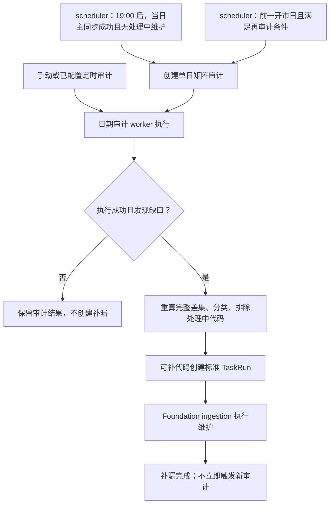

# 指数日线完整性审计、补漏与激活池说明

状态：2026-11-12 已完成当日首次自动补漏推迟到上海时间 19:00 的本地实现和隔离验收，未部署；方案、LLD 与验收结果见 §8。原生产验收事项见 §7。

本文合并原补漏 v1 与闭环 v2 的方案、LLD，保留原 v2 方案路径。2026-11-12 管理员授权本步方案、代码和测试修改；不包含部署、生产补数或改池。

## 1. 判断什么，事实属于谁

`index_daily` 的完整性问题是：**当前 Serving 激活池中，应有目标日日线的指数，哪些还没有进入 Serving？**

| 事实 | 来源与用途 |
| --- | --- |
| 默认向源站请求哪些指数 | `ops.index_series_active(resource='index_daily_raw')`；显式 `ts_code` 则只取指定代码 |
| 哪些结果允许进入 Serving | `ops.index_series_active(resource='index_daily')`；与请求池不同，显式指定代码也不绕过这道门禁 |
| 目标日是否完整 | 当前 `index_daily` 激活池代码集合，减去 `core_serving.index_daily_serving` 中目标日代码集合 |
| 缺口是否值得补、候选能否加入 | `raw_tushare.index_daily`、默认交易所交易日历、既有补漏 TaskRun；按 §3–5 派生，不持久化第二份状态 |

实现入口：[对象规划](/Users/congming/github/goldenshare/src/foundation/ingestion/unit_planner.py)的 `_resolve_index_codes()`、[写入器](/Users/congming/github/goldenshare/src/foundation/ingestion/writer.py)的 `_write_index_daily_serving()`、[数据集定义](/Users/congming/github/goldenshare/src/foundation/datasets/definitions/index_series.py)的 `index_daily.completeness`。写入器先 upsert 本次归一化结果到 Raw，再按 Serving 激活池过滤并写入 Serving；不是把整张 Raw 表重新发布一次。

完整性采用 `date_subject_matrix`：expected 为 `index_daily` 激活池，actual 为目标日 Serving。指数策略与股票上市/退市生命周期策略分开；`index_daily_raw` 不进入 expected。审计明细有 `DETAIL_LIMIT=5000` 的展示预算，补漏服务必须重新计算**完整差集**，不能只取已展示的缺口样本。实现见 [矩阵审计](/Users/congming/github/goldenshare/src/ops/services/date_completeness_audit_service.py)和 [缺口分类服务](/Users/congming/github/goldenshare/src/ops/services/index_daily_source_serviceability_service.py)。

[源站探测](/Users/congming/github/goldenshare/docs/ops/ops-index-daily-remote-source-probe-plan-v1.md)的五个样本只证明可以开始同步；探测命中、TaskRun 成功、返回行数和 Raw 有数据，都不能证明 Serving 完整。

## 2. 三个入口与实际链路

1. **19:00 后的当日首次审计。** 现有 scheduler 从已保存的 TaskRun 确认普通 `index_daily.maintain`、`dataset_action`、`success`、已结束且单日 point 目标为上海当天；当天须是默认交易所开市日。19:00 前不创建；19:00 后若同日维护任务仍为 queued/running/canceling，则等结束后再检查。当天已有 19:00 后创建的系统单日矩阵审计，或有未结束的同日审计时不重复创建。任务完成 Worker 不再创建这类审计，避免内存游标在 19:00 前推进后漏触发。详见 §8。
2. **次日受控再审计。** 同一个 [reconciliation service](/Users/congming/github/goldenshare/src/ops/services/index_daily_completeness_reconciliation_service.py)保留当前开市日早段、晚段检查前一开市日的规则，不需要新增 worker 或 systemd unit。
3. **手动／已配置的定时审计。** 继续使用现有日期审计入口。其审计结果也交给 repair service，但不绑定三个自动阶段。配置式定时审计另有自身 guard：`index_daily` 的窗口须为配置时区当天单日，且配置交易所当天开市；不能用 rolling 回退绕过休市日。见 [日期审计调度](/Users/congming/github/goldenshare/src/ops/services/date_completeness_schedule_service.py)。这条现存路径不能因清理旧晚间方案而被删掉。

日期审计 worker 只有在 `run_status=succeeded`、`result_status=failed`、`index_daily` 单日矩阵审计时才可能派生补漏；审计执行错误不等同于确认数据缺口。补漏创建时还要求上海当天开市、目标日为当天 `T` 或前一开市日 `P`，更早日期和休市日不派生补漏。这些限制也适用于手动审计之后的自动补漏；不限制普通手动维护本身可表达的历史范围。

## 3. 阶段、时间与停止条件

唯一策略来源为 [index_daily_reconciliation_policy.py](/Users/congming/github/goldenshare/src/ops/services/index_daily_reconciliation_policy.py)，是代码常量，不是 env、数据库配置或页面开关。调整须另获批准，并同步代码、测试和本文。

| 阶段／阈值 | 当前含义 |
| --- | --- |
| `same_day_initial` | 系统单日审计的目标日等于其 requested_at 的上海日期；scheduler 最早在上海 19:00 创建，当天补漏执行也不得早于 19:00 |
| `previous_open_day_morning` | 系统审计目标日为 requested_at 所在日期的前一开市日，创建时间在上海 `09:00:00–12:00:00` |
| `previous_open_day_afternoon` | 同上，创建时间在上海 `13:30:00–16:30:00` |
| 源站延迟候选窗口 | **包含目标日**及其前两个开市日，共 3 日；不是允许迟到三个完整开市日 |
| 每次调用的入队上限 | 100 code/TaskRun，最多 20 个 TaskRun，即最多选 2,000 个可补代码；不是全日总量或并发数 |

早晚窗口含表中精确端点；12:00:01、16:30:01 已在窗口外。自动阶段只对 `run_mode=scheduled`、`requested_by_user_id=null`、`schedule_id=null` 的系统单日矩阵审计解析。其它情形返回空阶段，沿用通用补漏分支，而非直接拒绝所有补漏。

**区分两个时钟：**阶段取审计已保存的 `requested_at`，目标日期是否仍可补取 repair service 此次执行的时间。例如早段审计下午才处理，仍记早段；但若目标日已早于执行当天的 `P`，不再创建补漏。因此窗口限制的是再审计入队，不是要求所有执行在窗口内结束。

阶段完成按「代码＋目标日＋repair_slot」从既有系统补漏 TaskRun 派生：`started_at` 非空且状态为 success/partial_success/failed/canceled 即计入。旧任务无阶段、无效阶段或未领取终态不计入；这是“已领取并终结”的记录，不能据此断言批内每个代码均请求成功或写入成功。不新增重试表，也不向日期审计表增加阶段列。

**scheduler 对前一开市日再审计须同时满足：**

1. 当前为开市日早段／晚段，目标仅为前一开市日 `P`。
2. 该日最新单日矩阵审计执行成功、结果失败；按 requested_at、id 判断最新。没有旧审计不自动补建。
3. 没有同日 queued/running 矩阵审计，也没有同日任何阶段的 queued/running/canceling 补漏 TaskRun。
4. 实时重算后，至少一个 `source_delayed` 代码尚未消耗**当前**阶段。

每次调用最多创建一条审计。当日首次条件见 §2、§8；前一开市日没有可补延迟代码、窗口已过、最新审计已通过或仍有处理中记录时，不入队。前一开市日分支仍未检查普通主维护任务是否运行；当日分支检查同日 queued/running/canceling 维护，但没有跨进程原子去重或针对后续新任务的锁，不能宣称任何并发下都不重叠。

## 4. 补漏选择与标准 TaskRun

[分类服务](/Users/congming/github/goldenshare/src/ops/services/index_daily_source_serviceability_service.py)先重算当前 active－目标日 Serving，再查询每个缺口代码的 Raw 目标日是否存在、全历史最新日期及已完成阶段。Raw 记录只能反映本库已经取得的数据，不是实时查询源站的证明。

| 内部分类 | 判定 | repair service 的选择 |
| --- | --- | --- |
| `serving_projection_gap` | Raw 已有目标日，但 Serving 缺失 | 可以创建补漏，**不受已完成阶段过滤**；仍须满足日期、审计类型和处理中代码排除条件 |
| `source_delayed` | Raw 无目标日，最新 Raw 日位于 §3 的 3 日集合，且三个阶段未全部完成 | 有阶段时只选当前阶段未完成的代码；空阶段时不做单阶段过滤 |
| `source_retry_exhausted` | 仍属于上述近期延迟，但三个阶段全部完成 | 不创建补漏；对外显示待审查 |
| `serviceability_review_required` | 无 Raw 历史、最新日太早，或最新日已越过但跳过目标日 | 不创建补漏；仍是 Serving 缺口 |

这两层判断不能混为一谈：**投影缺口可以被失败审计交给 repair service 处理，但它自身不驱动 scheduler 再审计。**“每代码最多三个阶段”只描述带阶段的源站延迟控制，不能作为所有补漏入口的全局请求上限。手动／配置式审计不写阶段、不消耗阶段，但共用的分类仍会读取已有阶段事实；已经分类为 exhausted 的代码不会因空阶段重新入选。

[补漏服务](/Users/congming/github/goldenshare/src/ops/services/index_daily_completeness_repair_service.py)排除同日 queued/running/canceling repair 中的代码，然后按代码顺序取前 2,000 个、分批调用标准 `TaskRunCommandService.create_task_run()`。该排除是按代码，不是像 scheduler 一样阻止整个目标日；没有独立锁或批次账本。

任务意图保持：`task_type=dataset_action`、`resource_key=index_daily`、`action=maintain`、`trigger_source=system`、用户和 schedule 均为空；`time_input={mode: point, trade_date: 目标日}`、`filters.ts_code` 为本批逗号分隔代码。payload 保存：

- `run_scope=index_daily_gap_repair`、`source_date_completeness_run_id`、`repair_trade_date`。
- `missing_code_count` 为重算后的**全部缺口数**，不是可补数或本批大小；`batch_index` 从 1 起，`batch_size` 为本批代码数。
- 仅解析到阶段时才有 `repair_slot`；不使用旧方案的 `source_run_id/source_gap_id`。

Ops 只创建意图，由 Foundation resolver／planner／request builder／writer 执行维护；投影缺口也走标准维护，不是 Ops 直接复制 Raw 到 Serving。[任务查询](/Users/congming/github/goldenshare/src/ops/queries/task_run_query_service.py)根据 system＋run_scope 派生“系统补漏”，页面只展示后端 label，不自行解读 payload。通用任务字段归 [TaskRun 契约](/Users/congming/github/goldenshare/docs/ops/ops-task-run-observability-redesign-plan-v1.md)和 [API 参考](/Users/congming/github/goldenshare/docs/ops/ops-api-reference-v1.md)。

## 5. 审查中心与人工改池

页面为 `/ops/v21/review/index`。接口字段及入参归 [API 参考 §8](/Users/congming/github/goldenshare/docs/ops/ops-api-reference-v1.md#8-review-center-接口)；当前消费链是 [review API](/Users/congming/github/goldenshare/src/ops/api/review_center.py) → [query](/Users/congming/github/goldenshare/src/ops/queries/review_center_query_service.py)／[command](/Users/congming/github/goldenshare/src/ops/services/review_center_service.py) → [页面](/Users/congming/github/goldenshare/frontend/src/pages/ops-v21-review-index-page.tsx)。本专题的资格与服务能力扩展只针对 `resource=index_daily`，其它资源不套用这道门槛。

**候选准入：**参考日固定为上海本地今天之前最近一个开市日，即使今天已经收盘也不改用今天。该日及此前两个开市日均有 Raw 日线，才满足连续 3 日资格；日历不足或缺记录均不合格。候选先从 index_basic 中排除已在指定池的代码；POST 再检查代码存在、未重复和资格，不合格返回 422／`source_serviceability_not_ready`。页面禁用不合格候选的选择按钮，不能代替后端校验。加入只写池记录，不同时触发补数；“先在 Raw 请求池观察”是运营建议，不是自动加池动作。

**现有 active 状态：**以同一参考日计算。该日有 Serving 缺口时使用 §4 分类；没有缺口时依据最新 Raw 日期是否达到参考日判断 ready。因此“正常”不等于每次都重新通过候选连续 3 日门槛。无参考日显示待审查。公开状态为 ready／source_delayed／serviceability_review_required；内部投影缺口映射 ready，exhausted 映射待审查。

`source_serviceability_reason` 返回内部原因值，例如延迟时为 `source_delayed`，不是旧示例的 `recent_raw_source_delay`。API 可以包含内部原因；页面不展示原因枚举，只消费中文 label、行动建议、Raw 最新日期和参考日。列表先计算 active 服务能力、再过滤分页，不是只对当前页做分类。

页面的 `data_status=complete` 只表示日／周／月 Serving **各自有记录**，不证明目标日已齐。因此某代码缺目标日日线，仍可能显示行情“完整”；应结合日期审计核对，不能承诺页面一定显示“缺日线”。“等待源站”的行动文案也不是某个任务已入队的凭证，实际仍受 §3 限制。

系统不自动移出激活池。运营确认移出后，只删除对应 `ops.index_series_active` 行，不删除 Raw 或 Serving 历史；下一次审计按新的池重算，旧审计不会追溯改写。文档治理不授权任何改池或数据删除。

## 6. 失败与闭环的现存限制

- **补漏成功不立即再审计。** completion 不再创建指数日线审计；scheduler 只按 §2–3、§8 条件入队。如果实际数据已补齐、只剩投影缺口或阶段已经耗尽，不一定再生成最终审计。因此可能保留旧的失败审计，不能把本机制写成“每次补漏都有最新通过结果”。是否增加最终确认审计需独立设计和授权。
- **不是批量原子入队。** 标准 TaskRun 创建逐个提交；后面一批失败时，前面已提交的任务仍在。[日期审计 worker](/Users/congming/github/goldenshare/src/ops/services/date_completeness_audit_service.py)对派生补漏捕获异常、rollback 未提交状态并记录日志，不改已提交审计结果；后续处理须重算差集并排除已有任务，不能假定整轮都回滚。
- **scheduler 没有这里承诺过的异常隔离。** [run_once()](/Users/congming/github/goldenshare/src/ops/runtime/scheduler.py)依次执行普通 schedule、日期审计 schedule、probe、指数再审计，返回值只含普通及 probe TaskRun。再审计异常会向外传播，[CLI 循环](/Users/congming/github/goldenshare/src/cli_parts/ops_handlers.py)也未捕获；不能写成“只记日志，循环必定继续”。已提交 Raw／Serving 不因该异常回滚，与 scheduler 可用性是两回事。
- **状态收敛不是重试机会回收。** [TaskRun 收敛服务](/Users/congming/github/goldenshare/src/ops/services/operations_task_run_reconciliation_service.py)按活动时间戳判断 running 超过 10 分钟、canceling 超过 3 分钟的陈旧记录，分别收敛为 failed／canceled，不处理 queued。带阶段且已领取的终态仍会计入阶段；不能因排队太久伪造领取或消耗机会。

以上是已核对的限制，不是新增允许模式或本轮代码整改任务。仍遵守 Ops 观测不得回滚已提交业务数据的边界，不新增业务表、执行器、配置、部署单元或依赖方向。

## 7. 验收、历史证据与维护入口

**正确验收是集合覆盖：**在同一只读事实时点核对 active 代码和目标日 Serving，列出 active－Serving 差集，差集为空才完整。两边数量相等可能代码不同；Serving 多出已退出池的历史代码也不意味着不完整。同步成功、Raw 行数、探测日志或页面日／周／月存在状态均不能代替此判定。

尚需独立核实的原生产事项：一次当日未齐、次日早／晚段补齐的事实，以及一次长期缺失展示待审查、不继续由本机制创建补漏的事实。应关联原审计、目标日、代码、TaskRun 阶段和最终物理差集；存在 §6 的最终审计缺口时如实记录，不能以 TaskRun 成功自动结案。本轮未查生产、不认定仍未部署，也没有为验收清表、改池或触发任务。

必要历史证据（仅代表原记录当时）：

- 2026-06-25 v1 建立矩阵审计、完整差集补漏、异步后处理和“系统补漏”展示。旧晚间周期方案及其生产 schedule 配置待办，不再作为当前推荐部署单。
- 2026-07-14 原生产记录：TaskRun #5362 后缺 344 个 active 代码；人工维护降至 77 个；#5399 返回 0 行后未出现新审计。930604.CSI 次日可取得前日数据，另有 Raw 最新日早于 2026-07-06 的长期缺失代码。它们说明为何区分短期延迟和待审查，不是今天的数量或源站状态。
- 2026-07-15 v2 及其后续实施记录改为当日／次日早段／次日晚段的命名阶段，避免按总终态次数在晚间耗尽机会；原文仍保留生产验收事项。旧全文可从合并前提交 `378ed9f6` 追溯，不留平行历史文档。

后续改代码时按影响选择已有回归，不因阅读本文自动运行数据库或生产任务：

| 覆盖点 | 已有测试入口 |
| --- | --- |
| 完整性定义、矩阵与股票边界 | `tests/test_dataset_definition_registry.py`、`tests/test_date_completeness_audit_service.py`、`tests/web/test_ops_date_completeness_api.py` |
| 分类、阶段与候选资格 | `tests/web/test_ops_index_daily_source_serviceability.py` |
| 全差集、批次、排除处理中代码、日期／空阶段／审计创建时间 | `tests/web/test_ops_index_daily_completeness_repair.py` |
| 窗口、休市、投影缺口不自循环及 scheduler 装配 | `tests/web/test_ops_index_daily_reconciliation.py`、`tests/web/test_ops_runtime.py` |
| completion 排除补漏、任务 label、CLI | `tests/web/test_ops_task_completion_worker.py`、`tests/web/test_ops_task_run_api.py`、`tests/test_cli_ops_runtime.py` |
| 人工加入／移出、服务能力展示 | `tests/web/test_ops_review_center_api.py`、`frontend/src/pages/ops-v21-review-index-page.test.tsx` |
| 审计与任务页消费 | `frontend/src/pages/ops-v21-dataset-audit-page.test.tsx`、`frontend/src/pages/ops-v21-task-records-tab.test.tsx`、`frontend/src/pages/ops-task-detail-page.test.tsx` |

2026-09-09 合并时只做代码／测试定义静态核对、链接／引用及文档完整性检查，不代表运行验收。使用已有环境，不自动安装或同步依赖；数据库测试须先确认隔离。字段／API 变更应核对上述全部消费者，不能只改页面或本文。合并去向与八项纠偏见 [治理记录](/Users/congming/github/goldenshare/docs/governance/docs-information-architecture-v1.md#ops-index-completeness-consolidation-20260909)。

## 8. 2026-11-12 当日首次自动补漏推迟至 19:00：方案与 LLD

### 8.1 目标、依据和范围

管理员明确指定上海时间 19:00，并授权先完成方案再修改。19:00 是业务决定，不是源站更新完成的承诺。生产只读证据：2026-11-12 主任务 #19352 在 17:39:56.331775 结束；审计 #224 发现 346 个指数缺口；#19354–19356 在 17:40:04 连续提交，分为 100、100、69 个互不重复的指数，均为 `same_day_initial`，三个任务获取和写入均为 0 行。该证据只覆盖四条任务、一条审计及三个任务保存的 269 个代码汇总，不代表全库核验。

本步仅改 Ops 自动触发时间、现有测试、本文、完成 Worker 原说明及架构快照中的相关调用链。不改 probe、源参数、对象池、DatasetDefinition、入库、API/CLI/前端字段或下一交易日早晚窗口；不安装依赖，不部署，不触发正式任务，不修改历史记录。同一轮仍按每批 100 个指数连续入队，不增加批次之间的等待。

### 8.2 代码审计与实施位置

- CodeGraph 已用 `codegraph_explore`、`codegraph_callers`、`codegraph_callees`、`codegraph_impact` 核验：`OperationsScheduler.run_once` → reconciliation service；完成 Worker → `TaskRunCompletionService.create_index_daily_completion_audit_run`；日期审计 Worker → repair service → 标准 TaskRun。当前代码逐项核对了 `TaskRun`、`DatasetDateCompletenessRun`、真实 `create_system_run`、补漏分类、任务列表时间字段及测试。
- 原办法只在任务结束事件到来时创建当日审计，完成 Worker 的内存游标不会在 19:00 回看已处理任务。只加“19:00 前返回”不能完成本需求。因此将当日首次审计的创建收敛到现有 scheduler，删除完成 Worker 中该调用及仅供它使用的方法；状态投影刷新和通知照常运行。
- `index_daily_reconciliation_policy.py` 增加唯一的 19:00 常量；reconciliation service 增加当日分支；repair service 在执行分类和入队前阻止同日系统首次补漏早于 19:00，覆盖已排队的旧系统审计。
- API/query/schema、Foundation resolver/request builder/writer 和前端只消费原合同，无需迁移；不新增跨子系统依赖、表、调度配置或执行器。CodeGraph 影响测试包括指数再审计、完成 Worker、Ops scheduler/CLI 及指数周月线的 scheduler 消费者。

### 8.3 硬口径与执行过程

1. 所有时间按 `Asia/Shanghai`。`19:00:00` 含端点；19:00 前不创建当日首次系统审计、不派生当日首次系统补漏。
2. 现有 scheduler 在当日开市且时间达到 19:00 时，读取持久化 TaskRun，要求存在已结束的普通 `index_daily.maintain` 成功任务，单日 point 日期为当天；补漏、Workflow、历史日期、区间、partial_success、failed、canceled 均不能代替该成功事实。
3. 同日单日维护若仍为 queued/running/canceling（含补漏），或同日矩阵审计 queued/running，则等待后续 scheduler 检查。主同步 19:00 后才结束也能接上；不依赖完成 Worker 在线或其内存游标。
4. 以同日、`scheduled`、用户和 schedule 均为空、`date_subject_matrix`、19:00 后创建的既有系统审计作为本日已入队事实。已有此记录即不重复入队，包括该审计执行成功、失败或取消之后；不靠内存标记。19:00 前的旧系统审计、手动和配置式审计不冒充该事实，但未结束审计仍阻止重叠。
5. 条件满足后只调用现有 `create_system_run` 创建当天审计；由真实日期审计 Worker 重新计算当前缺口，再走原分类、阶段和分批补漏。审计通过不补漏，执行错误不当成缺口，已消耗阶段的源站延迟代码不重新入选。
6. repair service 的时间限制仅作用于目标仍为当天的系统 `same_day_initial`；手动／已配置审计和普通维护不纳入本次自动时间调整。旧当日审计跨日处理继续遵守原目标日期限制和阶段解析。下一交易日早晚两阶段保留。

### 8.4 配置、读写和失败／续跑

| 项目 | 本步口径 |
| --- | --- |
| 时间来源 | `INDEX_DAILY_SAME_DAY_INITIAL_REPAIR_START_TIME`，值为 `time(19, 0)`；管理员指定，保存在既有 policy 模块，无 env/数据库/页面副本 |
| 消费者与生效 | reconciliation service 与 repair service 使用同一常量；代码部署并重启对应 scheduler/日期审计 Worker 后生效，本步不执行部署 |
| 运维可见性 | 继续使用审计列表和 TaskRun 的提交、开始、结束时间及阶段；不新增开关或页面配置 |
| 读取 | 当前交易日历、同日指数日线 TaskRun 的有界存在性查询、同日审计记录；定时检查不读取 Raw/Serving 行情明细、不调用源站 |
| 写入 | 仅复用现有系统审计及后续标准补漏 TaskRun 创建；业务表写入与状态事务边界不变 |

审计请求提交前中断，重启后的 scheduler 按上述持久化事实重新判断；请求已提交则不重复创建。queued/running 审计继续交给原 Worker；失败、取消及补漏分批失败沿用原人工处理和后续阶段，不在同日无限重试。scheduler 停机跨过本地自然日不追建上一日首次阶段；下一交易日再审计仍依赖原有失败审计事实。多 scheduler 并发原子去重不在本步范围，沿用现有部署边界；普通维护在检查后新入队的并发边界仍存在，不承诺新增锁的效果。任何状态失败不得回滚已经提交的 Raw/Serving 数据。

### 8.5 性能依据、测试和验收

当日检查最多执行五个 `LIMIT 1` 查询：开市日、已创建的当日首次系统审计、未结束维护、成功普通维护、未结束审计；每次最多返回一个日期或编号。只有需要入队时，复用 `create_system_run` 的一次 INSERT、提交及一次 refresh SELECT。正常完成后后续检查在“开市日＋已创建审计”处停止。重启后继续及最终只读验收复用同一查询范围，不把历史任务明细读入进程、不导出行情；数据库实际扫描开销须以代表性只读查询核验，不能由返回行数推出。补漏原有 100 code/TaskRun、最多 20 个 TaskRun 依据 §3 的现行代码，不作为新增性能保证；本步定时检查的行情源请求数为 0。

隔离测试使用已有内存 SQLite，合同依据真实 ORM 模型、`create_system_run` 及标准 TaskRun 字段；时间预期直接用管理员指定的上海 19:00 字面样本，不从待测 helper 生成 expected。测试须覆盖 18:59:59 拒绝、19:00 接受、19:00 后主任务才完成、主任务三种未结束状态、缺少成功主任务和错误范围／状态拒绝、同日重复轮询、换服务实例、已有早期审计、审计终态、休市及无日历、完成 Worker 不提前创建、旧系统审计不得提前补漏、手动路径和次日早晚阶段保留。

至少完成一次真实隔离链路：19:00 scheduler → 真实系统审计 → 真实日期审计 Worker → 标准补漏 TaskRun，使用人工可核算的小样本核对目标日期、代码和阶段。新增回归先在修复前运行，证明能抓住提前触发／19:00 漏触发，再验证修复后通过。生产只读验收限定本次事故四条任务、一条审计及同一日期的存在性查询，不执行真实下载或数据库写入；它只证明合同和选择语义，不证明新版已部署。临时测试缓存、日志和查询文件放本任务 `/private/tmp` 目录。

### 8.6 实施与验收记录

方案及 LLD 已先于代码、测试修改写入；2026-11-12 本地实现完成，管理员随后授权提交；未部署或触发生产补漏。共修改五个 Ops 实现文件、三个现有测试文件、本文及完成 Worker 说明和架构快照；API/CLI、DatasetDefinition、业务读写和依赖矩阵不变。

| 硬口径 | 实现与证据 |
| --- | --- |
| 19:00 前不触发、19:00 含端点 | policy 单一时间常量；reconciliation service 的当日分支和 repair service 的执行前限制；两组 18:59:59／19:00 字面时间测试 |
| 主任务成功后接上，处理中继续等 | 当日 point TaskRun 的 SQL 存在性查询；覆盖普通维护及补漏的 queued/running/canceling，并在 19:05 结束后创建；错误状态、日期、范围、任务类型及无主任务均拒绝 |
| 持久化去重及中断后继续 | 既有晚间系统审计作为入队事实；覆盖 queued/running/成功/失败/取消、换服务实例、创建前异常后重试、旧早期审计、手动及配置式审计不冒充系统事实 |
| 使用最新完整性结果决定补漏 | 两个指数的真实隔离 scheduler → 审计 Worker → 标准 TaskRun 链路；分别验证缺两行时只创建对应代码补漏、已齐时不创建；只替换时钟，没有替换审计或任务创建 |
| 既有边界保留 | 手动／配置式审计在上海 18:00 仍可走原通用补漏；跨日旧首次审计不被当天 19:00 误拦；次日早晚阶段、批次、分类、任务查询、CLI 及指数周月线相关回归通过 |
| 不再依靠完成事件提前创建 | 完成 Worker 的调用和专用方法已删除，引用核验无剩余代码消费者；正常投影刷新、通知、游标和异常隔离测试通过 |

回归证据：修复前选取五例，三例因“提前创建审计、提前补漏、19:00 没有接上”失败、两例通过；修复后核心测试 61 项、相关 API/调度/CLI/架构护栏 178 项、临时 PostgreSQL 的指数周月线 probe 回归 23 项，共 262 项通过。23 项 PostgreSQL 回归首次在临时数据库启动前因执行权限报错，单独使用获准执行方式后全部通过；没有过滤或跳过业务失败。既有依赖弃用提示不影响通过结果，未安装或升级依赖。原先上海 18:00 的系统补漏成功夹具随新时间要求调整到 19:00，手动／配置式 18:00 夹具保留，避免把新限制错误扩展到人工路径。

真实只读核验使用既有 `scripts/psql-remote.sh`，在生产 `goldenshare` 库显式 READ ONLY 事务中，执行从新实现提取、按 PostgreSQL 方言生成的五条 `LIMIT 1` 查询及 EXPLAIN ANALYZE。表白名单为 `core_serving.trade_calendar`（exchange/trade_date/is_open）、`ops.task_run`（id/task_type/resource_key/action/status/ended_at/time_input_json/request_payload_json）、`ops.dataset_date_completeness_run`（id/dataset_key/audit_scope/start_date/end_date/run_mode/requested_by_user_id/schedule_id/requested_at/run_status）；范围固定为 2026-11-12 的日期／意图与晚间系统审计条件，无行情明细导出、源请求或生产写入。五条查询实际返回数量依次为 1、1、0、1、0；服务器 Execution Time 为 0.025–3.926 毫秒，不含网络往返。成功主任务查询使用现有 resource 索引，索引候选 690 行、过滤掉 565 行后命中；因此不能将返回一行表述为只读取一行，也不能把本次耗时当作未来保证。实际 scheduler 在第二条查询已命中时即停止，后续三条是单独执行的合同与开销核验。

文档完整性和 `git diff --check` 通过；CodeGraph 已执行 sync，当前影响面和链路补核完成。无新增实现边界待拍板；多 scheduler 并发、跨日停机和失败处理限制继续按 §8.4 如实保留。生产是否按新时间触发尚未验收，后续须单独授权部署与运行观察，不能用本地通过或只读查询代替生产生效证据。临时数据库、缓存、查询文件和日志在结果归入本文后清理，不保留重复过程附件。
